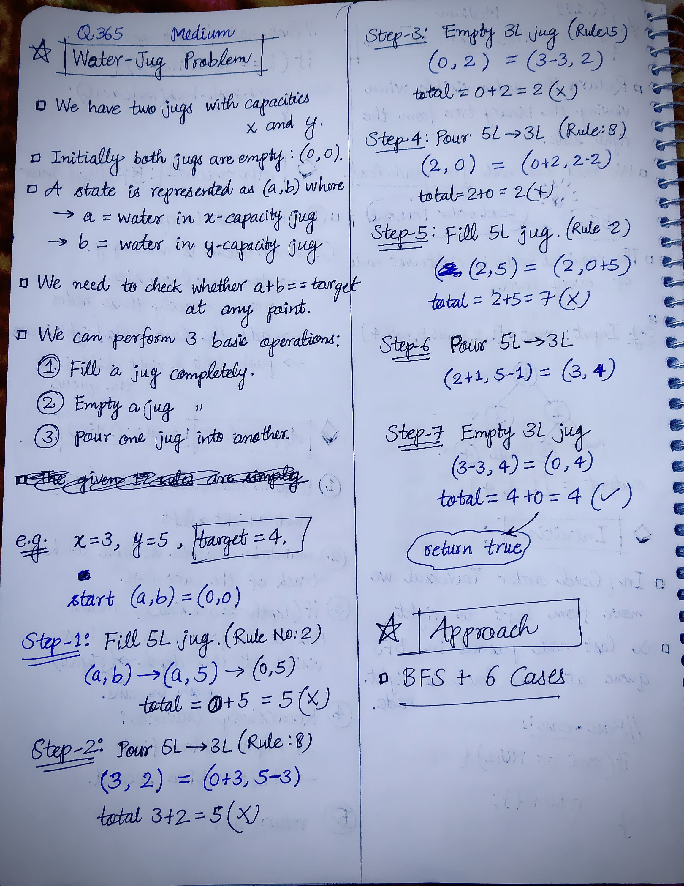
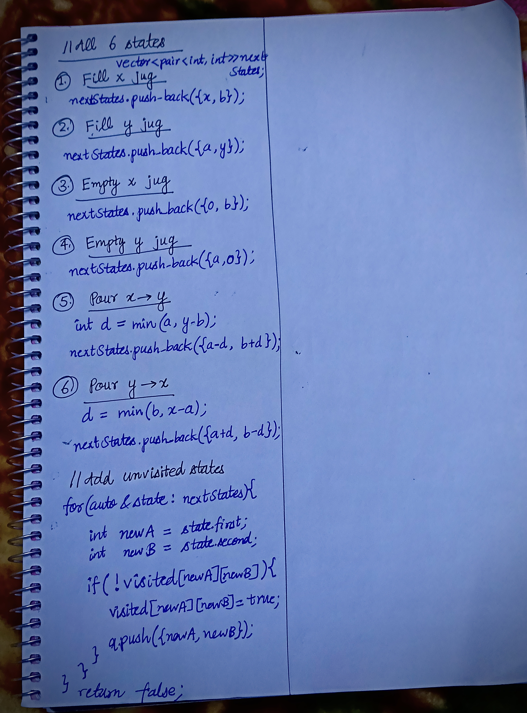

<h2><a href="https://leetcode.com/problems/water-and-jug-problem/">365. Water and Jug Problem</a></h2><h3>Medium</h3><hr><p>You are given two jugs with capacities <code>x</code> liters and <code>y</code> liters. You have an infinite water supply. Return whether the total amount of water in both jugs may reach <code>target</code> using the following operations:</p>

<ul>
	<li>Fill either jug completely with water.</li>
	<li>Completely empty either jug.</li>
	<li>Pour water from one jug into another until the receiving jug is full, or the transferring jug is empty.</li>
</ul>

<p>&nbsp;</p>
<p><strong class="example">Example 1: </strong></p>

<div class="example-block" style="border-color: var(--border-tertiary); border-left-width: 2px; color: var(--text-secondary); font-size: .875rem; margin-bottom: 1rem; margin-top: 1rem; overflow: visible; padding-left: 1rem;">
<p><strong>Input: </strong> <span class="example-io" style="font-family: Menlo,sans-serif; font-size: 0.85rem;"> x = 3, y = 5, target = 4 </span></p>

<p><strong>Output: </strong> <span class="example-io" style="font-family: Menlo,sans-serif; font-size: 0.85rem;"> true </span></p>

<p><strong>Explanation:</strong></p>

<p>Follow these steps to reach a total of 4 liters:</p>

<ol>
	<li>Fill the 5-liter jug (0, 5).</li>
	<li>Pour from the 5-liter jug into the 3-liter jug, leaving 2 liters (3, 2).</li>
	<li>Empty the 3-liter jug (0, 2).</li>
	<li>Transfer the 2 liters from the 5-liter jug to the 3-liter jug (2, 0).</li>
	<li>Fill the 5-liter jug again (2, 5).</li>
	<li>Pour from the 5-liter jug into the 3-liter jug until the 3-liter jug is full. This leaves 4 liters in the 5-liter jug (3, 4).</li>
	<li>Empty the 3-liter jug. Now, you have exactly 4 liters in the 5-liter jug (0, 4).</li>
</ol>

<p>Reference: The <a href="https://www.youtube.com/watch?v=BVtQNK_ZUJg&amp;ab_channel=notnek01" target="_blank">Die Hard</a> example.</p>
</div>

<p><strong class="example">Example 2: </strong></p>

<div class="example-block" style="border-color: var(--border-tertiary); border-left-width: 2px; color: var(--text-secondary); font-size: .875rem; margin-bottom: 1rem; margin-top: 1rem; overflow: visible; padding-left: 1rem;">
<p><strong>Input: </strong> <span class="example-io" style="font-family: Menlo,sans-serif; font-size: 0.85rem;"> x = 2, y = 6, target = 5 </span></p>

<p><strong>Output: </strong> <span class="example-io" style="font-family: Menlo,sans-serif; font-size: 0.85rem;"> false </span></p>
</div>

<p><strong class="example">Example 3: </strong></p>

<div class="example-block" style="border-color: var(--border-tertiary); border-left-width: 2px; color: var(--text-secondary); font-size: .875rem; margin-bottom: 1rem; margin-top: 1rem; overflow: visible; padding-left: 1rem;">
<p><strong>Input: </strong> <span class="example-io" style="font-family: Menlo,sans-serif; font-size: 0.85rem;"> x = 1, y = 2, target = 3 </span></p>

<p><strong>Output: </strong> <span class="example-io" style="font-family: Menlo,sans-serif; font-size: 0.85rem;"> true </span></p>

<p><strong>Explanation:</strong> Fill both jugs. The total amount of water in both jugs is equal to 3 now.</p>
</div>

<p>&nbsp;</p>
<p><strong>Constraints:</strong></p>

<ul>
	<li><code>1 &lt;= x, y, target&nbsp;&lt;= 10<sup>3</sup></code></li>
</ul>


<!-- AUTO-GENERATED-SOLUTION-START -->
---

## 🧠 Visual Solution & Intuition

### Part 1



### Part 2



---

## 💡 Approach

```text
Approach : BFS + 6 water jug cases
```

---

## ⏱️ Complexity Analysis

```text
Time Complexity = O(x * y) =>
Space Complexity = O(x * y) =>
```

---

## 💻 C++ Solution

[View Original C++ File](./0365-water-and-jug-problem.cpp)

```cpp
class Solution {
public:
    //Approach : BFS + 6 water jug cases

    //Time Complexity = O(x * y) =>
    /* Maximum possible states = (x + 1) × (y + 1).
    * Each state represents the amount of water (a, b) in the two jugs.
    * BFS visits each state at most once using visited.
    * For every state, we generate only 6 possible transitions → constant work.
    * Therefore, TC = O(x × y).
    */

    //Space Complexity = O(x * y) => 
    /* visited stores information for all possible (a, b) states → O(x × y).
    * BFS queue can also contain up to O(x × y) states.
    * Therefore, SC = O(x × y).
    */

    bool canMeasureWater(int x, int y, int target) {
        //1.)base-case or edge-case
        if(x + y < target){
            return false;
        }

        //2.) Start BFS from (0, 0) = (x = 0, y = 0)
        vector<vector<bool>> visited(x+1, vector<bool>(y+1, false));//initialize all with false
        queue<pair<int, int>> q;

        q.push({0, 0}); //initial state        
        visited[0][0] = true;

        while(!q.empty()){
            auto [a, b] = q.front();
            q.pop();
            
            //check if target reached
            if(a + b == target){
                return true;
            }

            vector<pair<int, int>> nextStates;

            //1.) Fill x jug
            nextStates.push_back({x, b});

            //2.) Fill y jug
            nextStates.push_back({a, y});

            //3.) Empty x jug
            nextStates.push_back({0, b});

            //4.) Empty y jug
            nextStates.push_back({a, 0});

            //5.) Pour x -> y jug
            int d = min(a, y-b);

            nextStates.push_back({a-d, b+d});

            //6.) Pour y -> x jug
            d = min(b, x-a);

            nextStates.push_back({a+d, b-d});

            //add unvisited states
            for(auto& state : nextStates){
                int newA = state.first;
                int newB = state.second;

                if(!visited[newA][newB]){

                    visited[newA][newB] = true;
                    q.push({newA, newB});
                }
            }

        }

        //if in above steps no true found
        return false;        

    }
};
```

<!-- AUTO-GENERATED-SOLUTION-END -->
