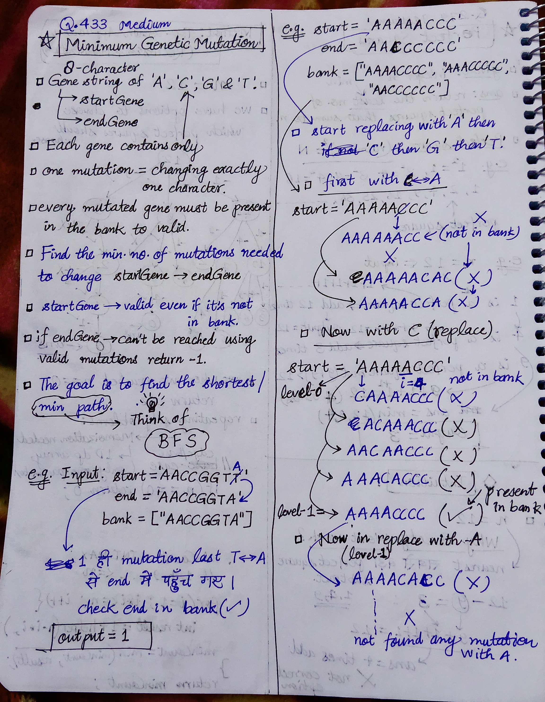
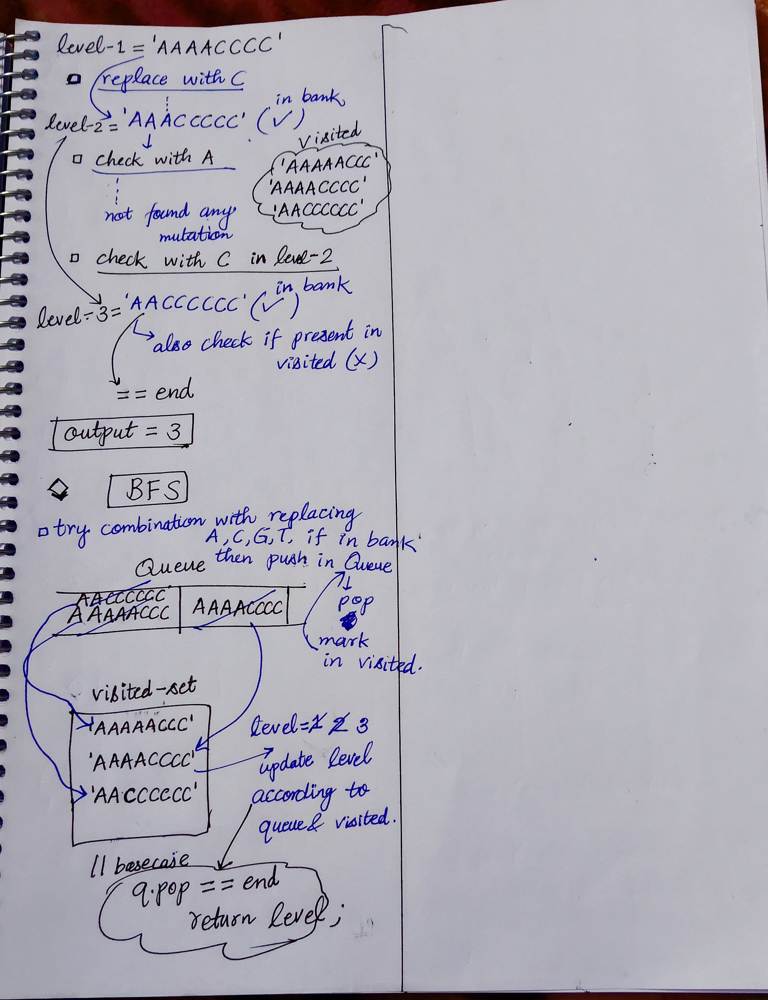

<h2><a href="https://leetcode.com/problems/minimum-genetic-mutation">433. Minimum Genetic Mutation</a></h2><h3>Medium</h3><hr><p>A gene string can be represented by an 8-character long string, with choices from <code>&#39;A&#39;</code>, <code>&#39;C&#39;</code>, <code>&#39;G&#39;</code>, and <code>&#39;T&#39;</code>.</p>

<p>Suppose we need to investigate a mutation from a gene string <code>startGene</code> to a gene string <code>endGene</code> where one mutation is defined as one single character changed in the gene string.</p>

<ul>
	<li>For example, <code>&quot;AACCGGTT&quot; --&gt; &quot;AACCGGTA&quot;</code> is one mutation.</li>
</ul>

<p>There is also a gene bank <code>bank</code> that records all the valid gene mutations. A gene must be in <code>bank</code> to make it a valid gene string.</p>

<p>Given the two gene strings <code>startGene</code> and <code>endGene</code> and the gene bank <code>bank</code>, return <em>the minimum number of mutations needed to mutate from </em><code>startGene</code><em> to </em><code>endGene</code>. If there is no such a mutation, return <code>-1</code>.</p>

<p>Note that the starting point is assumed to be valid, so it might not be included in the bank.</p>

<p>&nbsp;</p>
<p><strong class="example">Example 1:</strong></p>

<pre>
<strong>Input:</strong> startGene = &quot;AACCGGTT&quot;, endGene = &quot;AACCGGTA&quot;, bank = [&quot;AACCGGTA&quot;]
<strong>Output:</strong> 1
</pre>

<p><strong class="example">Example 2:</strong></p>

<pre>
<strong>Input:</strong> startGene = &quot;AACCGGTT&quot;, endGene = &quot;AAACGGTA&quot;, bank = [&quot;AACCGGTA&quot;,&quot;AACCGCTA&quot;,&quot;AAACGGTA&quot;]
<strong>Output:</strong> 2
</pre>

<p>&nbsp;</p>
<p><strong>Constraints:</strong></p>

<ul>
	<li><code>0 &lt;= bank.length &lt;= 10</code></li>
	<li><code>startGene.length == endGene.length == bank[i].length == 8</code></li>
	<li><code>startGene</code>, <code>endGene</code>, and <code>bank[i]</code> consist of only the characters <code>[&#39;A&#39;, &#39;C&#39;, &#39;G&#39;, &#39;T&#39;]</code>.</li>
</ul>


<!-- AUTO-GENERATED-SOLUTION-START -->
---

## 🧠 Visual Solution & Intuition

### Part 1



### Part 2



---

## 💻 C++ Solution

[View Original C++ File](./0433-minimum-genetic-mutation.cpp)

```cpp
class Solution {
public:
    //Method : BFS(using Queue and Visited set) => traversing level-wise

    //Time-Complexity = O(N * L^2) => O(N * 4 * L * L)
    /*For every gene :
    * 4 characters: A, C, G, T
    * L positions
    * Creating neigh takes O(L)
    * unordered_set lookup for a string takes average O(L) because hashing the string takes O(L). */


    //Space-Complexity = O(N * L) =>
    /* Storing :
    * bankSet → O(NL)
    * visited → O(NL)
    * queue → O(NL)
    */

    
    int minMutation(string startGene, string endGene, vector<string>& bank) {
        //we have to check in bank many times so push bank elements in a set(for easy searching)
        unordered_set<string> bankSet(bank.begin(), bank.end());


        //visited set
        unordered_set<string>visited;

        //queue for BFS
        queue<string> q;

        //Begin BFS with startGene
        q.push(startGene);
        visited.insert(startGene);
        
        int level = 0;

        while(!q.empty()){
            int n = q.size() ; //size of level

            while(n--){ //traverse in each level
                string curr = q.front();
                q.pop() ;

                if(curr == endGene){
                    return level ; //reached target endGene
                }

                for(char ch : "ACGT"){
                    for(int i=0 ; i<curr.length() ; i++){
                        string neigh = curr ;
                        neigh[i] = ch ;//first try with 'A' ,then 'C' then 'G' ,then 'T'


                        //check if it is visited and present in bank
                        if(visited.find(neigh) == visited.end() &&
                        bankSet.find(neigh) != bankSet.end()){
                            //if both conditions true
                            visited.insert(neigh) ; 
                            q.push(neigh) ;
                        }
                    }
                }
            }

            level++ ; 
        }

        //if impossible to find 
        return -1 ;
    }
};
```

<!-- AUTO-GENERATED-SOLUTION-END -->
