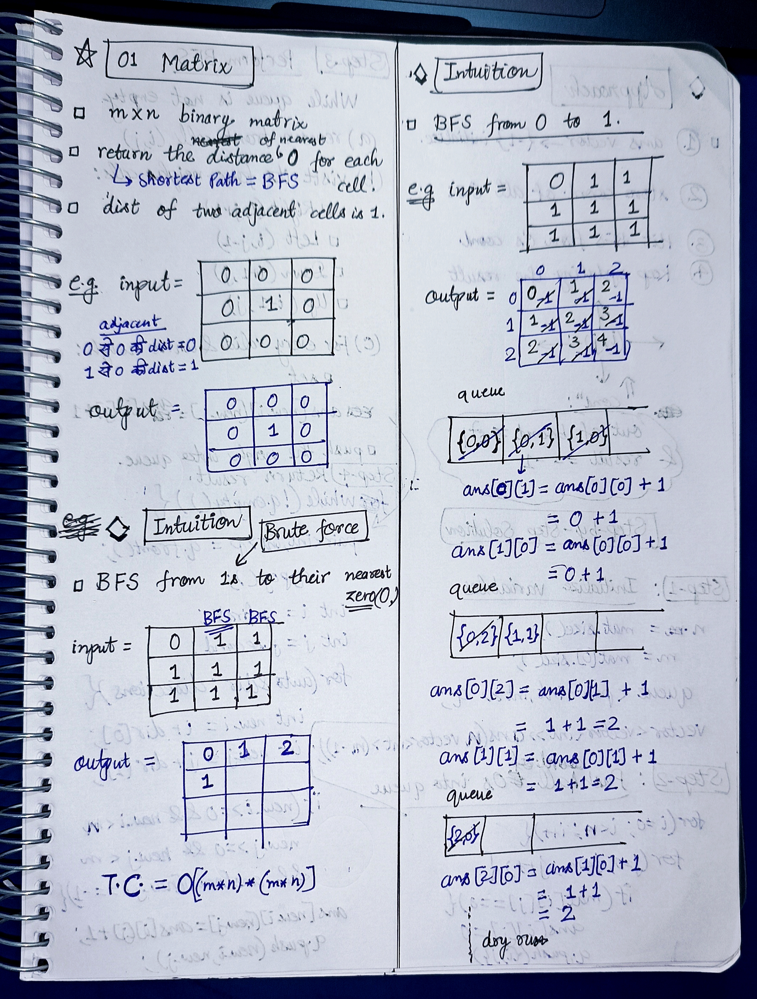
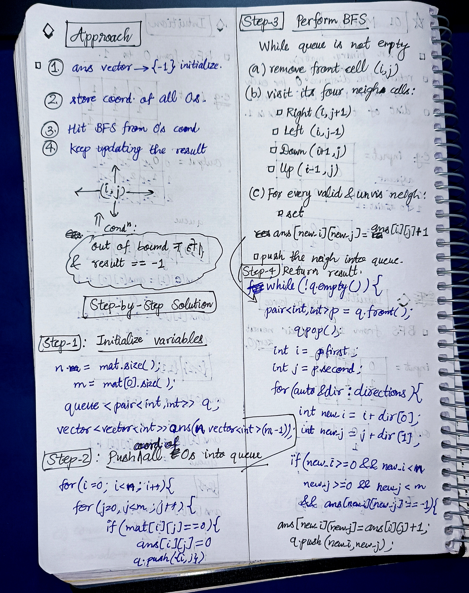

<h2><a href="https://leetcode.com/problems/01-matrix">542. 01 Matrix</a></h2><h3>Medium</h3><hr><p>Given an <code>m x n</code> binary matrix <code>mat</code>, return <em>the distance of the nearest </em><code>0</code><em> for each cell</em>.</p>

<p>The distance between two cells sharing a common edge is <code>1</code>.</p>

<p>&nbsp;</p>
<p><strong class="example">Example 1:</strong></p>

<pre>
<strong>Input:</strong> mat = [[0,0,0],[0,1,0],[0,0,0]]
<strong>Output:</strong> [[0,0,0],[0,1,0],[0,0,0]]
</pre>

<p><strong class="example">Example 2:</strong></p>

<pre>
<strong>Input:</strong> mat = [[0,0,0],[0,1,0],[1,1,1]]
<strong>Output:</strong> [[0,0,0],[0,1,0],[1,2,1]]
</pre>

<p>&nbsp;</p>
<p><strong>Constraints:</strong></p>

<ul>
	<li><code>m == mat.length</code></li>
	<li><code>n == mat[i].length</code></li>
	<li><code>1 &lt;= m, n &lt;= 10<sup>4</sup></code></li>
	<li><code>1 &lt;= m * n &lt;= 10<sup>4</sup></code></li>
	<li><code>mat[i][j]</code> is either <code>0</code> or <code>1</code>.</li>
	<li>There is at least one <code>0</code> in <code>mat</code>.</li>
</ul>

<p>&nbsp;</p>
<p><strong>Note:</strong> This question is the same as 1765: <a href="https://leetcode.com/problems/map-of-highest-peak/description/" target="_blank">https://leetcode.com/problems/map-of-highest-peak/</a></p>


<!-- AUTO-GENERATED-SOLUTION-START -->
---

## 🧠 Visual Solution & Intuition

### Part 1



### Part 2



---

## 💻 C++ Solution

[View Original C++ File](./0542-01-matrix.cpp)

```cpp
class Solution {
public:
    vector<vector<int>> directions{{0,1}, {0,-1}, {1,0}, {-1,0}} ;
    vector<vector<int>> updateMatrix(vector<vector<int>>& mat) {
        //1.) initialize variables
        int n = mat.size() ;
        int m = mat[0].size() ;

        queue<pair<int,int>> q ;
        vector<vector<int>> ans(n,vector<int>(m, -1)) ;

        //2.) push coord of all the 0s
        for(int i=0 ; i<n ; i++){
            for(int j=0 ; j<m ; j++){
                if(mat[i][j] == 0){
                    ans[i][j] = 0 ;//dist = 0
                    q.push({i,j}) ;
                }
            }
        }


        //3.) perfrom BFS
        while(!q.empty() ){
            pair<int,int> p = q.front() ;
            q.pop() ;

            int i = p.first ;
            int j = p.second ;
            //visit all four neighs : up,down,right,left
            for(auto &dir : directions){
                int new_i = i + dir[0] ;
                int new_j = j + dir[1] ;

                if(new_i >= 0 && new_i < n && new_j >= 0 && new_j < m && ans[new_i][new_j] == -1){
                    
                    ans[new_i][new_j] = ans[i][j] + 1 ;
                    q.push({new_i,new_j}) ;
                }
            }
        }
        //4.) return the ans
        return ans;
    }
};
```

<!-- AUTO-GENERATED-SOLUTION-END -->
