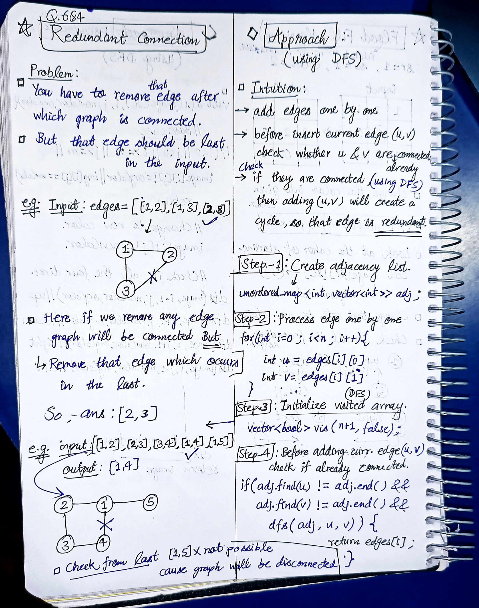
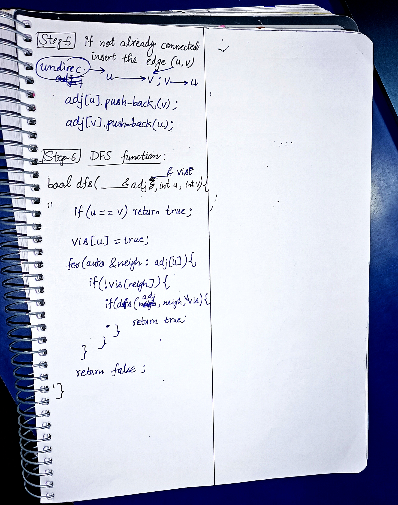

<h2><a href="https://leetcode.com/problems/redundant-connection">684. Redundant Connection</a></h2><h3>Medium</h3><hr><p>In this problem, a tree is an <strong>undirected graph</strong> that is connected and has no cycles.</p>

<p>You are given a graph that started as a tree with <code>n</code> nodes labeled from <code>1</code> to <code>n</code>, with one additional edge added. The added edge has two <strong>different</strong> vertices chosen from <code>1</code> to <code>n</code>, and was not an edge that already existed. The graph is represented as an array <code>edges</code> of length <code>n</code> where <code>edges[i] = [a<sub>i</sub>, b<sub>i</sub>]</code> indicates that there is an edge between nodes <code>a<sub>i</sub></code> and <code>b<sub>i</sub></code> in the graph.</p>

<p>Return <em>an edge that can be removed so that the resulting graph is a tree of </em><code>n</code><em> nodes</em>. If there are multiple answers, return the answer that occurs last in the input.</p>

<p>&nbsp;</p>
<p><strong class="example">Example 1:</strong></p>

<pre>
<strong>Input:</strong> edges = [[1,2],[1,3],[2,3]]
<strong>Output:</strong> [2,3]
</pre>

<p><strong class="example">Example 2:</strong></p>

<pre>
<strong>Input:</strong> edges = [[1,2],[2,3],[3,4],[1,4],[1,5]]
<strong>Output:</strong> [1,4]
</pre>

<p>&nbsp;</p>
<p><strong>Constraints:</strong></p>

<ul>
	<li><code>n == edges.length</code></li>
	<li><code>3 &lt;= n &lt;= 1000</code></li>
	<li><code>edges[i].length == 2</code></li>
	<li><code>1 &lt;= a<sub>i</sub> &lt; b<sub>i</sub> &lt;= edges.length</code></li>
	<li><code>a<sub>i</sub> != b<sub>i</sub></code></li>
	<li>There are no repeated edges.</li>
	<li>The given graph is connected.</li>
</ul>


<!-- AUTO-GENERATED-SOLUTION-START -->
---

## 🧠 Visual Solution & Intuition

### Part 1



### Part 2



---

## ⏱️ Complexity Analysis

```text
Time Complexity = O(n²)
Space Complexity = O(n)
```

---

## 💻 C++ Solution

[View Original C++ File](./0684-redundant-connection.cpp)

```cpp
class Solution {
public:
    //Time Complexity = O(n²)
    //Space Complexity = O(n)
    bool dfs(unordered_map<int, vector<int>>& adj, int u, int v, vector<bool>& vis ){ //6.) DFS function
        //if u is v
        if(u == v) return true ;

        vis[u] = true ; //mark u = visited
        
        // Traverse all neighbours connected to node u
        for(auto &neigh : adj[u]){
            if(!vis[neigh]){
                if(dfs(adj, neigh, v, vis) ){
                    return true ;
                }
            }
        }

        //if in above check no connection found then
        return false ;
    }
    vector<int> findRedundantConnection(vector<vector<int>>& edges) {
        int n = edges.size() ;

        //1.) Create adjacency list
        unordered_map<int, vector<int>> adj ;

        //2.)Process edge one by one
        for(int i=0 ; i<n ; i++){
            int u = edges[i][0] ;
            int v = edges[i][1] ;


            //3.) Initialize visited array
            vector<bool> vis(n+1, false) ;

            //4.) check is (u,v) already connected then return the ans.
            if(adj.find(u) != adj.end() && adj.find(v) != adj.end() &&
               dfs(adj, u, v, vis) ){
                    
                    return edges[i] ;
            }

            else{ //5.) if not connected then insert the edge in adj 
                adj[u].push_back(v) ; // u -----> v
                adj[v].push_back(u) ; // v -----> u (cause undirected)

            }

        }

        
     //if not found any redundant edge then
     return {} ; //empty array

    }
};
```

<!-- AUTO-GENERATED-SOLUTION-END -->
