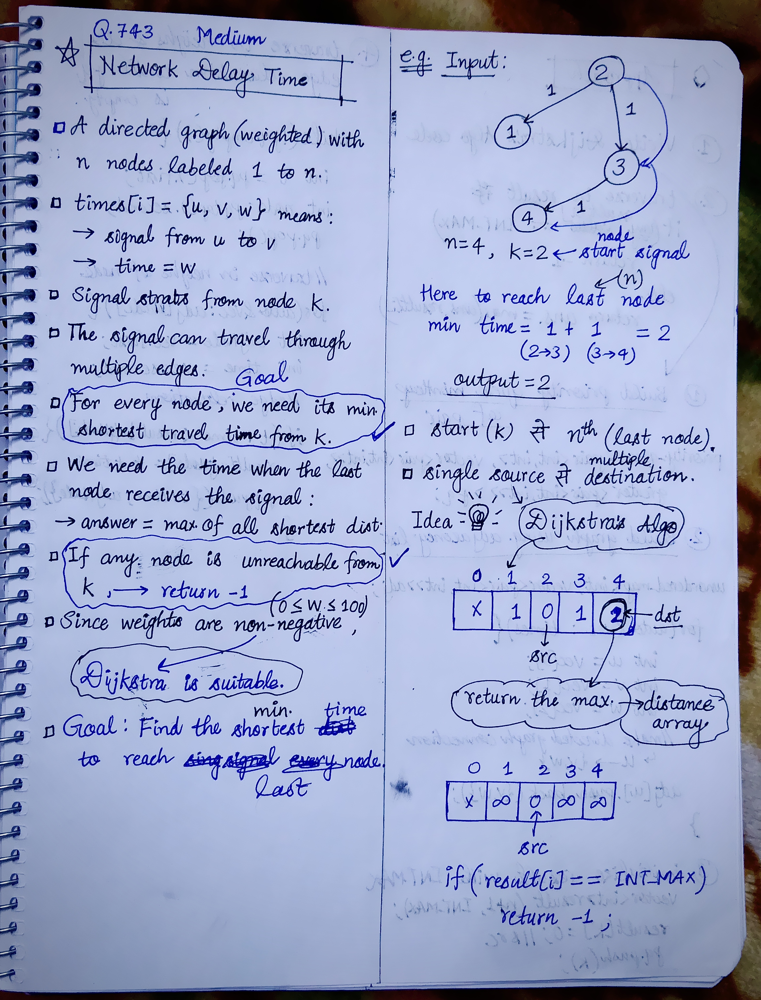
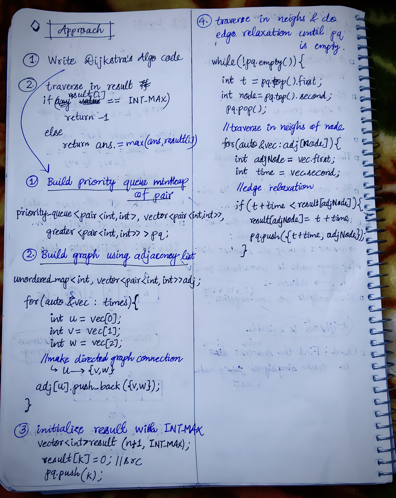

<h2><a href="https://leetcode.com/problems/network-delay-time">743. Network Delay Time</a></h2><h3>Medium</h3><hr><p>You are given a network of <code>n</code> nodes, labeled from <code>1</code> to <code>n</code>. You are also given <code>times</code>, a list of travel times as directed edges <code>times[i] = (u<sub>i</sub>, v<sub>i</sub>, w<sub>i</sub>)</code>, where <code>u<sub>i</sub></code> is the source node, <code>v<sub>i</sub></code> is the target node, and <code>w<sub>i</sub></code> is the time it takes for a signal to travel from source to target.</p>

<p>We will send a signal from a given node <code>k</code>. Return <em>the <strong>minimum</strong> time it takes for all the</em> <code>n</code> <em>nodes to receive the signal</em>. If it is impossible for all the <code>n</code> nodes to receive the signal, return <code>-1</code>.</p>

<p>&nbsp;</p>
<p><strong class="example">Example 1:</strong></p>

<pre>
<strong>Input:</strong> times = [[2,1,1],[2,3,1],[3,4,1]], n = 4, k = 2
<strong>Output:</strong> 2
</pre>

<p><strong class="example">Example 2:</strong></p>

<pre>
<strong>Input:</strong> times = [[1,2,1]], n = 2, k = 1
<strong>Output:</strong> 1
</pre>

<p><strong class="example">Example 3:</strong></p>

<pre>
<strong>Input:</strong> times = [[1,2,1]], n = 2, k = 2
<strong>Output:</strong> -1
</pre>

<p>&nbsp;</p>
<p><strong>Constraints:</strong></p>

<ul>
	<li><code>1 &lt;= k &lt;= n &lt;= 100</code></li>
	<li><code>1 &lt;= times.length &lt;= 6000</code></li>
	<li><code>times[i].length == 3</code></li>
	<li><code>1 &lt;= u<sub>i</sub>, v<sub>i</sub> &lt;= n</code></li>
	<li><code>u<sub>i</sub> != v<sub>i</sub></code></li>
	<li><code>0 &lt;= w<sub>i</sub> &lt;= 100</code></li>
	<li>All the pairs <code>(u<sub>i</sub>, v<sub>i</sub>)</code> are <strong>unique</strong>. (i.e., no multiple edges.)</li>
</ul>


<!-- AUTO-GENERATED-SOLUTION-START -->
---

## 🧠 Visual Solution & Intuition

### Part 1



### Part 2



---

## 💡 Approach

```text
Approach : Dijkstra's Algorithm
```

---

## ⏱️ Complexity Analysis

```text
Time Complexity = O((V + E) log V) =>
Space Complexity = O(V + E) =>
```

---

## 💻 C++ Solution

[View Original C++ File](./0743-network-delay-time.cpp)

```cpp
class Solution {
public:
    //Approach : Dijkstra's Algorithm
    
    //Time Complexity = O((V + E) log V) =>
    /* Building adjacency list → O(E)
    * Dijkstra using min-heap → O(E log V)
    * Checking all nodes → O(V)
    * Overall TC → O((V + E) log V)
    * For this problem: O((n + E) log n)
    */

    //Space Complexity = O(V + E) =>
    /* Adjacency list → O(E)
    * Distance array → O(V)
    * Priority queue → O(E)
    * Overall SC → O(V + E)
    * For this problem: O(n + E)
    */

    
    int networkDelayTime(vector<vector<int>>& times, int n, int k) {
        //Step-1: Write Dijkstra's Algo code
        priority_queue<pair<int, int>, vector<pair<int, int>>, greater<pair<int, int>> > pq; //minHeap
        
        //Build graph using adjacency list
        unordered_map<int, vector<pair<int, int>>> adj;

        for(auto& vec : times){
            int u = vec[0];
            int v = vec[1];
            int w = vec[2];

            //make connections directed graph
            adj[u].push_back({v,w}); //u--->{v,w}
            
        }

        vector<int> result(n+1, INT_MAX); //initialize all distances with infinity
        result[k] = 0; //time of source = 0
        pq.push({0,k}); //push {time, src} in priority queue

        while(!pq.empty()){
            int t = pq.top().first; //time
            int node = pq.top().second; //node
            pq.pop();

            //traverse in neighbors of node
            for(auto& vec : adj[node]){
                int adjNode = vec.first;
                int time = vec.second; 

                //edge relaxation
                if(t + time < result[adjNode]){
                    result[adjNode] = t + time;
                    pq.push({t + time, adjNode});
                }
            }

        }

        int ans = INT_MIN;

        for(int i=1; i<=n; i++){

            if(result[i] == INT_MAX) //unreachable node
                return -1;

            ans = max(ans, result[i]);
        }

        //finally return the output
        return ans;
    } 
};
```

<!-- AUTO-GENERATED-SOLUTION-END -->
