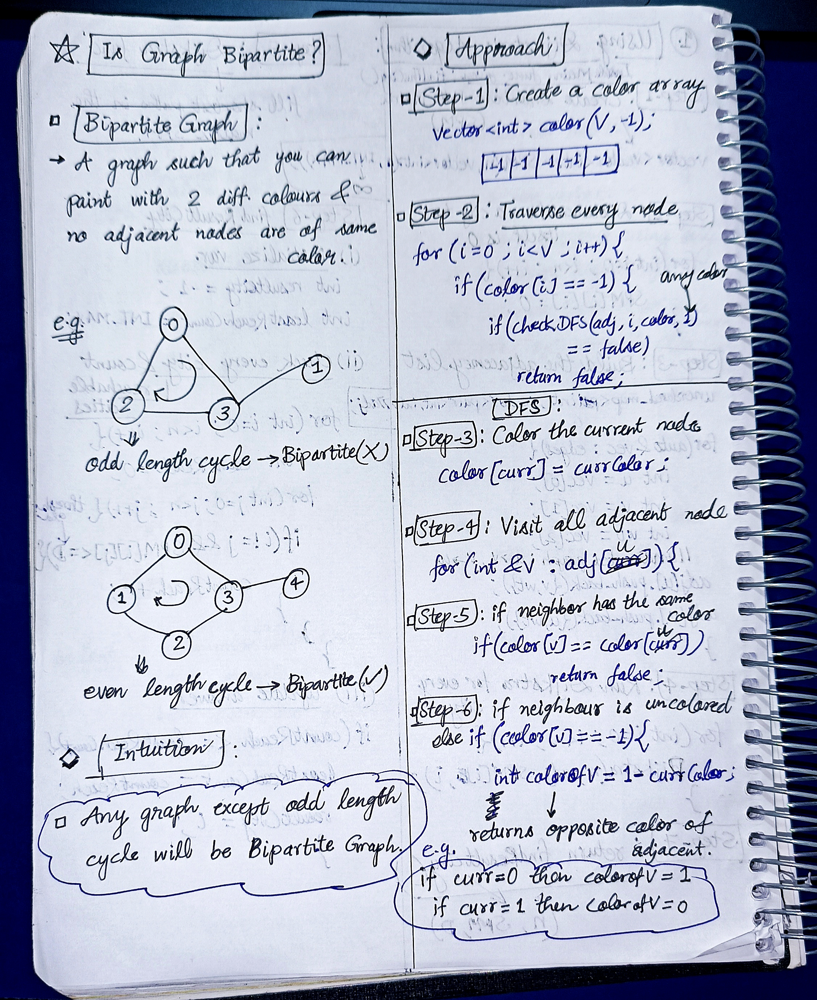

<h2><a href="https://leetcode.com/problems/is-graph-bipartite">801. Is Graph Bipartite?</a></h2><h3>Medium</h3><hr><p>There is an <strong>undirected</strong> graph with <code>n</code> nodes, where each node is numbered between <code>0</code> and <code>n - 1</code>. You are given a 2D array <code>graph</code>, where <code>graph[u]</code> is an array of nodes that node <code>u</code> is adjacent to. More formally, for each <code>v</code> in <code>graph[u]</code>, there is an undirected edge between node <code>u</code> and node <code>v</code>. The graph has the following properties:</p>

<ul>
	<li>There are no self-edges (<code>graph[u]</code> does not contain <code>u</code>).</li>
	<li>There are no parallel edges (<code>graph[u]</code> does not contain duplicate values).</li>
	<li>If <code>v</code> is in <code>graph[u]</code>, then <code>u</code> is in <code>graph[v]</code> (the graph is undirected).</li>
	<li>The graph may not be connected, meaning there may be two nodes <code>u</code> and <code>v</code> such that there is no path between them.</li>
</ul>

<p>A graph is <strong>bipartite</strong> if the nodes can be partitioned into two independent sets <code>A</code> and <code>B</code> such that <strong>every</strong> edge in the graph connects a node in set <code>A</code> and a node in set <code>B</code>.</p>

<p>Return <code>true</code><em> if and only if it is <strong>bipartite</strong></em>.</p>

<p>&nbsp;</p>
<p><strong class="example">Example 1:</strong></p>

<pre>
<strong>Input:</strong> graph = [[1,2,3],[0,2],[0,1,3],[0,2]]
<strong>Output:</strong> false
<strong>Explanation:</strong> There is no way to partition the nodes into two independent sets such that every edge connects a node in one and a node in the other.</pre>

<p><strong class="example">Example 2:</strong></p>

<pre>
<strong>Input:</strong> graph = [[1,3],[0,2],[1,3],[0,2]]
<strong>Output:</strong> true
<strong>Explanation:</strong> We can partition the nodes into two sets: {0, 2} and {1, 3}.</pre>

<p>&nbsp;</p>
<p><strong>Constraints:</strong></p>

<ul>
	<li><code>graph.length == n</code></li>
	<li><code>1 &lt;= n &lt;= 100</code></li>
	<li><code>0 &lt;= graph[u].length &lt; n</code></li>
	<li><code>0 &lt;= graph[u][i] &lt;= n - 1</code></li>
	<li><code>graph[u]</code>&nbsp;does not contain&nbsp;<code>u</code>.</li>
	<li>All the values of <code>graph[u]</code> are <strong>unique</strong>.</li>
	<li>If <code>graph[u]</code> contains <code>v</code>, then <code>graph[v]</code> contains <code>u</code>.</li>
</ul>


<!-- AUTO-GENERATED-SOLUTION-START -->
---

## 🧠 Visual Solution & Intuition



---

## ⏱️ Complexity Analysis

```text
Time Complexity = O(V + E)
Space Complexity = O(V)
```

---

## 💻 C++ Solution

[View Original C++ File](./0785-is-graph-bipartite.cpp)

```cpp
class Solution {
public:
    //Time Complexity = O(V + E)
    //Space Complexity = O(V)
    bool checkDFS(vector<vector<int>>& adj, int curr, vector<int> &color, int currColor){
        //queue for DFS
        queue<int> q ;
        q.push(curr) ; //start with curr
        color[curr] = currColor ;

        while(!q.empty() ){
            int u = q.front() ;
            q.pop() ;

            //traverse in neighs 
            for(int &v : adj[u]){
                if(color[v] == color[u]) //same color of ajacent nodes
                    return false ;
                
                else if(color[v] == -1){ //uncolored
                    
                    int colorOfV = 1 - currColor ;

                    //recursively perform DFS
                    if(checkDFS(adj, v, color, colorOfV) == false)
                        return false ;

                }

            }
        }

        return true ;
    }
    bool isBipartite(vector<vector<int>>& adj) {
        //1.) make color array
        int V = adj.size() ;
        vector<int> color(V, -1) ;

        //2.) traverse every node
        for(int i=0 ; i<V ; i++){
            if(color[i] == -1){
                if(checkDFS(adj, i, color, 1) == false)
                    return false ;
            }
        }

        //if no false found then
        return true ; 
    }
};
```

<!-- AUTO-GENERATED-SOLUTION-END -->
