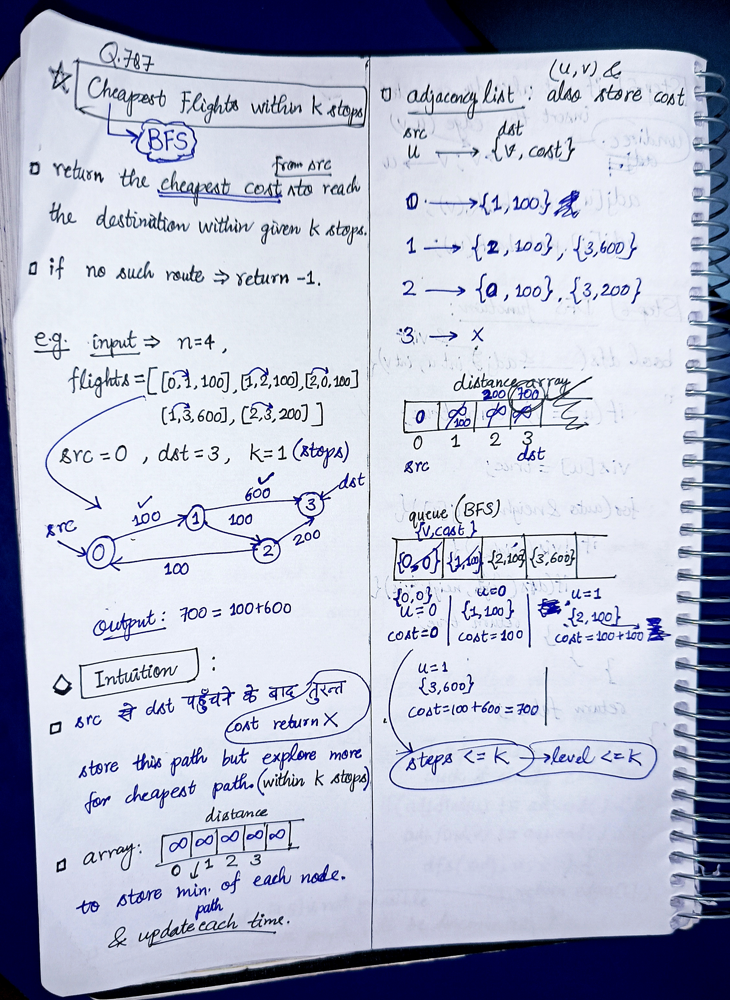
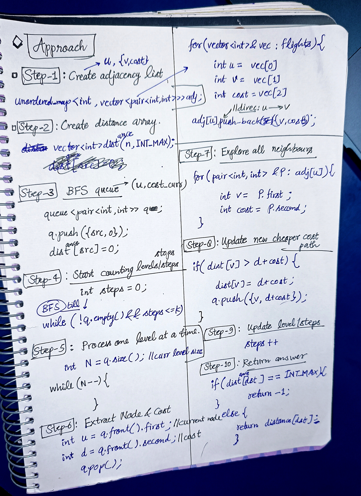

<h2><a href="https://leetcode.com/problems/cheapest-flights-within-k-stops">803. Cheapest Flights Within K Stops</a></h2><h3>Medium</h3><hr><p>There are <code>n</code> cities connected by some number of flights. You are given an array <code>flights</code> where <code>flights[i] = [from<sub>i</sub>, to<sub>i</sub>, price<sub>i</sub>]</code> indicates that there is a flight from city <code>from<sub>i</sub></code> to city <code>to<sub>i</sub></code> with cost <code>price<sub>i</sub></code>.</p>

<p>You are also given three integers <code>src</code>, <code>dst</code>, and <code>k</code>, return <em><strong>the cheapest price</strong> from </em><code>src</code><em> to </em><code>dst</code><em> with at most </em><code>k</code><em> stops. </em>If there is no such route, return<em> </em><code>-1</code>.</p>

<p>&nbsp;</p>
<p><strong class="example">Example 1:</strong></p>

<pre>
<strong>Input:</strong> n = 4, flights = [[0,1,100],[1,2,100],[2,0,100],[1,3,600],[2,3,200]], src = 0, dst = 3, k = 1
<strong>Output:</strong> 700
<strong>Explanation:</strong>
The graph is shown above.
The optimal path with at most 1 stop from city 0 to 3 is marked in red and has cost 100 + 600 = 700.
Note that the path through cities [0,1,2,3] is cheaper but is invalid because it uses 2 stops.
</pre>

<p><strong class="example">Example 2:</strong></p>

<pre>
<strong>Input:</strong> n = 3, flights = [[0,1,100],[1,2,100],[0,2,500]], src = 0, dst = 2, k = 1
<strong>Output:</strong> 200
<strong>Explanation:</strong>
The graph is shown above.
The optimal path with at most 1 stop from city 0 to 2 is marked in red and has cost 100 + 100 = 200.
</pre>

<p><strong class="example">Example 3:</strong></p>

<pre>
<strong>Input:</strong> n = 3, flights = [[0,1,100],[1,2,100],[0,2,500]], src = 0, dst = 2, k = 0
<strong>Output:</strong> 500
<strong>Explanation:</strong>
The graph is shown above.
The optimal path with no stops from city 0 to 2 is marked in red and has cost 500.
</pre>

<p>&nbsp;</p>
<p><strong>Constraints:</strong></p>

<ul>
	<li><code>2 &lt;= n &lt;= 100</code></li>
	<li><code>0 &lt;= flights.length &lt;= (n * (n - 1) / 2)</code></li>
	<li><code>flights[i].length == 3</code></li>
	<li><code>0 &lt;= from<sub>i</sub>, to<sub>i</sub> &lt; n</code></li>
	<li><code>from<sub>i</sub> != to<sub>i</sub></code></li>
	<li><code>1 &lt;= price<sub>i</sub> &lt;= 10<sup>4</sup></code></li>
	<li>There will not be any multiple flights between two cities.</li>
	<li><code>0 &lt;= src, dst, k &lt; n</code></li>
	<li><code>src != dst</code></li>
</ul>


<!-- AUTO-GENERATED-SOLUTION-START -->
---

## 🧠 Visual Solution & Intuition

### Part 1



### Part 2



---

## 💻 C++ Solution

[View Original C++ File](./0787-cheapest-flights-within-k-stops.cpp)

```cpp
class Solution {
public:
    int findCheapestPrice(int n, vector<vector<int>>& flights, int src, int dst, int k) {
        //1.) Create adjacency list
        unordered_map<int, vector<pair<int, int>>> adj ;

        for(vector<int>& vec : flights){
            
            int u = vec[0] ;
            int v = vec[1] ;
            int cost = vec[2] ;


            //direction : u ----> v
            adj[u].push_back({v, cost}) ;
        }


        //2.) Create distance array
        vector<int> distance(n, INT_MAX) ;

        //3.) BFS queue
        queue<pair<int, int>> q ; //(v, curr_cost) ;

        q.push({src,0}) ;
        distance[src] = 0 ; //src se src ka distance = 0

        //4.)Start counting levels/steps
        int steps = 0 ;

        //5.) BFS and process one level at a time
        while(!q.empty() && steps <= k){
            
            int N = q.size() ; //size of current level

            while(N--){ //6.) extract node & cost
                int u = q.front().first ;
                int d = q.front().second ; //cost
                q.pop() ;


                //7.) explore all neighbours
                for(pair<int,int> &P : adj[u]){
                    int v = P.first ;
                    int cost = P.second ;

                    //8.) Edge Relaxation : check if cheaper path exists
                    if(distance[v] > d+cost){
                        distance[v] = d+cost ;
                        q.push({v, d+cost}) ;
                    }
                }
            }
            //9.)update steps after each level
            steps++ ;
        }


        //10.) return the answer

        if(distance[dst] == INT_MAX){
            return -1 ; //cause still distance is infinity => no path found
        }

        else{ //path found
            
            return distance[dst] ;

        }

    }
};
```

<!-- AUTO-GENERATED-SOLUTION-END -->
