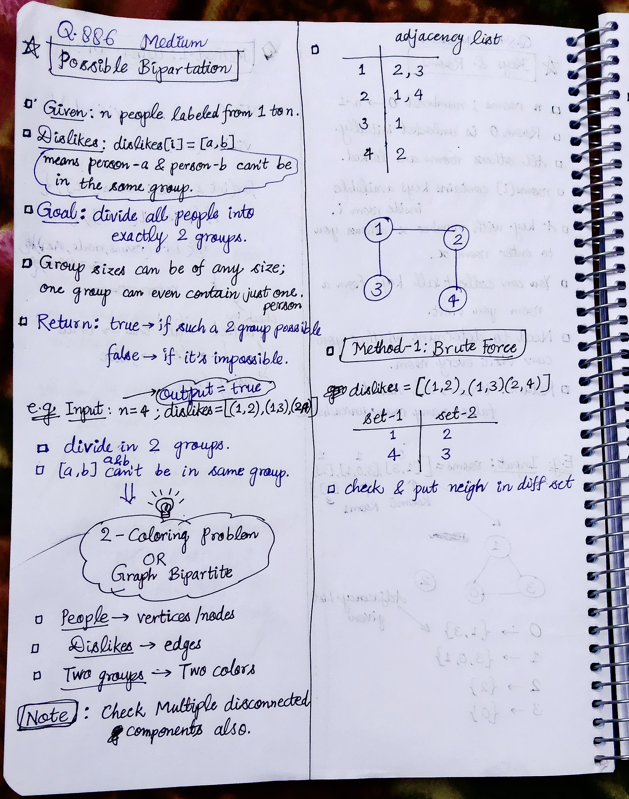
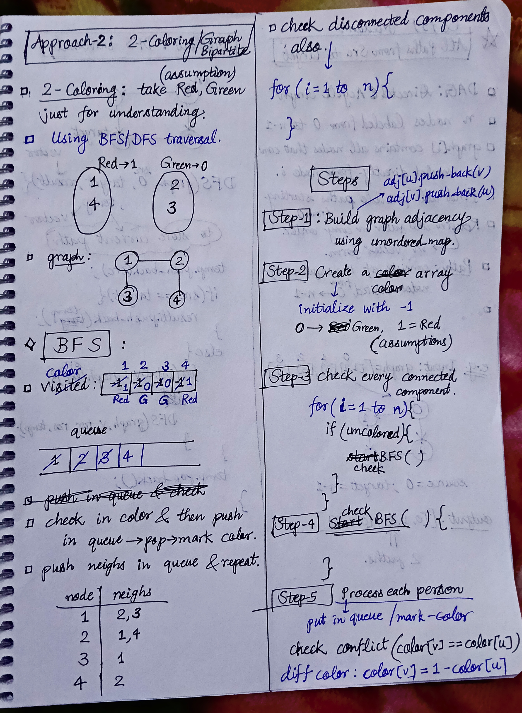

<h2><a href="https://leetcode.com/problems/possible-bipartition/">886. Possible Bipartition</a></h2><h3>Medium</h3><hr><p>We want to split a group of <code>n</code> people (labeled from <code>1</code> to <code>n</code>) into two groups of <strong>any size</strong>. Each person may dislike some other people, and they should not go into the same group.</p>

<p>Given the integer <code>n</code> and the array <code>dislikes</code> where <code>dislikes[i] = [a<sub>i</sub>, b<sub>i</sub>]</code> indicates that the person labeled <code>a<sub>i</sub></code> does not like the person labeled <code>b<sub>i</sub></code>, return <code>true</code> <em>if it is possible to split everyone into two groups in this way</em>.</p>

<p>&nbsp;</p>
<p><strong class="example">Example 1:</strong></p>

<pre>
<strong>Input:</strong> n = 4, dislikes = [[1,2],[1,3],[2,4]]
<strong>Output:</strong> true
<strong>Explanation:</strong> The first group has [1,4], and the second group has [2,3].
</pre>

<p><strong class="example">Example 2:</strong></p>

<pre>
<strong>Input:</strong> n = 3, dislikes = [[1,2],[1,3],[2,3]]
<strong>Output:</strong> false
<strong>Explanation:</strong> We need at least 3 groups to divide them. We cannot put them in two groups.
</pre>

<p>&nbsp;</p>
<p><strong>Constraints:</strong></p>

<ul>
	<li><code>1 &lt;= n &lt;= 2000</code></li>
	<li><code>0 &lt;= dislikes.length &lt;= 10<sup>4</sup></code></li>
	<li><code>dislikes[i].length == 2</code></li>
	<li><code>1 &lt;= a<sub>i</sub> &lt; b<sub>i</sub> &lt;= n</code></li>
	<li>All the pairs of <code>dislikes</code> are <strong>unique</strong>.</li>
</ul>


<!-- AUTO-GENERATED-SOLUTION-START -->
---

## 🧠 Visual Solution & Intuition

### Part 1



### Part 2



---

## ⏱️ Complexity Analysis

```text
Time Complexity  = O(V + E) =>
Space Complexity = O(V + E) =>
```

---

## 💻 C++ Solution

[View Original C++ File](./0886-possible-bipartition.cpp)

```cpp
class Solution {
public:
    //Method : 2-Coloring Approach/ Graph Bipartite?

    //Time Complexity  = O(V + E) =>
    /* V = n → number of people
    * E = dislikes.size() → number of dislike relationships
    */

    //Space Complexity = O(V + E) =>
    /* V = n → number of people
    * E = dislikes.size() → number of dislike relationships
    */


    bool checkBFSBipartite(unordered_map<int, vector<int>>& adj, int node, vector<int>& color){
        //queue for BFS
        queue<int> q;

        q.push(node);
        color[node] = 1; //1 = Red

        while(!q.empty()){
            int u = q.front();
            q.pop();
            
            //explore neighs of u
            for(int& v : adj[u]){
                if(color[u] == color[v]){ //same color
                    return false;
                }

                if(color[v] == -1){//not colored yet
                    q.push(v);
                    color[v] = 1 - color[u]; //this formula helps : if color[u] = 0 , then color[v] = 1 & vice versa.
                }
            }
        }

        return true;
    }
    bool possibleBipartition(int n, vector<vector<int>>& dislikes) {
        //1.) Build graph adjacency
        unordered_map<int, vector<int>> adj;
        

        for(auto& vec : dislikes){
            int u = vec[0]; 
            int v = vec[1];

            //make connections : bidirectional graph
            adj[u].push_back(v); //u---->v
            adj[v].push_back(u); //v---->u
        }

        //color vector to store : Red, Green
        vector<int> color(n+1, -1); //initially fill with -1
         
        for(int i=1; i<= n; i++){
            if(color[i] == -1){
                if(checkBFSBipartite(adj, i, color) == false){
                    return false;
                }
            }
        }

        //if bipartite != false
        return true;

    }
};
```

<!-- AUTO-GENERATED-SOLUTION-END -->
