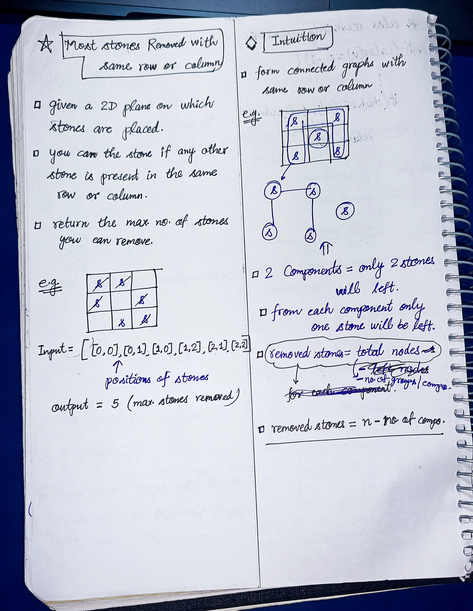
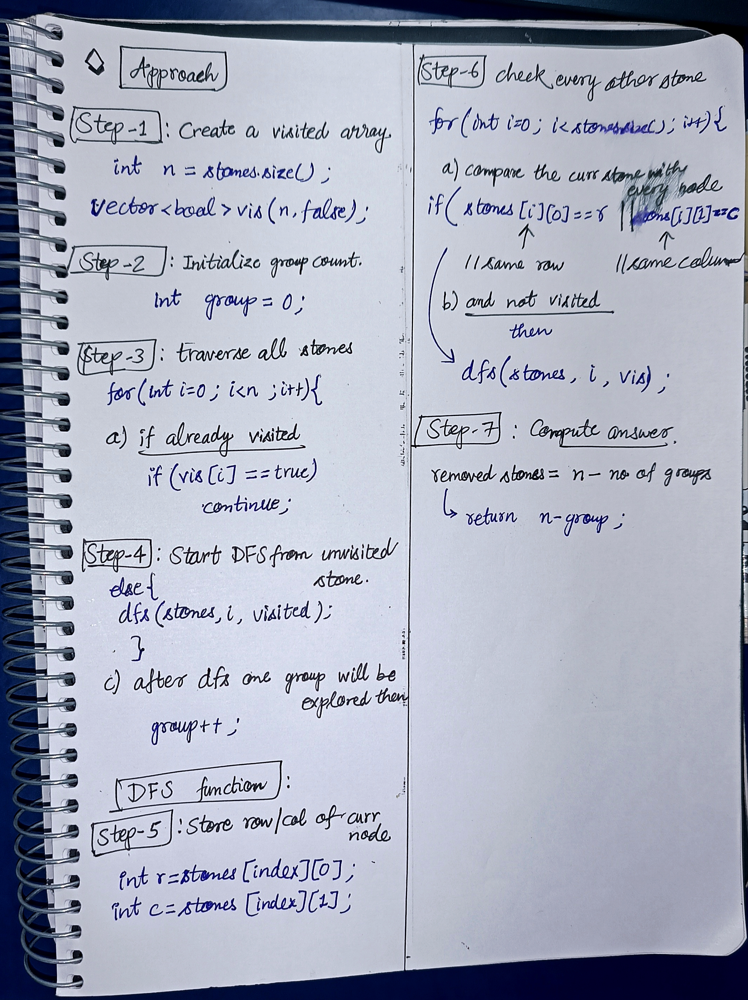

<h2><a href="https://leetcode.com/problems/most-stones-removed-with-same-row-or-column">984. Most Stones Removed with Same Row or Column</a></h2><h3>Medium</h3><hr><p>On a 2D plane, we place <code>n</code> stones at some integer coordinate points. Each coordinate point may have at most one stone.</p>

<p>A stone can be removed if it shares either <strong>the same row or the same column</strong> as another stone that has not been removed.</p>

<p>Given an array <code>stones</code> of length <code>n</code> where <code>stones[i] = [x<sub>i</sub>, y<sub>i</sub>]</code> represents the location of the <code>i<sup>th</sup></code> stone, return <em>the largest possible number of stones that can be removed</em>.</p>

<p>&nbsp;</p>
<p><strong class="example">Example 1:</strong></p>

<pre>
<strong>Input:</strong> stones = [[0,0],[0,1],[1,0],[1,2],[2,1],[2,2]]
<strong>Output:</strong> 5
<strong>Explanation:</strong> One way to remove 5 stones is as follows:
1. Remove stone [2,2] because it shares the same row as [2,1].
2. Remove stone [2,1] because it shares the same column as [0,1].
3. Remove stone [1,2] because it shares the same row as [1,0].
4. Remove stone [1,0] because it shares the same column as [0,0].
5. Remove stone [0,1] because it shares the same row as [0,0].
Stone [0,0] cannot be removed since it does not share a row/column with another stone still on the plane.
</pre>

<p><strong class="example">Example 2:</strong></p>

<pre>
<strong>Input:</strong> stones = [[0,0],[0,2],[1,1],[2,0],[2,2]]
<strong>Output:</strong> 3
<strong>Explanation:</strong> One way to make 3 moves is as follows:
1. Remove stone [2,2] because it shares the same row as [2,0].
2. Remove stone [2,0] because it shares the same column as [0,0].
3. Remove stone [0,2] because it shares the same row as [0,0].
Stones [0,0] and [1,1] cannot be removed since they do not share a row/column with another stone still on the plane.
</pre>

<p><strong class="example">Example 3:</strong></p>

<pre>
<strong>Input:</strong> stones = [[0,0]]
<strong>Output:</strong> 0
<strong>Explanation:</strong> [0,0] is the only stone on the plane, so you cannot remove it.
</pre>

<p>&nbsp;</p>
<p><strong>Constraints:</strong></p>

<ul>
	<li><code>1 &lt;= stones.length &lt;= 1000</code></li>
	<li><code>0 &lt;= x<sub>i</sub>, y<sub>i</sub> &lt;= 10<sup>4</sup></code></li>
	<li>No two stones are at the same coordinate point.</li>
</ul>


<!-- AUTO-GENERATED-SOLUTION-START -->
---

## 🧠 Visual Solution & Intuition

### Part 1



### Part 2



---

## ⏱️ Complexity Analysis

```text
Time Complexity = O(n²)
Space Complexity = O(n)
```

---

## 💻 C++ Solution

[View Original C++ File](./0947-most-stones-removed-with-same-row-or-column.cpp)

```cpp
class Solution {
public:
    //Time Complexity = O(n²)
    //Space Complexity = O(n)
    void dfs(vector<vector<int>>& stones, int idx, vector<bool>& vis){

        //mark curr idx true
        vis[idx] = true ;
        
        //check every other stone
        for(int i=0 ; i<stones.size() ; i++){
            int r = stones[idx][0] ;
            int c = stones[idx][1] ;

            //compare curr stone with every node
            if( (vis[i] == false) && (stones[i][0] == r || stones[i][1] == c) ){
                
                dfs(stones, i, vis) ;
            }
        }

    }
    int removeStones(vector<vector<int>>& stones) {
        int n = stones.size() ;

        //1.) create visited array
        vector<bool> vis(n, false) ;

        //2.) initialize group count 
        int group = 0 ; 

        //3.) traverse all stones
        for(int i=0 ; i<n ; i++){
            
            if(vis[i] == true)
                continue ;

            else{ //explore unvisited stones using DFS
                dfs(stones, i, vis) ;
            }
            group++ ; //after each dfs increase group count
        }


        //7.) Computer answer
        return n - group ;

    }
};
```

<!-- AUTO-GENERATED-SOLUTION-END -->
