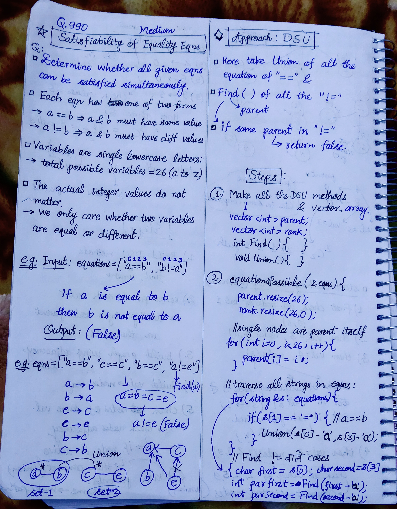

<h2><a href="https://leetcode.com/problems/satisfiability-of-equality-equations">1032. Satisfiability of Equality Equations</a></h2><h3>Medium</h3><hr><p>You are given an array of strings <code>equations</code> that represent relationships between variables where each string <code>equations[i]</code> is of length <code>4</code> and takes one of two different forms: <code>&quot;x<sub>i</sub>==y<sub>i</sub>&quot;</code> or <code>&quot;x<sub>i</sub>!=y<sub>i</sub>&quot;</code>.Here, <code>x<sub>i</sub></code> and <code>y<sub>i</sub></code> are lowercase letters (not necessarily different) that represent one-letter variable names.</p>

<p>Return <code>true</code><em> if it is possible to assign integers to variable names so as to satisfy all the given equations, or </em><code>false</code><em> otherwise</em>.</p>

<p>&nbsp;</p>
<p><strong class="example">Example 1:</strong></p>

<pre>
<strong>Input:</strong> equations = [&quot;a==b&quot;,&quot;b!=a&quot;]
<strong>Output:</strong> false
<strong>Explanation:</strong> If we assign say, a = 1 and b = 1, then the first equation is satisfied, but not the second.
There is no way to assign the variables to satisfy both equations.
</pre>

<p><strong class="example">Example 2:</strong></p>

<pre>
<strong>Input:</strong> equations = [&quot;b==a&quot;,&quot;a==b&quot;]
<strong>Output:</strong> true
<strong>Explanation:</strong> We could assign a = 1 and b = 1 to satisfy both equations.
</pre>

<p>&nbsp;</p>
<p><strong>Constraints:</strong></p>

<ul>
	<li><code>1 &lt;= equations.length &lt;= 500</code></li>
	<li><code>equations[i].length == 4</code></li>
	<li><code>equations[i][0]</code> is a lowercase letter.</li>
	<li><code>equations[i][1]</code> is either <code>&#39;=&#39;</code> or <code>&#39;!&#39;</code>.</li>
	<li><code>equations[i][2]</code> is <code>&#39;=&#39;</code>.</li>
	<li><code>equations[i][3]</code> is a lowercase letter.</li>
</ul>


<!-- AUTO-GENERATED-SOLUTION-START -->
---

## 🧠 Visual Solution & Intuition



---

## 💡 Approach

```text
Approach : DSU / Union-Find — Equality Constraint + Contradiction Detection
```

---

## ⏱️ Complexity Analysis

```text
Time Complexity = O(n) =>
Space Complexity = O(26) = O(1) =>
```

---

## 💻 C++ Solution

[View Original C++ File](./0990-satisfiability-of-equality-equations.cpp)

```cpp
class Solution {
public:
    //Approach : DSU / Union-Find — Equality Constraint + Contradiction Detection

    //Time Complexity = O(n) =>
    /* N = number of equations
    * α = inverse Ackermann function, practically constant.
    */


    //Space Complexity = O(26) = O(1) =>
    /* parent[26] 
    * rank[26]
    */


    //Step-1 : Make all the DSU related functions, vectors.
    vector<int> parent;
    vector<int> rank;

    int find(int x){
        if(parent[x] == x)
            return x;

        else{
            return parent[x] = find(parent[x]);
        }
    }

    void Union(int x, int y){
        int x_parent = find(x);
        int y_parent = find(y);

        if(x_parent == y_parent)
            return;

        if(rank[x_parent] > rank[y_parent]){
            parent[y_parent] = x_parent;
        }
        else if(rank[x_parent] < rank[y_parent]){
            parent[x_parent] = y_parent;
        }

        else{
            parent[x_parent] = y_parent;
            rank[y_parent] += 1;
        }
    }
    bool equationsPossible(vector<string>& equations) {

        //Step-2
        parent.resize(26);
        rank.resize(26, 0); //initial rank of each is zero

        //single nodes are parent itself
        for(int i=0; i<26; i++){
            parent[i] = i;
        }

        //Step-2(a): traverse in equations & take Union of all the '=' variables
        for(string& s : equations){
            if(s[1] == '='){
                Union(s[0]-'a', s[3]-'a');//s[0] = first var, s[3] = second var
            }
        }

        //Step-2(b): traverse in equations & find parent of '!=' variables
        for(string& s : equations){
            if(s[1] == '!'){
                int first = s[0];
                int second = s[3];

                int parentFirst = find(first-'a');
                int parentSecond = find(second-'a');


                //Step-2(c) : check if != has same parent then false
                if(parentFirst == parentSecond)
                    return false;
            }
        }

        //if in above no false returned then
        return true;
    }
};
```

<!-- AUTO-GENERATED-SOLUTION-END -->
