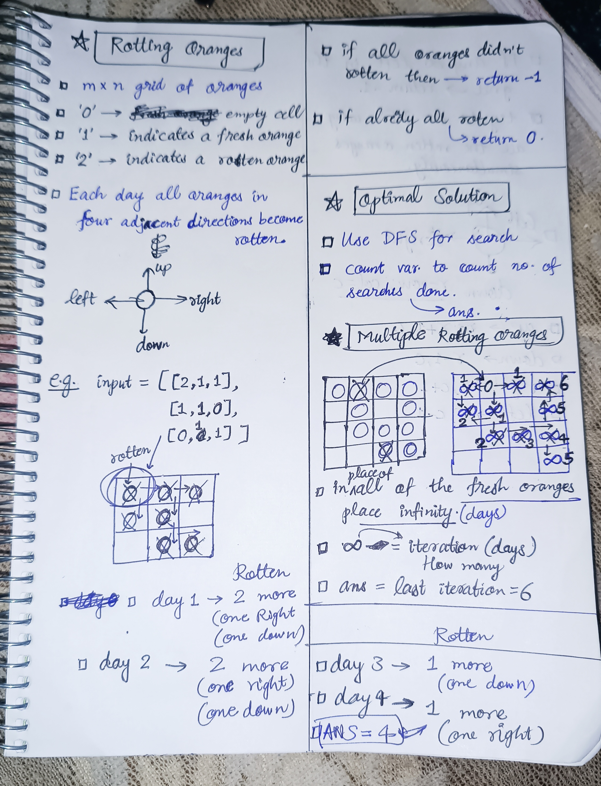
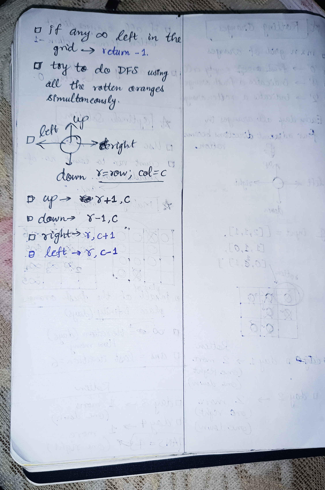

<h2><a href="https://leetcode.com/problems/rotting-oranges">1036. Rotting Oranges</a></h2><h3>Medium</h3><hr><p>You are given an <code>m x n</code> <code>grid</code> where each cell can have one of three values:</p>

<ul>
	<li><code>0</code> representing an empty cell,</li>
	<li><code>1</code> representing a fresh orange, or</li>
	<li><code>2</code> representing a rotten orange.</li>
</ul>

<p>Every minute, any fresh orange that is <strong>4-directionally adjacent</strong> to a rotten orange becomes rotten.</p>

<p>Return <em>the minimum number of minutes that must elapse until no cell has a fresh orange</em>. If <em>this is impossible, return</em> <code>-1</code>.</p>

<p>&nbsp;</p>
<p><strong class="example">Example 1:</strong></p>

<pre>
<strong>Input:</strong> grid = [[2,1,1],[1,1,0],[0,1,1]]
<strong>Output:</strong> 4
</pre>

<p><strong class="example">Example 2:</strong></p>

<pre>
<strong>Input:</strong> grid = [[2,1,1],[0,1,1],[1,0,1]]
<strong>Output:</strong> -1
<strong>Explanation:</strong> The orange in the bottom left corner (row 2, column 0) is never rotten, because rotting only happens 4-directionally.
</pre>

<p><strong class="example">Example 3:</strong></p>

<pre>
<strong>Input:</strong> grid = [[0,2]]
<strong>Output:</strong> 0
<strong>Explanation:</strong> Since there are already no fresh oranges at minute 0, the answer is just 0.
</pre>

<p>&nbsp;</p>
<p><strong>Constraints:</strong></p>

<ul>
	<li><code>m == grid.length</code></li>
	<li><code>n == grid[i].length</code></li>
	<li><code>1 &lt;= m, n &lt;= 10</code></li>
	<li><code>grid[i][j]</code> is <code>0</code>, <code>1</code>, or <code>2</code>.</li>
</ul>


<!-- AUTO-GENERATED-SOLUTION-START -->
---

## 🧠 Visual Solution & Intuition

### Part 1



### Part 2



---

## ⏱️ Complexity Analysis

```text
Time Complexity = O((m × n) × (m × n)) = O((mn)²)
Space Complexity = O(m x n) => dfs recursion stack depth
```

---

## 💻 C++ Solution

[View Original C++ File](./0994-rotting-oranges.cpp)

```cpp
class Solution {
public:
    //Time Complexity = O((m × n) × (m × n)) = O((mn)²) 
    //Space Complexity = O(m x n) => dfs recursion stack depth
    int rows, cols ; //global variable to avoid using in function parameters
    
    vector<vector<int>> directions = {{-1,0},{1,0},{0,1},{0,-1}} ;

    void dfs(vector<vector<int>> &grid,vector<vector<int>> &days,int r, int c, int currTime ){
        //boundary conditions 
        if (r < 0 || r >= rows || c < 0 || c >= cols ||
            grid[r][c] == 0 || currTime >= days[r][c]){
            
            return ; //simply return from dfs
        }

        //initialize currTime
        days[r][c] = currTime ;
       
       //move in all four directions(up,down,right,left) 
       for(auto &dir : directions){
        dfs(grid, days, r + dir[0], c + dir[1], currTime + 1);
        //update r , c values, and currTime by each iteration.
       }

    }
    int orangesRotting(vector<vector<int>>& grid ) {
        rows = grid.size() ;
        cols = grid[0].size() ;

        vector<vector<int>> days(rows,vector<int>(cols,INT_MAX)) ; //INT_MAX = infinity
        //traverse in the grid and start DFS
        for(int i=0 ; i<rows ; i++){
            for(int j=0 ; j<cols ; j++){
                if(grid[i][j] == 2){ //'2' means rotten orange
                    dfs(grid,days,i,j,0) ; //then do DFS
                }
            }
        }
        int ans = 0 ; //

        for(int i=0 ; i<rows ; i++){
            for(int j=0 ; j<cols ; j++){
                //if fresh orange or never get rotten
                if(grid[i][j] == 1 && days[i][j] == INT_MAX){
                    return -1 ; 
                }

                //track days if rotten
                if(days[i][j] != INT_MAX){
                   ans = max(ans, days[i][j]) ;
                }

            }
        }

        return ans ; //very important to return ans
    }
};
```

<!-- AUTO-GENERATED-SOLUTION-END -->
