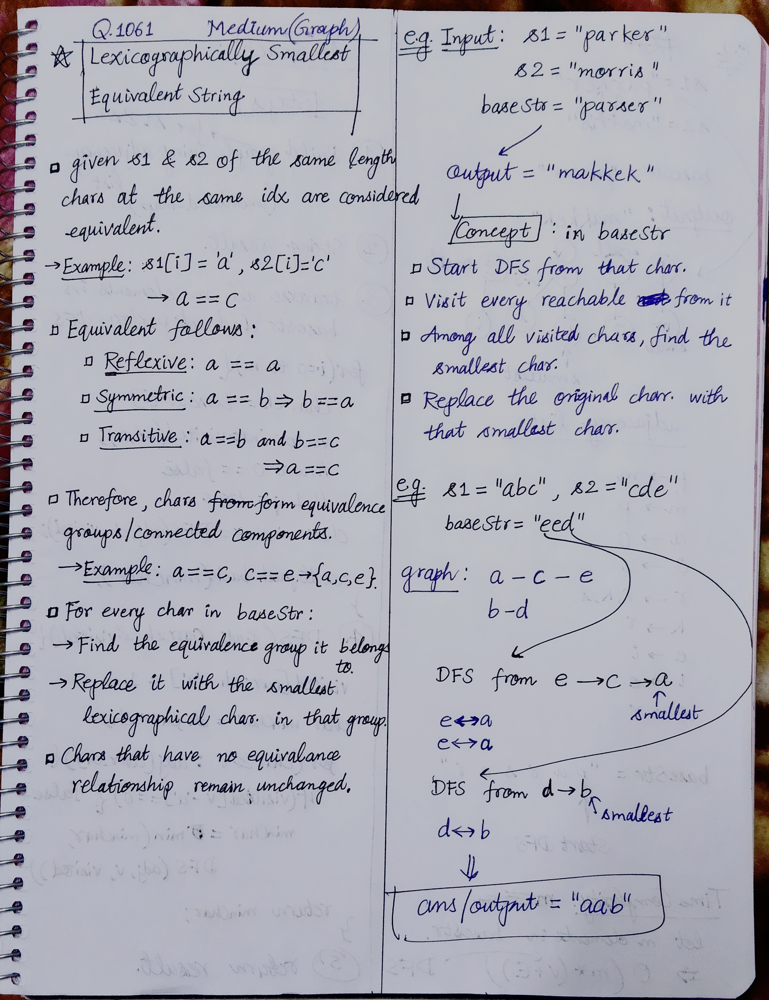
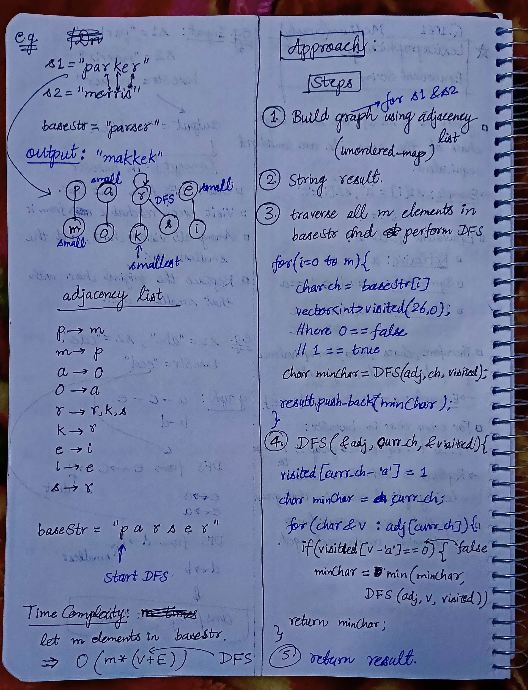

<h2><a href="https://leetcode.com/problems/lexicographically-smallest-equivalent-string">1058. Lexicographically Smallest Equivalent String</a></h2><h3>Medium</h3><hr><p>You are given two strings of the same length <code>s1</code> and <code>s2</code> and a string <code>baseStr</code>.</p>

<p>We say <code>s1[i]</code> and <code>s2[i]</code> are equivalent characters.</p>

<ul>
	<li>For example, if <code>s1 = &quot;abc&quot;</code> and <code>s2 = &quot;cde&quot;</code>, then we have <code>&#39;a&#39; == &#39;c&#39;</code>, <code>&#39;b&#39; == &#39;d&#39;</code>, and <code>&#39;c&#39; == &#39;e&#39;</code>.</li>
</ul>

<p>Equivalent characters follow the usual rules of any equivalence relation:</p>

<ul>
	<li><strong>Reflexivity:</strong> <code>&#39;a&#39; == &#39;a&#39;</code>.</li>
	<li><strong>Symmetry:</strong> <code>&#39;a&#39; == &#39;b&#39;</code> implies <code>&#39;b&#39; == &#39;a&#39;</code>.</li>
	<li><strong>Transitivity:</strong> <code>&#39;a&#39; == &#39;b&#39;</code> and <code>&#39;b&#39; == &#39;c&#39;</code> implies <code>&#39;a&#39; == &#39;c&#39;</code>.</li>
</ul>

<p>For example, given the equivalency information from <code>s1 = &quot;abc&quot;</code> and <code>s2 = &quot;cde&quot;</code>, <code>&quot;acd&quot;</code> and <code>&quot;aab&quot;</code> are equivalent strings of <code>baseStr = &quot;eed&quot;</code>, and <code>&quot;aab&quot;</code> is the lexicographically smallest equivalent string of <code>baseStr</code>.</p>

<p>Return <em>the lexicographically smallest equivalent string of </em><code>baseStr</code><em> by using the equivalency information from </em><code>s1</code><em> and </em><code>s2</code>.</p>

<p>&nbsp;</p>
<p><strong class="example">Example 1:</strong></p>

<pre>
<strong>Input:</strong> s1 = &quot;parker&quot;, s2 = &quot;morris&quot;, baseStr = &quot;parser&quot;
<strong>Output:</strong> &quot;makkek&quot;
<strong>Explanation:</strong> Based on the equivalency information in s1 and s2, we can group their characters as [m,p], [a,o], [k,r,s], [e,i].
The characters in each group are equivalent and sorted in lexicographical order.
So the answer is &quot;makkek&quot;.
</pre>

<p><strong class="example">Example 2:</strong></p>

<pre>
<strong>Input:</strong> s1 = &quot;hello&quot;, s2 = &quot;world&quot;, baseStr = &quot;hold&quot;
<strong>Output:</strong> &quot;hdld&quot;
<strong>Explanation: </strong>Based on the equivalency information in s1 and s2, we can group their characters as [h,w], [d,e,o], [l,r].
So only the second letter &#39;o&#39; in baseStr is changed to &#39;d&#39;, the answer is &quot;hdld&quot;.
</pre>

<p><strong class="example">Example 3:</strong></p>

<pre>
<strong>Input:</strong> s1 = &quot;leetcode&quot;, s2 = &quot;programs&quot;, baseStr = &quot;sourcecode&quot;
<strong>Output:</strong> &quot;aauaaaaada&quot;
<strong>Explanation:</strong> We group the equivalent characters in s1 and s2 as [a,o,e,r,s,c], [l,p], [g,t] and [d,m], thus all letters in baseStr except &#39;u&#39; and &#39;d&#39; are transformed to &#39;a&#39;, the answer is &quot;aauaaaaada&quot;.
</pre>

<p>&nbsp;</p>
<p><strong>Constraints:</strong></p>

<ul>
	<li><code>1 &lt;= s1.length, s2.length, baseStr &lt;= 1000</code></li>
	<li><code>s1.length == s2.length</code></li>
	<li><code>s1</code>, <code>s2</code>, and <code>baseStr</code> consist of lowercase English letters.</li>
</ul>


<!-- AUTO-GENERATED-SOLUTION-START -->
---

## 🧠 Visual Solution & Intuition

### Part 1



### Part 2



---

## 💡 Approach

```text
Approach : DFS + Graph(connected components)
```

---

## ⏱️ Complexity Analysis

```text
Time Complexity = O(m * (V + E)) =>
Space Complexity = O(V + E) =>
```

---

## 💻 C++ Solution

[View Original C++ File](./1061-lexicographically-smallest-equivalent-string.cpp)

```cpp
class Solution {
public:
    //Approach : DFS + Graph(connected components)

    //Time Complexity = O(m * (V + E)) =>
    /*     m = length of baseStr.
    * For each character in baseStr, we run DFS.
    * One DFS visits:
    * V vertices → O(V)
    * E edges → O(E)
    * So one DFS = O(V + E).
    * We do it m times.
    */

    //Space Complexity = O(V + E) =>
    /* adj stores all vertices and edges → O(V + E).
    * visited array → O(V).
    * DFS recursion stack → O(V).
    * Dominated by adjacency list.
    */


    char dfsFindMin(unordered_map<char, vector<char>>& adj, char curr_ch, vector<int>& visited){
        //mark curr_ch true
        visited[curr_ch - 'a'] = 1;

        char minChar = curr_ch;//assume curr_ch is min

        //traverse all neighs of curr_ch
        for(char& v : adj[curr_ch]){
            if(visited[v - 'a'] == 0){
                minChar = min(minChar, dfsFindMin(adj, v, visited));
            }
        }

        return minChar;
    }
    string smallestEquivalentString(string s1, string s2, string baseStr) {
        int n = s1.length();
        int m = baseStr.length();


        //1.) Build graph using adjacency list
        unordered_map<char, vector<char>> adj;

        for(int i=0; i<n; i++){
            int u = s1[i];
            int v = s2[i];

            //make undirected graph connections : both directions
            adj[u].push_back(v); //u---->v
            adj[v].push_back(u); //v--->u
        }

        //2.) declare result var
        string result;

        //3.) traverse all m elements in baseStr and perform DFS
        for(int i=0; i<m; i++){
            char ch = baseStr[i];

            vector<int> visited(26, 0);//array for 26 alphabets
            //0 == false
            //1 == true

            char minChar = dfsFindMin(adj, ch, visited);

            result.push_back(minChar);
        }

        //5.) finally return output
        return result;
    }
};
```

<!-- AUTO-GENERATED-SOLUTION-END -->
