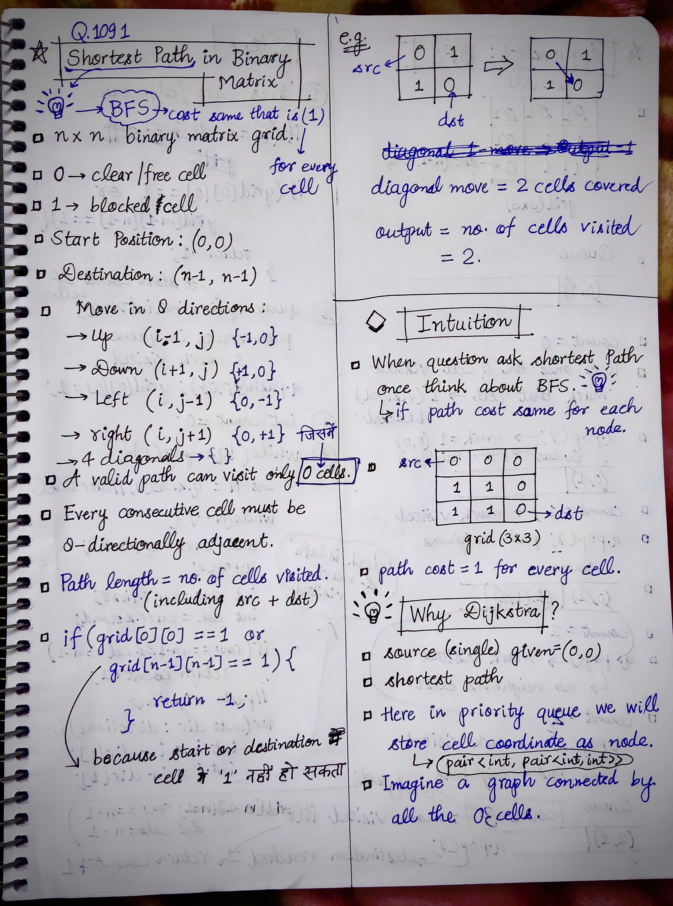
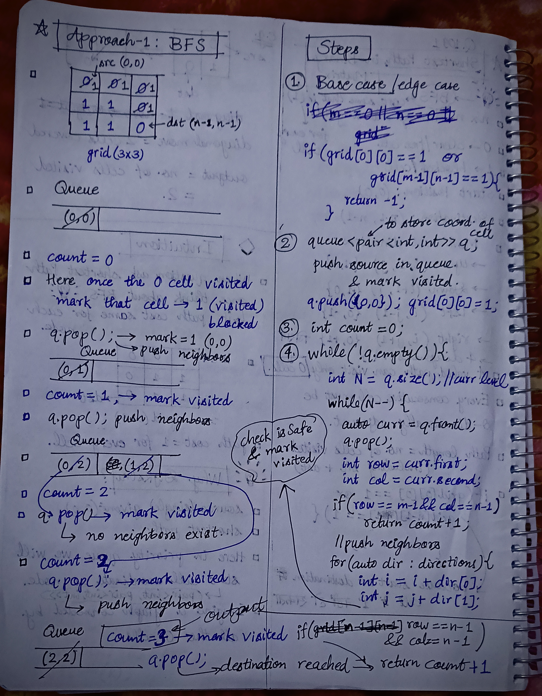
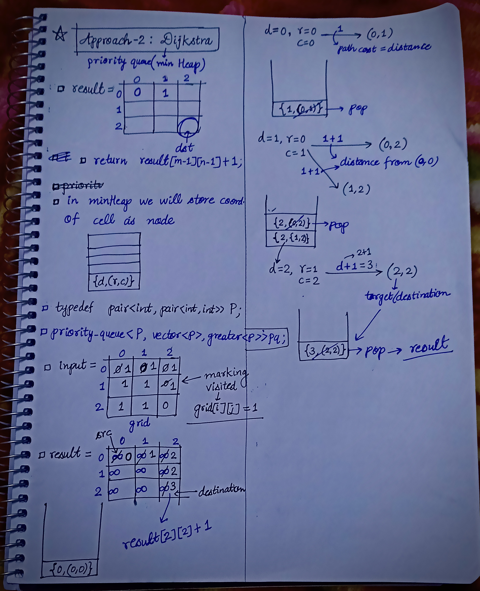

<h2><a href="https://leetcode.com/problems/shortest-path-in-binary-matrix">1171. Shortest Path in Binary Matrix</a></h2><h3>Medium</h3><hr><p>Given an <code>n x n</code> binary matrix <code>grid</code>, return <em>the length of the shortest <strong>clear path</strong> in the matrix</em>. If there is no clear path, return <code>-1</code>.</p>

<p>A <strong>clear path</strong> in a binary matrix is a path from the <strong>top-left</strong> cell (i.e., <code>(0, 0)</code>) to the <strong>bottom-right</strong> cell (i.e., <code>(n - 1, n - 1)</code>) such that:</p>

<ul>
	<li>All the visited cells of the path are <code>0</code>.</li>
	<li>All the adjacent cells of the path are <strong>8-directionally</strong> connected (i.e., they are different and they share an edge or a corner).</li>
</ul>

<p>The <strong>length of a clear path</strong> is the number of visited cells of this path.</p>

<p>&nbsp;</p>
<p><strong class="example">Example 1:</strong></p>

<pre>
<strong>Input:</strong> grid = [[0,1],[1,0]]
<strong>Output:</strong> 2
</pre>

<p><strong class="example">Example 2:</strong></p>

<pre>
<strong>Input:</strong> grid = [[0,0,0],[1,1,0],[1,1,0]]
<strong>Output:</strong> 4
</pre>

<p><strong class="example">Example 3:</strong></p>

<pre>
<strong>Input:</strong> grid = [[1,0,0],[1,1,0],[1,1,0]]
<strong>Output:</strong> -1
</pre>

<p>&nbsp;</p>
<p><strong>Constraints:</strong></p>

<ul>
	<li><code>n == grid.length</code></li>
	<li><code>n == grid[i].length</code></li>
	<li><code>1 &lt;= n &lt;= 100</code></li>
	<li><code>grid[i][j] is 0 or 1</code></li>
</ul>
<!---LeetCode Approaches Start-->
<hr>
<h3>💡 Solutions & Approaches</h3>

- [Approach 1 (C++)](1091-shortest-path-in-binary-matrix.cpp) — *BFS(Breadth First Search)*
- [Approach 2 (C++)](1091-shortest-path-in-binary-matrix-approach-2-dijkstras-algorithm.cpp) — *Dijkstra's Algorithm*

<!---LeetCode Approaches End-->


<!-- AUTO-GENERATED-SOLUTION-START -->
---

## 🧠 Visual Solution & Intuition

### Part 1



### Part 2



### Part 3



---

## 💻 C++ Solution

### 1091-shortest-path-in-binary-matrix.cpp

#### 💡 Approach

```text
Approach-1 : BFS(Breadth First Search)
```

#### ⏱️ Complexity Analysis

```text
Time Complexity = O(n * n)
Space Complexity = O(n * n)
```

[View Original C++ File](./1091-shortest-path-in-binary-matrix.cpp)

```cpp
class Solution {
public:
    //Approach-1 : BFS(Breadth First Search) 

    //Time Complexity = O(n * n)
    //Space Complexity = O(n * n)

    //directions vector : all 8 directions 
    vector<vector<int>> directions{ {-1, 0}, {1, 0}, {0, -1}, {0, 1}, {1, 1}, {1, -1}, {-1, 1}, {-1, -1} };
    int shortestPathBinaryMatrix(vector<vector<int>>& grid) {
        int m = grid.size(); //row size
        int n = grid[0].size(); //column size

        //1.) base-case
        if(grid[0][0] == 1 || grid[m-1][n-1] == 1){
            return -1;
        }

        //4.(b) check isSafe to visit
        auto isSafe = [&](int r, int c){
            return (r >= 0 && r < m && c >= 0 && c < n && grid[r][c] == 0);
        };

        //2.) queue for BFS
        queue<pair<int,int>> q; //pair because storing coordinate pairs

        q.push({0,0}); //push sourc coord.
        grid[0][0] = 1; //mark visited

        //3.)initialize count
        int count = 0;

        //4.) 
        while(!q.empty()){
            int N = q.size(); //curr level size

            while(N--){ //traverse in curr level
                auto curr = q.front();//pair
                q.pop();

                int row = curr.first;//because curr is pair so first, second
                int col = curr.second;

                //check if destination reached
                if(row == m-1 && col == n-1){
                    return count+1;
                }

                //push neighbors of curr in all 8 directions only if isSafe
                for(auto dir : directions){
                    int i = row + dir[0];  
                    int j = col + dir[1]; 

                    if(isSafe(i, j)){
                        q.push({i, j});
                        grid[i][j] = 1; //mark visited
                    }

                }

            }
            count++;//curr level finished update count
        }

        //if impossible to find path in above
        return -1;
    }
};
```

### 1091-shortest-path-in-binary-matrix-approach-2-dijkstras-algorithm.cpp

#### 💡 Approach

```text
Approach-2 : Dijkstra's Algorithm
```

#### ⏱️ Complexity Analysis

```text
Time Complexity = O(n * n * logn)
Space Complexity = O(n * n)
```

[View Original C++ File](./1091-shortest-path-in-binary-matrix-approach-2-dijkstras-algorithm.cpp)

```cpp
class Solution {
public:
    //Approach-2 : Dijkstra's Algorithm 

    //Time Complexity = O(n * n * logn)
    //Space Complexity = O(n * n)
    
    typedef pair<int, pair<int, int>> P;
    //directions vector : all 8 directions 
    vector<vector<int>> directions{ {-1, 0}, {1, 0}, {0, -1}, {0, 1}, {1, 1}, {1, -1}, {-1, 1}, {-1, -1} };
    int shortestPathBinaryMatrix(vector<vector<int>>& grid) {
        int m = grid.size(); //row size
        int n = grid[0].size(); //column size

        //1.) base-case
        if(grid[0][0] == 1 || grid[m-1][n-1] == 1){
            return -1;
        }

        //4.(b) check isSafe to visit
        auto isSafe = [&](int r, int c){
            return (r >= 0 && r < m && c >= 0 && c < n && grid[r][c] == 0);
        };

        //2.) priority_queue for Dijkstra
        priority_queue<P, vector<P>, greater<P> > pq; //pair because storing coordinate pairs

        pq.push({0, {0,0}}); //push source coord.
        
        vector<vector<int>> result(m, vector<int>(n, INT_MAX) );
        result[0][0] = 0; //src to src distance = 0

        //4.) 
        while(!pq.empty()){
            int d = pq.top().first;
            pair<int, int> coord = pq.top().second;
            int r = coord.first;
            int c = coord.second;
            pq.pop();

            //traverse in neighbors of curr coord(r, c)
            for(auto dir : directions){
                int i = r + dir[0];
                int j = c + dir[1];
 
                int dist = 1; //path cost of every cell is same = 1

                //if isSafe to visit , do edge relaxation 
                if(isSafe(i, j) && d + dist < result[i][j]){
                    
                    pq.push({d+dist, {i, j}});
                    result[i][j] = d + dist;
                }
            }

                
        }

        //if impossible to find path
        if(result[m-1][n-1] == INT_MAX){
            return -1;
        }
        else{
            return result[m-1][n-1] + 1;
        }
    }
};
```

<!-- AUTO-GENERATED-SOLUTION-END -->
