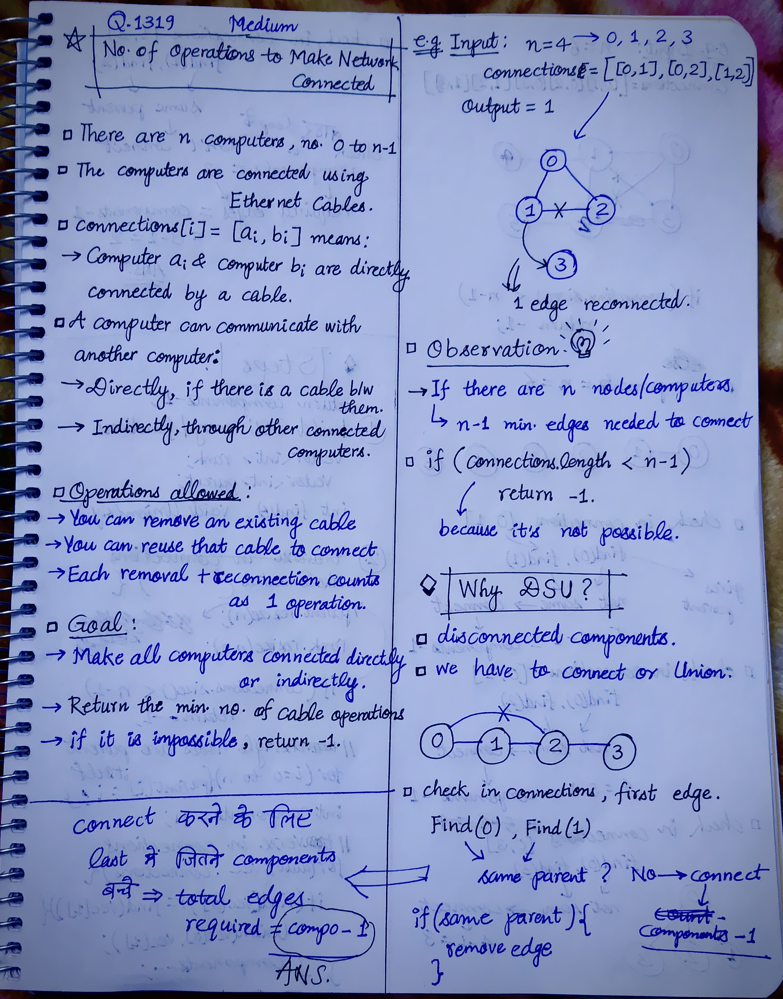
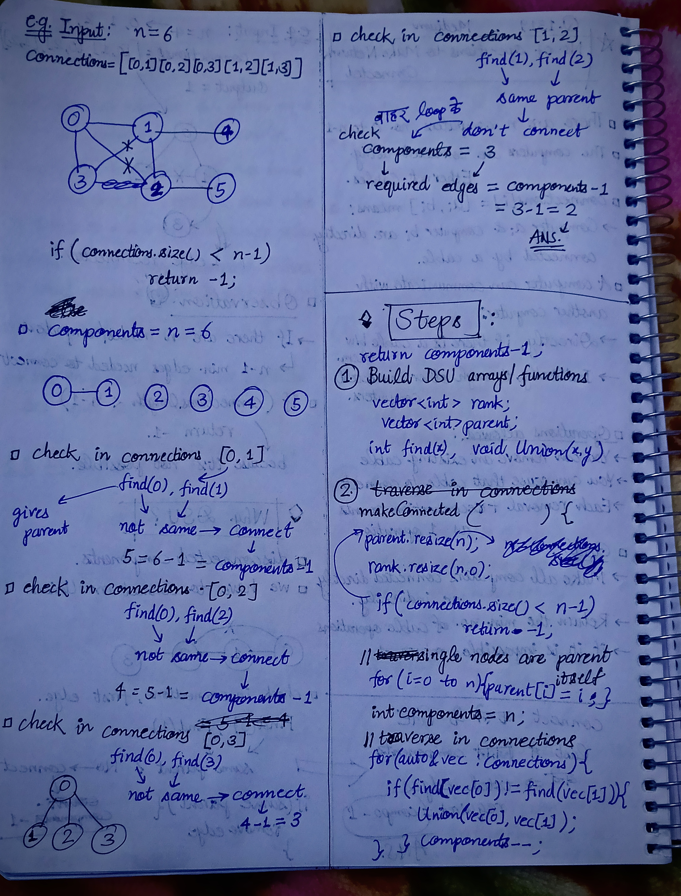

<h2><a href="https://leetcode.com/problems/number-of-operations-to-make-network-connected/">1442. Number of Operations to Make Network Connected</a></h2><h3>Medium</h3><hr><p>There are <code>n</code> computers numbered from <code>0</code> to <code>n - 1</code> connected by ethernet cables <code>connections</code> forming a network where <code>connections[i] = [a<sub>i</sub>, b<sub>i</sub>]</code> represents a connection between computers <code>a<sub>i</sub></code> and <code>b<sub>i</sub></code>. Any computer can reach any other computer directly or indirectly through the network.</p>

<p>You are given an initial computer network <code>connections</code>. You can extract certain cables between two directly connected computers, and place them between any pair of disconnected computers to make them directly connected.</p>

<p>Return <em>the minimum number of times you need to do this in order to make all the computers connected</em>. If it is not possible, return <code>-1</code>.</p>

<p>&nbsp;</p>
<p><strong class="example">Example 1:</strong></p>

<pre>
<strong>Input:</strong> n = 4, connections = [[0,1],[0,2],[1,2]]
<strong>Output:</strong> 1
<strong>Explanation:</strong> Remove cable between computer 1 and 2 and place between computers 1 and 3.
</pre>

<p><strong class="example">Example 2:</strong></p>

<pre>
<strong>Input:</strong> n = 6, connections = [[0,1],[0,2],[0,3],[1,2],[1,3]]
<strong>Output:</strong> 2
</pre>

<p><strong class="example">Example 3:</strong></p>

<pre>
<strong>Input:</strong> n = 6, connections = [[0,1],[0,2],[0,3],[1,2]]
<strong>Output:</strong> -1
<strong>Explanation:</strong> There are not enough cables.
</pre>

<p>&nbsp;</p>
<p><strong>Constraints:</strong></p>

<ul>
	<li><code>1 &lt;= n &lt;= 10<sup>5</sup></code></li>
	<li><code>1 &lt;= connections.length &lt;= min(n * (n - 1) / 2, 10<sup>5</sup>)</code></li>
	<li><code>connections[i].length == 2</code></li>
	<li><code>0 &lt;= a<sub>i</sub>, b<sub>i</sub> &lt; n</code></li>
	<li><code>a<sub>i</sub> != b<sub>i</sub></code></li>
	<li>There are no repeated connections.</li>
	<li>No two computers are connected by more than one cable.</li>
</ul>


<!-- AUTO-GENERATED-SOLUTION-START -->
---

## 🧠 Visual Solution & Intuition

### Part 1



### Part 2



---

## 💡 Approach

```text
Approach : Disjoint Set Union (DSU) / Union-Find — Connected Components
```

---

## ⏱️ Complexity Analysis

```text
Time Complexity = O(n + E × α(n)) => O(n + E)
Space Complexity = O(n) =>
```

---

## 💻 C++ Solution

[View Original C++ File](./1319-number-of-operations-to-make-network-connected.cpp)

```cpp
class Solution {
public:
    //Approach : Disjoint Set Union (DSU) / Union-Find — Connected Components

    //Time Complexity = O(n + E × α(n)) => O(n + E)
    /* Initializing parent and rank: O(n)
    * Processing all connections: O(E × α(n))
    *Since α(n) (Inverse Ackermann function) grows extremely slowly, this is practically:
    ≈ O(n + E)
    */

    //Space Complexity = O(n) =>
    /* parent array → O(n)
    * rank array → O(n)
    */


    //Step-1 : Build DSU arrays/ functions
    vector<int> parent;
    vector<int> rank;

    int find(int x){
        
        if(x == parent[x])
            return x;
        
        return parent[x] = find(parent[x]);
    }

    void Union(int x, int y){

        int x_parent = find(x);
        int y_parent = find(y);

        if(x_parent == y_parent)
            return;
        
        //three-Cases
        if(rank[x_parent] > rank[y_parent]){
            parent[y_parent] = x_parent;
        }

        else if(rank[x_parent] < rank[y_parent]){
            parent[x_parent] = y_parent;
        }

        else{
            parent[x_parent] = y_parent;
            rank[y_parent] += 1;
        }
    }

    int makeConnected(int n, vector<vector<int>>& connections) {
        //edge-case
        if(connections.size() < n-1)
            return -1;

        parent.resize(n);
        rank.resize(n, 0); //initially rank of all is zero

        //single nodes are parent itself
        for(int i=0; i<n; i++){
            parent[i] = i;
        }

        //traverse in connections and check parent
        int components = n;

        for(auto& vec : connections){
            
            if(find(vec[0]) != find(vec[1])){ //means parents are diff
                Union(vec[0], vec[1]);

                components--;
            }
        }

        //finally return total no. of operations/edges removal required
        return components-1;
    }
};
```

<!-- AUTO-GENERATED-SOLUTION-END -->
