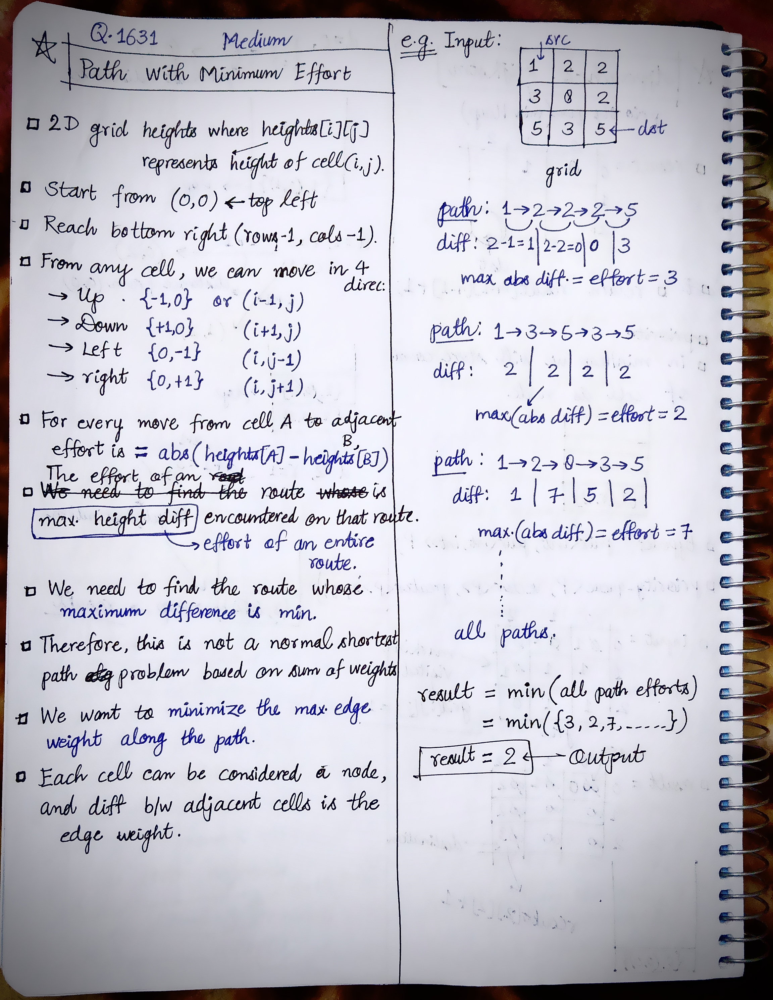
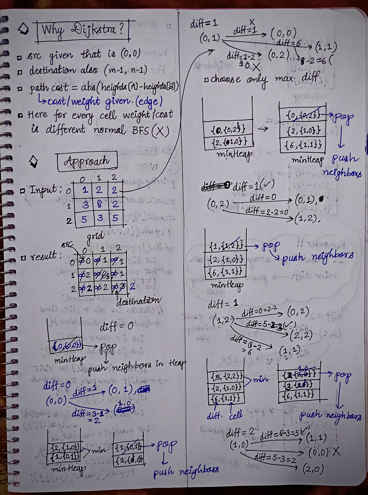
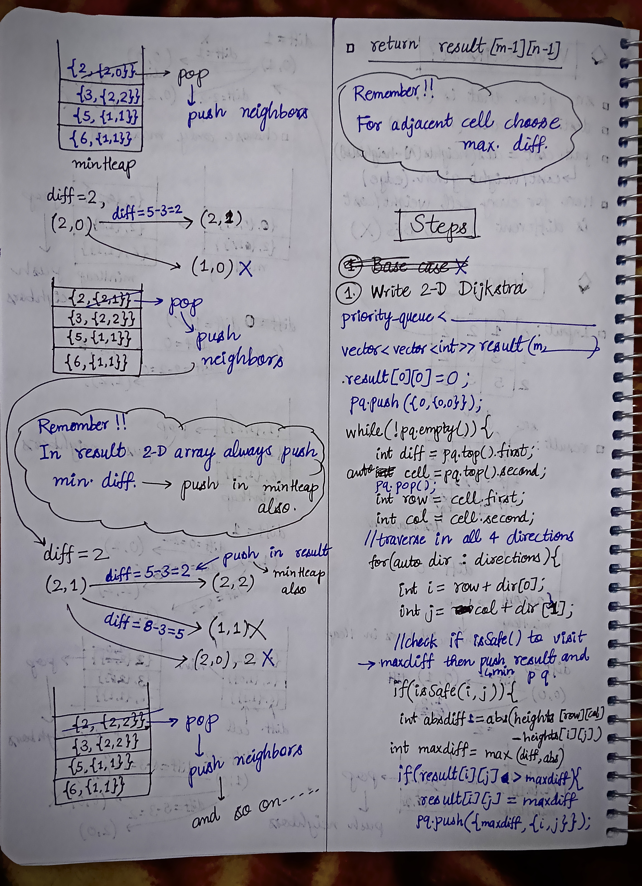

<h2><a href="https://leetcode.com/problems/path-with-minimum-effort">1753. Path With Minimum Effort</a></h2><h3>Medium</h3><hr><p>You are a hiker preparing for an upcoming hike. You are given <code>heights</code>, a 2D array of size <code>rows x columns</code>, where <code>heights[row][col]</code> represents the height of cell <code>(row, col)</code>. You are situated in the top-left cell, <code>(0, 0)</code>, and you hope to travel to the bottom-right cell, <code>(rows-1, columns-1)</code> (i.e.,&nbsp;<strong>0-indexed</strong>). You can move <strong>up</strong>, <strong>down</strong>, <strong>left</strong>, or <strong>right</strong>, and you wish to find a route that requires the minimum <strong>effort</strong>.</p>

<p>A route&#39;s <strong>effort</strong> is the <strong>maximum absolute difference</strong><strong> </strong>in heights between two consecutive cells of the route.</p>

<p>Return <em>the minimum <strong>effort</strong> required to travel from the top-left cell to the bottom-right cell.</em></p>

<p>&nbsp;</p>
<p><strong class="example">Example 1:</strong></p>

<p></p>

<pre>
<strong>Input:</strong> heights = [[1,2,2],[3,8,2],[5,3,5]]
<strong>Output:</strong> 2
<strong>Explanation:</strong> The route of [1,3,5,3,5] has a maximum absolute difference of 2 in consecutive cells.
This is better than the route of [1,2,2,2,5], where the maximum absolute difference is 3.
</pre>

<p><strong class="example">Example 2:</strong></p>

<p></p>

<pre>
<strong>Input:</strong> heights = [[1,2,3],[3,8,4],[5,3,5]]
<strong>Output:</strong> 1
<strong>Explanation:</strong> The route of [1,2,3,4,5] has a maximum absolute difference of 1 in consecutive cells, which is better than route [1,3,5,3,5].
</pre>

<p><strong class="example">Example 3:</strong></p>

<pre>
<strong>Input:</strong> heights = [[1,2,1,1,1],[1,2,1,2,1],[1,2,1,2,1],[1,2,1,2,1],[1,1,1,2,1]]
<strong>Output:</strong> 0
<strong>Explanation:</strong> This route does not require any effort.
</pre>

<p>&nbsp;</p>
<p><strong>Constraints:</strong></p>

<ul>
	<li><code>rows == heights.length</code></li>
	<li><code>columns == heights[i].length</code></li>
	<li><code>1 &lt;= rows, columns &lt;= 100</code></li>
	<li><code>1 &lt;= heights[i][j] &lt;= 10<sup>6</sup></code></li>
</ul>
<!---LeetCode Approaches Start-->
<hr>
<h3>💡 Solutions & Approaches</h3>

- [Approach 1 (C++)](1631-path-with-minimum-effort.cpp) — *Dijkstra's Algorithm*
- [Approach 2 (C++)](1631-path-with-minimum-effort-approach-2.cpp)
- [Approach 3 (C++)](1631-path-with-minimum-effort-approach-3-dijkstras-algorithm.cpp) — *Dijkstra's Algorithm*

<!---LeetCode Approaches End-->


<!-- AUTO-GENERATED-SOLUTION-START -->
---

## 🧠 Visual Solution & Intuition

### Part 1



### Part 2



### Part 3



---

## 💻 C++ Solution

### 1631-path-with-minimum-effort.cpp

#### 💡 Approach

```text
Approach-1 : Dijkstra's Algorithm
```

#### ⏱️ Complexity Analysis

```text
Time Complexity = O(m * n * logmn) =>
Space Complexity = O(m * n) =>
```

[View Original C++ File](./1631-path-with-minimum-effort.cpp)

```cpp
class Solution {
public:
    //Approach-1 : Dijkstra's Algorithm
    
    //Time Complexity = O(m * n * logmn) =>
    /* There are m * n cells in the grid.
    * Each cell can be pushed into the min-heap multiple times in the worst case.
    * Each heap operation (push/pop) takes O(log(m * n)).
    */

    //Space Complexity = O(m * n) =>
    /* result[][] stores the minimum effort for every cell → O(m * n)
    * Priority queue can contain up to O(m * n) cells.
    * directions[] takes constant space.
    */


    typedef pair<int, pair<int,int>> P;
    vector<vector<int>> directions{ {-1, 0}, {1, 0}, {0, -1}, {0, 1} };//up, down, left, right
    int minimumEffortPath(vector<vector<int>>& heights) {
        
        int m = heights.size();//row size
        int n = heights[0].size(); //column size

        priority_queue<P, vector<P>, greater<P> > pq; //minHeap

        vector<vector<int>> result(m, vector<int>(n, INT_MAX));

        auto isSafe = [&](int r, int c){
            return (r >= 0 && r < m && c >= 0 && c < n);
        };

        //push src in result & minHeap
        result[0][0] = 0;
        pq.push({0, {0,0}});

        while(!pq.empty()){

            int diff = pq.top().first;
            auto cell = pq.top().second;
            pq.pop();

            int r = cell.first;
            int c = cell.second;

            //optimization
            if(r == m-1 && c == n-1){
                return diff;
            }

            //traverse in all 4 directions of curr cell
            for(auto dir : directions){
                int i = r + dir[0]; //row wise => up, down
                int j = c + dir[1]; //column wise => left, right
                
                //check if isSafe() to visit (i, j)
                if(isSafe(i, j)){
                    int absDiff = abs(heights[r][c] - heights[i][j]);
                    int maxDiff = max(diff, absDiff);

                    //now in result push min and also in minHeap
                    if(result[i][j] > maxDiff){ //if result is greater than curr maxDiff means this is min
                        result[i][j] = maxDiff;

                        pq.push({maxDiff, {i, j}});
                    }
                } 

            }

        }

        //finally return the maxDiff value of (m-1, n-1) cell in result
        return result[m-1][n-1];
    }
};
```

### 1631-path-with-minimum-effort-approach-2.cpp

[View Original C++ File](./1631-path-with-minimum-effort-approach-2.cpp)

```cpp
class Solution {
public:

    typedef pair<int, pair<int,int>> P;
    vector<vector<int>> directions{ {-1, 0}, {1, 0}, {0, -1}, {0, 1} };//up, down, left, right
    int minimumEffortPath(vector<vector<int>>& heights) {
        
        int m = heights.size();//row size
        int n = heights[0].size(); //column size

        priority_queue<P, vector<P>, greater<P> > pq; //minHeap

        vector<vector<int>> result(m, vector<int>(n, INT_MAX));

        auto isSafe = [&](int r, int c){
            return (r >= 0 && r < m && c >= 0 && c < n);
        };

        //push src in result & minHeap
        result[0][0] = 0;
        pq.push({0, {0,0}});

        while(!pq.empty()){

            int diff = pq.top().first;
            auto cell = pq.top().second;
            pq.pop();

            int r = cell.first;
            int c = cell.second;

            //optimization
            if(r == m-1 && c == n-1){
                return diff;
            }

            //traverse in all 4 directions of curr cell
            for(auto dir : directions){
                int i = r + dir[0]; //row wise => up, down
                int j = c + dir[1]; //column wise => left, right
                
                //check if isSafe() to visit (i, j)
                if(isSafe(i, j)){
                    int absDiff = abs(heights[r][c] - heights[i][j]);
                    int maxDiff = max(diff, absDiff);

                    //now in result push min and also in minHeap
                    if(result[i][j] > maxDiff){ //if result is greater than curr maxDiff means this is min
                        result[i][j] = maxDiff;

                        pq.push({maxDiff, {i, j}});
                    }
                } 

            }

        }

        //finally return the maxDiff value of (m-1, n-1) cell in result
        return result[m-1][n-1];
    }
};
```

### 1631-path-with-minimum-effort-approach-3-dijkstras-algorithm.cpp

#### 💡 Approach

```text
Approach-1 : Dijkstra's Algorithm
```

#### ⏱️ Complexity Analysis

```text
Time Complexity = O(m * n * logmn)
Space Complexity = O(m * n)
```

[View Original C++ File](./1631-path-with-minimum-effort-approach-3-dijkstras-algorithm.cpp)

```cpp
class Solution {
public:
    //Approach-1 : Dijkstra's Algorithm
    
    //Time Complexity = O(m * n * logmn)

    //Space Complexity = O(m * n)

    typedef pair<int, pair<int,int>> P;
    vector<vector<int>> directions{ {-1, 0}, {1, 0}, {0, -1}, {0, 1} };//up, down, left, right
    int minimumEffortPath(vector<vector<int>>& heights) {
        
        int m = heights.size();//row size
        int n = heights[0].size(); //column size

        priority_queue<P, vector<P>, greater<P> > pq; //minHeap

        vector<vector<int>> result(m, vector<int>(n, INT_MAX));

        auto isSafe = [&](int r, int c){
            return (r >= 0 && r < m && c >= 0 && c < n);
        };

        //push src in result & minHeap
        result[0][0] = 0;
        pq.push({0, {0,0}});

        while(!pq.empty()){

            int diff = pq.top().first;
            auto cell = pq.top().second;
            pq.pop();

            int r = cell.first;
            int c = cell.second;

            //optimization
            if(r == m-1 && c == n-1){
                return diff;
            }

            //traverse in all 4 directions of curr cell
            for(auto dir : directions){
                int i = r + dir[0]; //row wise => up, down
                int j = c + dir[1]; //column wise => left, right
                
                //check if isSafe() to visit (i, j)
                if(isSafe(i, j)){
                    int absDiff = abs(heights[r][c] - heights[i][j]);
                    int maxDiff = max(diff, absDiff);

                    //now in result push min and also in minHeap
                    if(result[i][j] > maxDiff){ //if result is greater than curr maxDiff means this is min
                        result[i][j] = maxDiff;

                        pq.push({maxDiff, {i, j}});
                    }
                } 

            }

        }

        //finally return the maxDiff value of (m-1, n-1) cell in result
        return result[m-1][n-1];
    }
};
```

<!-- AUTO-GENERATED-SOLUTION-END -->
