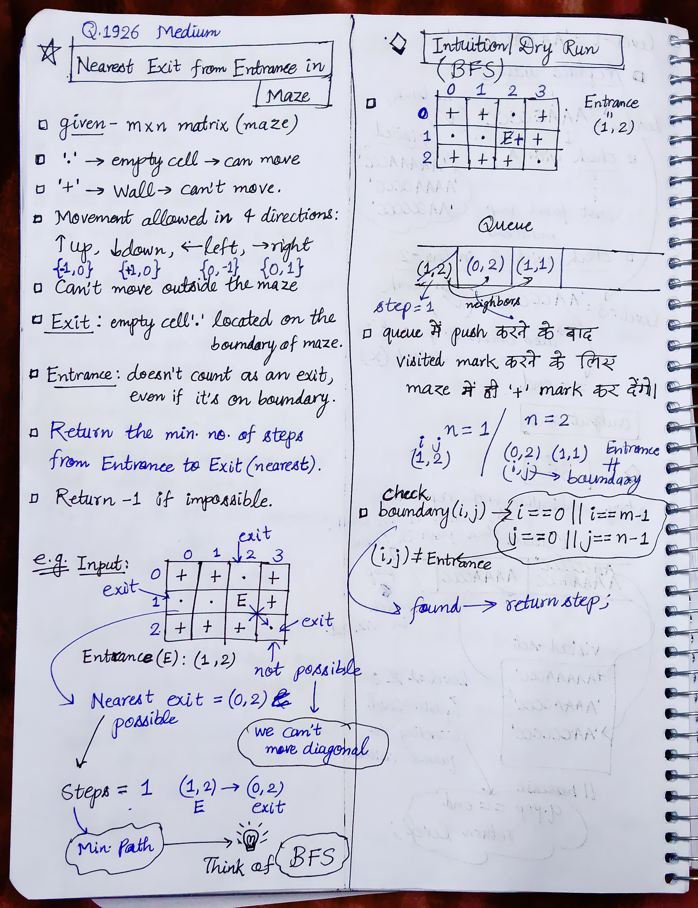

<h2><a href="https://leetcode.com/problems/nearest-exit-from-entrance-in-maze">2038. Nearest Exit from Entrance in Maze</a></h2><h3>Medium</h3><hr><p>You are given an <code>m x n</code> matrix <code>maze</code> (<strong>0-indexed</strong>) with empty cells (represented as <code>&#39;.&#39;</code>) and walls (represented as <code>&#39;+&#39;</code>). You are also given the <code>entrance</code> of the maze, where <code>entrance = [entrance<sub>row</sub>, entrance<sub>col</sub>]</code> denotes the row and column of the cell you are initially standing at.</p>

<p>In one step, you can move one cell <strong>up</strong>, <strong>down</strong>, <strong>left</strong>, or <strong>right</strong>. You cannot step into a cell with a wall, and you cannot step outside the maze. Your goal is to find the <strong>nearest exit</strong> from the <code>entrance</code>. An <strong>exit</strong> is defined as an <strong>empty cell</strong> that is at the <strong>border</strong> of the <code>maze</code>. The <code>entrance</code> <strong>does not count</strong> as an exit.</p>

<p>Return <em>the <strong>number of steps</strong> in the shortest path from the </em><code>entrance</code><em> to the nearest exit, or </em><code>-1</code><em> if no such path exists</em>.</p>

<p>&nbsp;</p>
<p><strong class="example">Example 1:</strong></p>

<pre>
<strong>Input:</strong> maze = [[&quot;+&quot;,&quot;+&quot;,&quot;.&quot;,&quot;+&quot;],[&quot;.&quot;,&quot;.&quot;,&quot;.&quot;,&quot;+&quot;],[&quot;+&quot;,&quot;+&quot;,&quot;+&quot;,&quot;.&quot;]], entrance = [1,2]
<strong>Output:</strong> 1
<strong>Explanation:</strong> There are 3 exits in this maze at [1,0], [0,2], and [2,3].
Initially, you are at the entrance cell [1,2].
- You can reach [1,0] by moving 2 steps left.
- You can reach [0,2] by moving 1 step up.
It is impossible to reach [2,3] from the entrance.
Thus, the nearest exit is [0,2], which is 1 step away.
</pre>

<p><strong class="example">Example 2:</strong></p>

<pre>
<strong>Input:</strong> maze = [[&quot;+&quot;,&quot;+&quot;,&quot;+&quot;],[&quot;.&quot;,&quot;.&quot;,&quot;.&quot;],[&quot;+&quot;,&quot;+&quot;,&quot;+&quot;]], entrance = [1,0]
<strong>Output:</strong> 2
<strong>Explanation:</strong> There is 1 exit in this maze at [1,2].
[1,0] does not count as an exit since it is the entrance cell.
Initially, you are at the entrance cell [1,0].
- You can reach [1,2] by moving 2 steps right.
Thus, the nearest exit is [1,2], which is 2 steps away.
</pre>

<p><strong class="example">Example 3:</strong></p>

<pre>
<strong>Input:</strong> maze = [[&quot;.&quot;,&quot;+&quot;]], entrance = [0,0]
<strong>Output:</strong> -1
<strong>Explanation:</strong> There are no exits in this maze.
</pre>

<p>&nbsp;</p>
<p><strong>Constraints:</strong></p>

<ul>
	<li><code>maze.length == m</code></li>
	<li><code>maze[i].length == n</code></li>
	<li><code>1 &lt;= m, n &lt;= 100</code></li>
	<li><code>maze[i][j]</code> is either <code>&#39;.&#39;</code> or <code>&#39;+&#39;</code>.</li>
	<li><code>entrance.length == 2</code></li>
	<li><code>0 &lt;= entrance<sub>row</sub> &lt; m</code></li>
	<li><code>0 &lt;= entrance<sub>col</sub> &lt; n</code></li>
	<li><code>entrance</code> will always be an empty cell.</li>
</ul>


<!-- AUTO-GENERATED-SOLUTION-START -->
---

## 🧠 Visual Solution & Intuition



---

## ⏱️ Complexity Analysis

```text
Time Complexity = O(m * n) =>
Space Complexity = O(m * n) =>
```

---

## 💻 C++ Solution

[View Original C++ File](./1926-nearest-exit-from-entrance-in-maze.cpp)

```cpp
class Solution {
public:
    //Method : BFS(Breadth First Search) 

    //Time Complexity = O(m * n) =>
    /* Each cell in the maze is visited at most once.
    * For every cell, we check 4 directions.
    * Therefore: O(4mn) = O(mn).
    */


    //Space Complexity = O(m * n) =>
    /* Queue can contain up to O(mn) cells in the worst case.
    * No separate visited matrix is used because you mark visited cells directly in maze.
    * Therefore auxiliary space: O(mn).
    */


    vector<vector<int>>directions{ {-1,0}, {1,0}, {0,-1}, {0,1} }; //up, down, left, right
    int nearestExit(vector<vector<char>>& maze, vector<int>& entrance) {
        int m = maze.size() ;
        int n = maze[0].size() ;

        queue<pair<int,int>> q; // q(i,j)

        //start with 
        q.push({entrance[0], entrance[1]}) ; //(row, column) => index: 0 means row, index: 1 means column

        //mark visited with '+'
        maze[entrance[0]][entrance[1]]= '+';


        int steps = 0;

        //Classic BFS 
        while(!q.empty()){
            int N = q.size() ; //size of each level

            while(N--){
                pair<int, int>temp = q.front();
                q.pop();

                int i = temp.first;
                int j = temp.second;

                //if reached boundary then return steps
                if( (temp != make_pair(entrance[0], entrance[1])) &&
                    (i == 0 || i == m-1 || j == 0 || j == n-1) ){
                        return steps ;
                }


                //explore the neighbors
                for(auto &dir : directions){
                    int new_i = i + dir[0] ; //dir[0] == row
                    int new_j = j + dir[1] ; //dir[1] == column

                    //check if there is wall or out of bound index => if not then push in queue & mark visited
                    if(new_i >= 0 && new_i < m && new_j >= 0 && new_j < n &&
                       maze[new_i][new_j] != '+'){
                          q.push(make_pair(new_i, new_j));
                          maze[new_i][new_j] = '+'; //visited marked
                    }
                }
                
            }
            steps++ ; //update steps after each level
        }

        //if in above checks no boundary condition reached
        return -1; //impossible
    }
};
```

<!-- AUTO-GENERATED-SOLUTION-END -->
