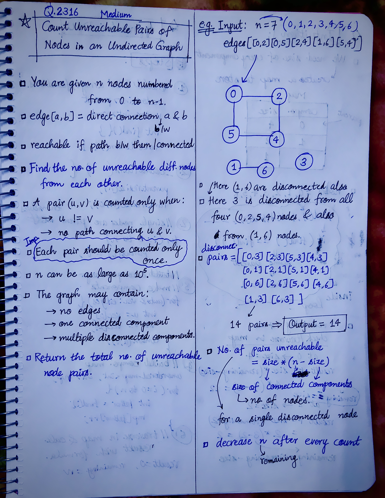
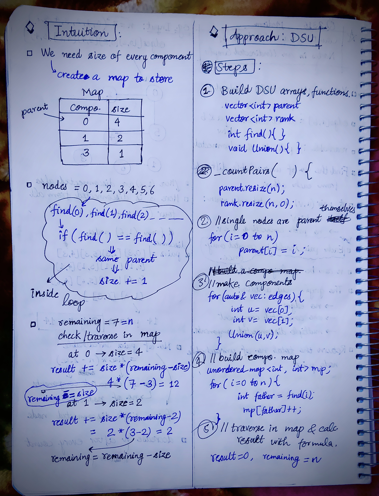

<h2><a href="https://leetcode.com/problems/count-unreachable-pairs-of-nodes-in-an-undirected-graph">2403. Count Unreachable Pairs of Nodes in an Undirected Graph</a></h2><h3>Medium</h3><hr><p>You are given an integer <code>n</code>. There is an <strong>undirected</strong> graph with <code>n</code> nodes, numbered from <code>0</code> to <code>n - 1</code>. You are given a 2D integer array <code>edges</code> where <code>edges[i] = [a<sub>i</sub>, b<sub>i</sub>]</code> denotes that there exists an <strong>undirected</strong> edge connecting nodes <code>a<sub>i</sub></code> and <code>b<sub>i</sub></code>.</p>

<p>Return <em>the <strong>number of pairs</strong> of different nodes that are <strong>unreachable</strong> from each other</em>.</p>

<p>&nbsp;</p>
<p><strong class="example">Example 1:</strong></p>

<pre>
<strong>Input:</strong> n = 3, edges = [[0,1],[0,2],[1,2]]
<strong>Output:</strong> 0
<strong>Explanation:</strong> There are no pairs of nodes that are unreachable from each other. Therefore, we return 0.
</pre>

<p><strong class="example">Example 2:</strong></p>

<pre>
<strong>Input:</strong> n = 7, edges = [[0,2],[0,5],[2,4],[1,6],[5,4]]
<strong>Output:</strong> 14
<strong>Explanation:</strong> There are 14 pairs of nodes that are unreachable from each other:
[[0,1],[0,3],[0,6],[1,2],[1,3],[1,4],[1,5],[2,3],[2,6],[3,4],[3,5],[3,6],[4,6],[5,6]].
Therefore, we return 14.
</pre>

<p>&nbsp;</p>
<p><strong>Constraints:</strong></p>

<ul>
	<li><code>1 &lt;= n &lt;= 10<sup>5</sup></code></li>
	<li><code>0 &lt;= edges.length &lt;= 2 * 10<sup>5</sup></code></li>
	<li><code>edges[i].length == 2</code></li>
	<li><code>0 &lt;= a<sub>i</sub>, b<sub>i</sub> &lt; n</code></li>
	<li><code>a<sub>i</sub> != b<sub>i</sub></code></li>
	<li>There are no repeated edges.</li>
</ul>


<!-- AUTO-GENERATED-SOLUTION-START -->
---

## 🧠 Visual Solution & Intuition

### Part 1



### Part 2



---

## 💡 Approach

```text
Approach : DSU (Disjoint Set Union) + Connected Component Size Counting
```

---

## ⏱️ Complexity Analysis

```text
Time Complexity = O((N + E) × α(N)) =>
Space Complexity = O(N) =>
```

---

## 💻 C++ Solution

[View Original C++ File](./2316-count-unreachable-pairs-of-nodes-in-an-undirected-graph.cpp)

```cpp
class Solution {
public:
    //Approach : DSU (Disjoint Set Union) + Connected Component Size Counting

    //Time Complexity = O((N + E) × α(N)) =>
    /* N = number of nodes
    * E = number of edges
    * DSU operations → approximately O(α(N))
    * Building component-size map → O(N)
    * Traversing components → O(N)
    * Overall → O((N + E) α(N)) ≈ O(N + E)
    */


    //Space Complexity = O(N) =>
    /* parent → O(N)
    * rank → O(N)
    * unordered_map → O(N)
    */

    //Step-1 : Build DSU arrays, functions
    vector<int> parent;
    vector<int> rank;

    int find(int x){ //finds parent

        if(parent[x] == x)
            return x;
        
        return parent[x] = find(parent[x]);
    }

    void Union(int x, int y){
        int x_parent = find(x);
        int y_parent = find(y);

        if(x_parent == y_parent) //same component
            return;//skip
        
        //three cases
        if(rank[x_parent] > rank[y_parent]){
            parent[y_parent] = x_parent;
        }

        else if(rank[x_parent] > rank[y_parent]){
            parent[x_parent] = y_parent;
        }

        else{
            parent[x_parent] = y_parent;
            rank[y_parent] += 1;
        }
        
    }
    long long countPairs(int n, vector<vector<int>>& edges) {
        parent.resize(n);

        rank.resize(n, 0); //initial rank of each is zero
        
        //Step-2 : A single node is its own parent
        for(int i=0; i<n; i++){
            parent[i] = i;
        }

        //Step-3 : make components : using connections in edges
        for(auto& vec : edges){
            int u = vec[0]; //edges[i] = [a, b] => u = index 0, v = index 1
            int v = vec[1];

            Union(u, v);
        }

        //Step-4 : build a components -> size map
        unordered_map<int, int> mp;

        for(int i=0; i<n; i++){
            int father = find(i);
            mp[father]++;
        } 

        //Step-5 : traverse in map & count size , calc. result using formula
        long long result = 0;
        long long remaining = n;

        for(auto& it : mp){

            long long size = it.second; //(father -> size) 
            
            result += size * (remaining - size);

            remaining = remaining - size; //update size after each iteration

        }

        //finally return no. of pairs output
        return result;

    }
};
```

<!-- AUTO-GENERATED-SOLUTION-END -->
