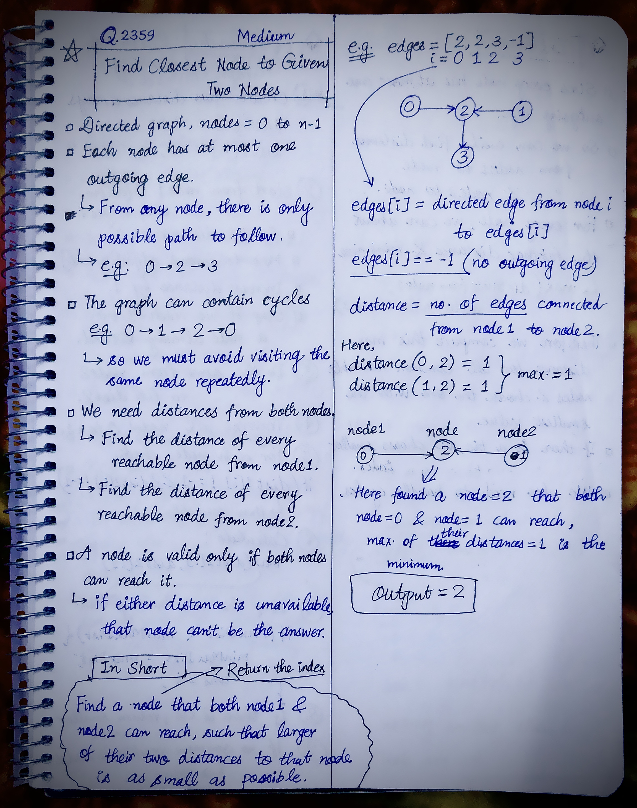
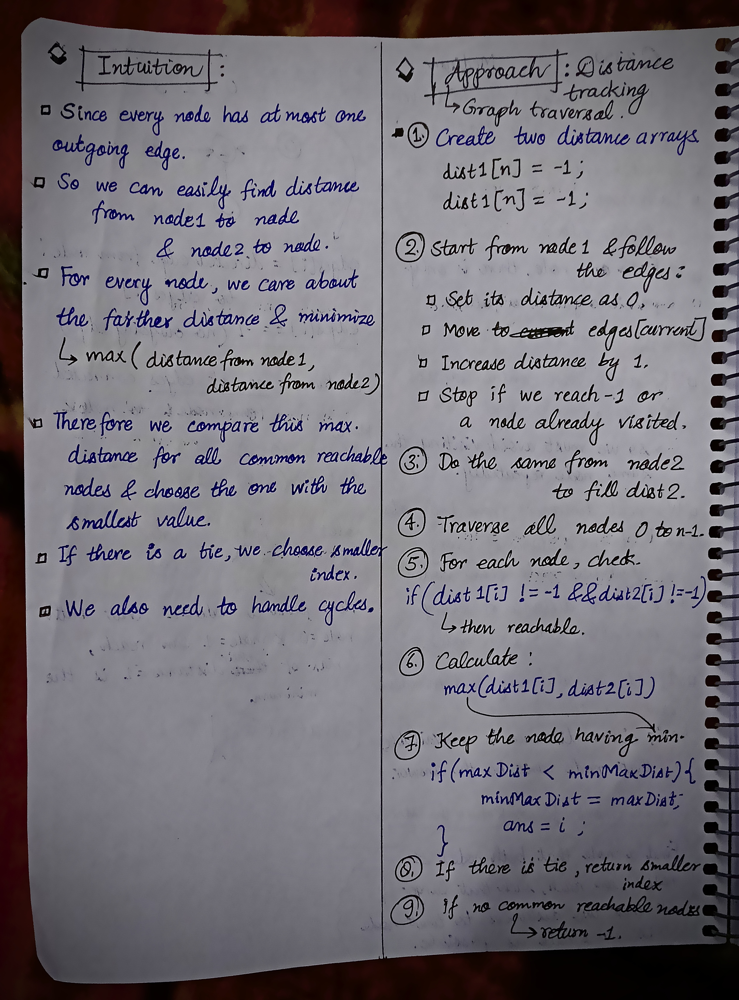

<h2><a href="https://leetcode.com/problems/find-closest-node-to-given-two-nodes">2438. Find Closest Node to Given Two Nodes</a></h2><h3>Medium</h3><hr><p>You are given a <strong>directed</strong> graph of <code>n</code> nodes numbered from <code>0</code> to <code>n - 1</code>, where each node has <strong>at most one</strong> outgoing edge.</p>

<p>The graph is represented with a given <strong>0-indexed</strong> array <code>edges</code> of size <code>n</code>, indicating that there is a directed edge from node <code>i</code> to node <code>edges[i]</code>. If there is no outgoing edge from <code>i</code>, then <code>edges[i] == -1</code>.</p>

<p>You are also given two integers <code>node1</code> and <code>node2</code>.</p>

<p>Return <em>the <strong>index</strong> of the node that can be reached from both </em><code>node1</code><em> and </em><code>node2</code><em>, such that the <strong>maximum</strong> between the distance from </em><code>node1</code><em> to that node, and from </em><code>node2</code><em> to that node is <strong>minimized</strong></em>. If there are multiple answers, return the node with the <strong>smallest</strong> index, and if no possible answer exists, return <code>-1</code>.</p>

<p>Note that <code>edges</code> may contain cycles.</p>

<p>&nbsp;</p>
<p><strong class="example">Example 1:</strong></p>

<pre>
<strong>Input:</strong> edges = [2,2,3,-1], node1 = 0, node2 = 1
<strong>Output:</strong> 2
<strong>Explanation:</strong> The distance from node 0 to node 2 is 1, and the distance from node 1 to node 2 is 1.
The maximum of those two distances is 1. It can be proven that we cannot get a node with a smaller maximum distance than 1, so we return node 2.
</pre>

<p><strong class="example">Example 2:</strong></p>

<pre>
<strong>Input:</strong> edges = [1,2,-1], node1 = 0, node2 = 2
<strong>Output:</strong> 2
<strong>Explanation:</strong> The distance from node 0 to node 2 is 2, and the distance from node 2 to itself is 0.
The maximum of those two distances is 2. It can be proven that we cannot get a node with a smaller maximum distance than 2, so we return node 2.
</pre>

<p>&nbsp;</p>
<p><strong>Constraints:</strong></p>

<ul>
	<li><code>n == edges.length</code></li>
	<li><code>2 &lt;= n &lt;= 10<sup>5</sup></code></li>
	<li><code>-1 &lt;= edges[i] &lt; n</code></li>
	<li><code>edges[i] != i</code></li>
	<li><code>0 &lt;= node1, node2 &lt; n</code></li>
</ul>


<!-- AUTO-GENERATED-SOLUTION-START -->
---

## 🧠 Visual Solution & Intuition

### Part 1



### Part 2



---

## 💡 Approach

```text
Approach : Distance Tracking/ Graph Traversal
```

---

## ⏱️ Complexity Analysis

```text
Time Complexity = O(n) =>
Space Complexity = O(n) =>
```

---

## 💻 C++ Solution

[View Original C++ File](./2359-find-closest-node-to-given-two-nodes.cpp)

```cpp
class Solution {
public:
    //Approach : Distance Tracking/ Graph Traversal

    //Time Complexity = O(n) =>
    /* There are 3 main traversals:
    1. Traverse from node1: O(n)
    2. Traverse from node2: O(n)
    3. Traverse all nodes to find the answer: O(n)   
    */

    //Space Complexity = O(n) =>
    /* We use two distance arrays:
    * Each contains n elements:
    * dist1 → O(n)
    * dist2 → O(n)
    */

    int closestMeetingNode(vector<int>& edges, int node1, int node2) {
        
        int n = edges.size();

        //1.) Distance arrays
        vector<int> dist1(n, -1);
        vector<int> dist2(n, -1);

        //2.)Find distances from node1
        int curr = node1;
        int distance = 0;
        
        while(curr != -1 && dist1[curr] == -1){
            dist1[curr] = distance;
            distance++;

            curr = edges[curr];//move to edges current
        }

        //3.)Find distances from node2
        curr = node2;
        distance = 0;
        
        while(curr != -1 && dist2[curr] == -1){
            dist2[curr] = distance;
            distance++;

            curr = edges[curr];//move to edges current
        }

        //4.)Find the best common node
        int ans = -1;
        int minMaxDist = INT_MAX;

        for(int i = 0; i < n; i++){
            //5.) Both nodes must be able to reach i
            if(dist1[i] != -1 && dist2[i] != -1){
                
                //6.) Take the larger of the two distances
                int maxDist = max(dist1[i], dist2[i]);

                //7.) Keep the node having min.
                if(maxDist < minMaxDist){
                    minMaxDist = maxDist;
                    ans = i;
                }
            }
        }

        //finally return the output
        return ans;

    }
};
```

<!-- AUTO-GENERATED-SOLUTION-END -->
