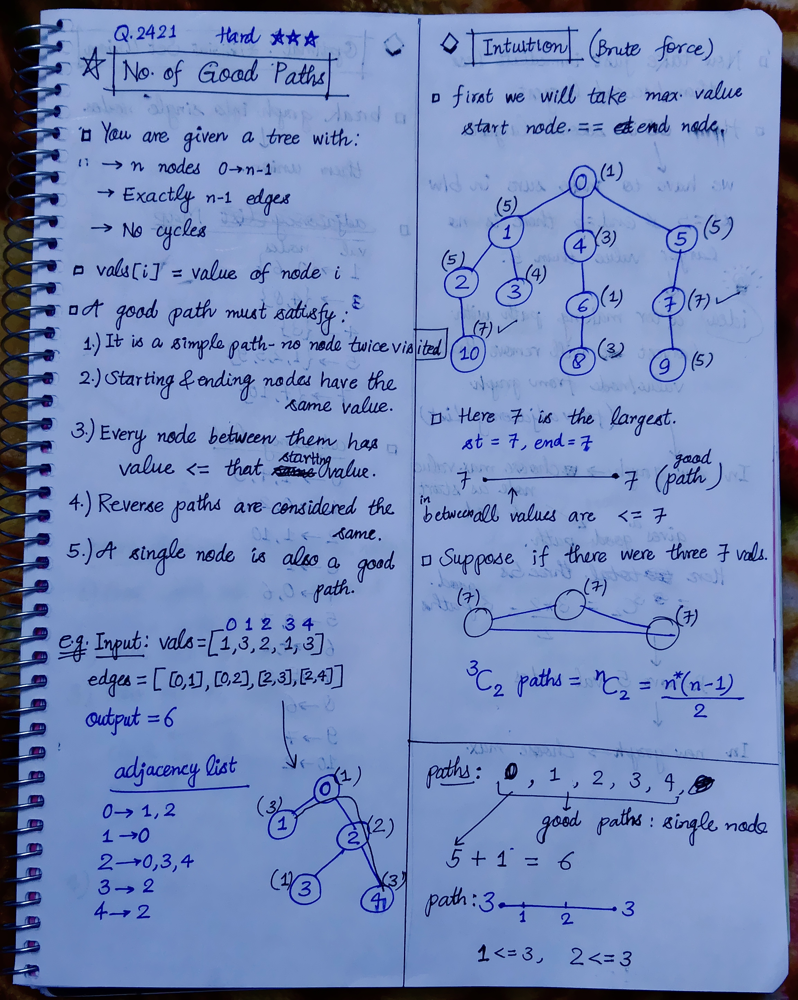
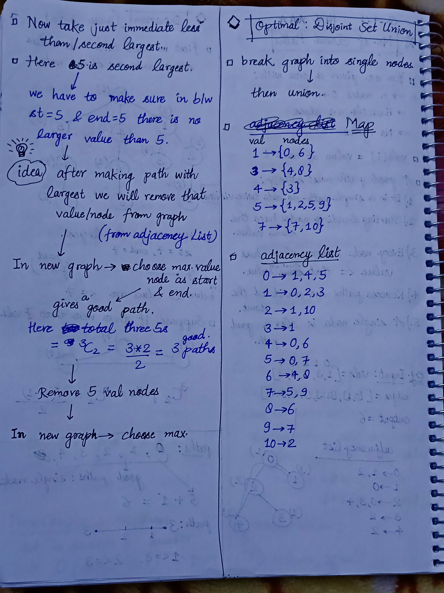
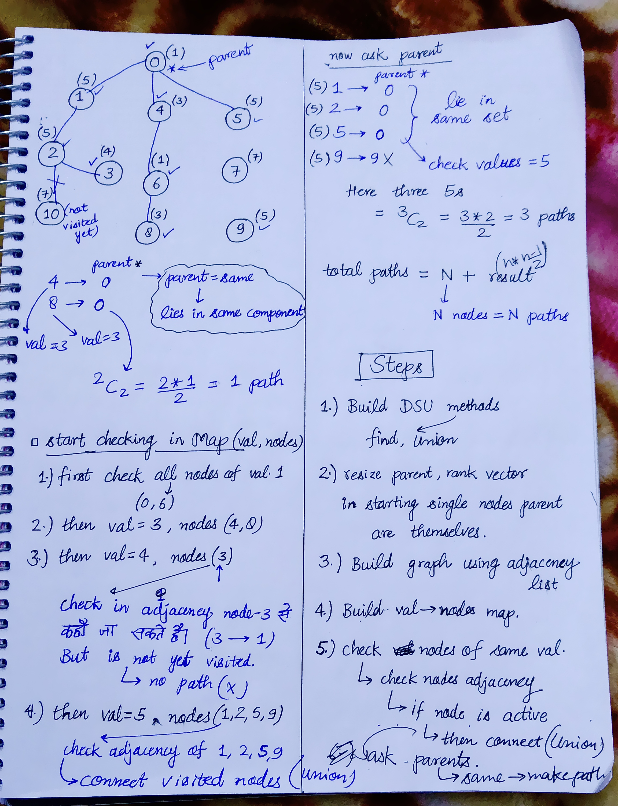

<h2><a href="https://leetcode.com/problems/number-of-good-paths">2505. Number of Good Paths</a></h2><h3>Hard</h3><hr><p>There is a tree (i.e. a connected, undirected graph with no cycles) consisting of <code>n</code> nodes numbered from <code>0</code> to <code>n - 1</code> and exactly <code>n - 1</code> edges.</p>

<p>You are given a <strong>0-indexed</strong> integer array <code>vals</code> of length <code>n</code> where <code>vals[i]</code> denotes the value of the <code>i<sup>th</sup></code> node. You are also given a 2D integer array <code>edges</code> where <code>edges[i] = [a<sub>i</sub>, b<sub>i</sub>]</code> denotes that there exists an <strong>undirected</strong> edge connecting nodes <code>a<sub>i</sub></code> and <code>b<sub>i</sub></code>.</p>

<p>A <strong>good path</strong> is a simple path that satisfies the following conditions:</p>

<ol>
	<li>The starting node and the ending node have the <strong>same</strong> value.</li>
	<li>All nodes between the starting node and the ending node have values <strong>less than or equal to</strong> the starting node (i.e. the starting node&#39;s value should be the maximum value along the path).</li>
</ol>

<p>Return <em>the number of distinct good paths</em>.</p>

<p>Note that a path and its reverse are counted as the <strong>same</strong> path. For example, <code>0 -&gt; 1</code> is considered to be the same as <code>1 -&gt; 0</code>. A single node is also considered as a valid path.</p>

<p>&nbsp;</p>
<p><strong class="example">Example 1:</strong></p>

<pre>
<strong>Input:</strong> vals = [1,3,2,1,3], edges = [[0,1],[0,2],[2,3],[2,4]]
<strong>Output:</strong> 6
<strong>Explanation:</strong> There are 5 good paths consisting of a single node.
There is 1 additional good path: 1 -&gt; 0 -&gt; 2 -&gt; 4.
(The reverse path 4 -&gt; 2 -&gt; 0 -&gt; 1 is treated as the same as 1 -&gt; 0 -&gt; 2 -&gt; 4.)
Note that 0 -&gt; 2 -&gt; 3 is not a good path because vals[2] &gt; vals[0].
</pre>

<p><strong class="example">Example 2:</strong></p>

<pre>
<strong>Input:</strong> vals = [1,1,2,2,3], edges = [[0,1],[1,2],[2,3],[2,4]]
<strong>Output:</strong> 7
<strong>Explanation:</strong> There are 5 good paths consisting of a single node.
There are 2 additional good paths: 0 -&gt; 1 and 2 -&gt; 3.
</pre>

<p><strong class="example">Example 3:</strong></p>

<pre>
<strong>Input:</strong> vals = [1], edges = []
<strong>Output:</strong> 1
<strong>Explanation:</strong> The tree consists of only one node, so there is one good path.
</pre>

<p>&nbsp;</p>
<p><strong>Constraints:</strong></p>

<ul>
	<li><code>n == vals.length</code></li>
	<li><code>1 &lt;= n &lt;= 3 * 10<sup>4</sup></code></li>
	<li><code>0 &lt;= vals[i] &lt;= 10<sup>5</sup></code></li>
	<li><code>edges.length == n - 1</code></li>
	<li><code>edges[i].length == 2</code></li>
	<li><code>0 &lt;= a<sub>i</sub>, b<sub>i</sub> &lt; n</code></li>
	<li><code>a<sub>i</sub> != b<sub>i</sub></code></li>
	<li><code>edges</code> represents a valid tree.</li>
</ul>


<!-- AUTO-GENERATED-SOLUTION-START -->
---

## 🧠 Visual Solution & Intuition

### Part 1



### Part 2



### Part 3



---

## 💡 Approach

```text
Approach : DSU (Disjoint Set Union / Union-Find) + Sorting by Node Values
```

---

## ⏱️ Complexity Analysis

```text
Time Complexity = O(n * logn) =>
Space Complexity = O(n) =>
```

---

## 💻 C++ Solution

[View Original C++ File](./2421-number-of-good-paths.cpp)

```cpp
class Solution {
public:
   //Approach : DSU (Disjoint Set Union / Union-Find) + Sorting by Node Values

   //Time Complexity = O(n * logn) => 
   /* map / sorting values → O(n log n)
    * DSU operations → approximately O(n α(n))
    * Overall → O(n log n)
   */


   //Space Complexity = O(n) =>
   /* DSU arrays → O(n)
    * Adjacency list → O(n)
    * Value-to-nodes map → O(n)
    * Active array → O(n)
   */

   // ! DISCLAIMER : Try this question at your own risk.

   //Step-1 : Make DSU functions/methods
    vector<int> parent;
    vector<int> rank;

    int find(int x){ //finds parent
        if(x == parent[x])
            return x;

        return parent[x] = find(parent[x]);
    }

    void Union(int x, int y){
        int x_parent = find(x);
        int y_parent = find(y);

        if(x_parent == y_parent) //means lie in same set
            return;
        
        if(rank[x_parent] > rank[y_parent]){
            parent[y_parent] = x_parent;
        }
        else if(rank[x_parent] < rank[y_parent]){
            parent[x_parent] = y_parent;
        }
        else{
            parent[y_parent] = x_parent; 
            rank[x_parent] += 1;
        }
    }
    int numberOfGoodPaths(vector<int>& vals, vector<vector<int>>& edges) {
        int n = vals.size();
        
        //Step-2
        parent.resize(n);
        rank.resize(n, 1);

        for(int i=0; i<n; i++){
            parent[i] = i;
        }

        //Step-3 : Build Graph
        unordered_map<int, vector<int>> adj;

        for(auto& vec : edges){
            int u = vec[0];//edges[i] = [a,b] => index 0 is u, index 1 is v
            int v = vec[1];

            //make connections
            adj[u].push_back(v); //u--->v
            adj[v].push_back(u); //v--->u
        }

        //Step-4 : Make a map (val -> nodes)
        map<int, vector<int>> val_to_nodes;

        for(int i=0; i<n; i++){
            int value = vals[i];

            val_to_nodes[value].push_back(i); //index is value => nodes(i)
        }

        //Step-5 : traverse in map & check nodes of same value
        int result = n;

        vector<bool> is_active(n, false);
        
        for(auto& it : val_to_nodes){
            vector<int>& nodes = it.second; 

            //Step-5(a): check nodes adjacency
            for(int& u : nodes){
                
                for(int& v : adj[u]){
                    //Step-5(b) : if node is active
                    if(is_active[v]){
                        
                        //Step-5(c) : then connect(Union)
                        Union(u, v);
                    }
                }
                //make current u node active : visited
                is_active[u] = true;
            }

            //Step-5(d) : ask parents
            vector<int> your_parents;

            for(int& u : nodes){
                int parent_who = find(u); //find func. gives parent

                your_parents.push_back(parent_who);
            }

            //Step-5(e) : check same parent nodes
            sort(your_parents.begin(), your_parents.end());

            int sz = your_parents.size();

            for(int j=0; j<sz; j++){
                long long count = 0;

                int curr_parent = your_parents[j];

                while(j < sz && your_parents[j] == curr_parent){
                    count++;
                    j++;
                }
                j--;

                int formula = (count * (count-1)/2);
                result += formula;
            }
        }

        //finally return total result
        return result;
    }
};
```

<!-- AUTO-GENERATED-SOLUTION-END -->
