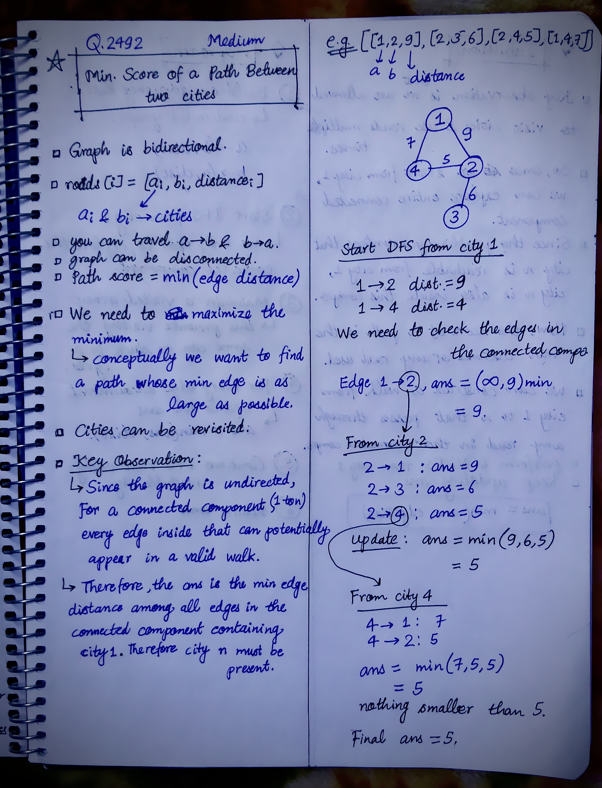
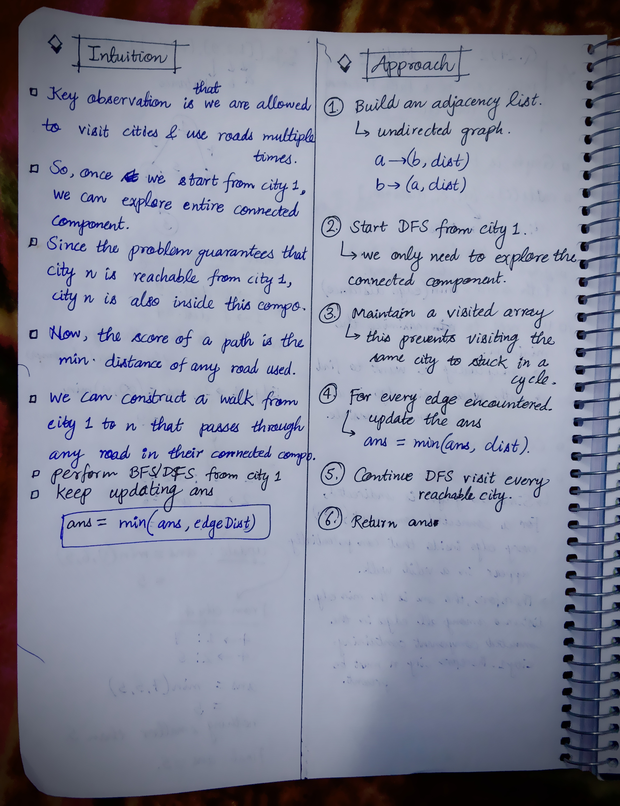

<h2><a href="https://leetcode.com/problems/minimum-score-of-a-path-between-two-cities">2582. Minimum Score of a Path Between Two Cities</a></h2><h3>Medium</h3><hr><p>You are given a positive integer <code>n</code> representing <code>n</code> cities numbered from <code>1</code> to <code>n</code>. You are also given a <strong>2D</strong> array <code>roads</code> where <code>roads[i] = [a<sub>i</sub>, b<sub>i</sub>, distance<sub>i</sub>]</code> indicates that there is a <strong>bidirectional </strong>road between cities <code>a<sub>i</sub></code> and <code>b<sub>i</sub></code> with a distance equal to <code>distance<sub>i</sub></code>. The cities graph is not necessarily connected.</p>

<p>The <strong>score</strong> of a path between two cities is defined as the <strong>minimum </strong>distance of a road in this path.</p>

<p>Return the <strong>minimum </strong>possible score of a path between cities 1 and <code>n</code>.</p>

<p><strong>Note</strong>:</p>

<ul>
	<li>A path is a sequence of roads between two cities.</li>
	<li>It is allowed for a path to contain the same road <strong>multiple</strong> times, and you can visit cities 1 and <code>n</code> multiple times along the path.</li>
	<li>The test cases are generated such that there is <strong>at least</strong> one path between 1 and <code>n</code>.</li>
</ul>

<p>&nbsp;</p>
<p><strong class="example">Example 1:</strong></p>

<pre>
<strong>Input:</strong> n = 4, roads = [[1,2,9],[2,3,6],[2,4,5],[1,4,7]]
<strong>Output:</strong> 5
<strong>Explanation:</strong> The path from city 1 to 4 with the minimum score is: 1 -&gt; 2 -&gt; 4. The score of this path is min(9,5) = 5.
It can be shown that no other path has less score.
</pre>

<p><strong class="example">Example 2:</strong></p>

<pre>
<strong>Input:</strong> n = 4, roads = [[1,2,2],[1,3,4],[3,4,7]]
<strong>Output:</strong> 2
<strong>Explanation:</strong> The path from city 1 to 4 with the minimum score is: 1 -&gt; 2 -&gt; 1 -&gt; 3 -&gt; 4. The score of this path is min(2,2,4,7) = 2.
</pre>

<p>&nbsp;</p>
<p><strong>Constraints:</strong></p>

<ul>
	<li><code>2 &lt;= n &lt;= 10<sup>5</sup></code></li>
	<li><code>1 &lt;= roads.length &lt;= 10<sup>5</sup></code></li>
	<li><code>roads[i].length == 3</code></li>
	<li><code>1 &lt;= a<sub>i</sub>, b<sub>i</sub> &lt;= n</code></li>
	<li><code>a<sub>i</sub> != b<sub>i</sub></code></li>
	<li><code>1 &lt;= distance<sub>i</sub> &lt;= 10<sup>4</sup></code></li>
	<li>There are no repeated edges.</li>
	<li>There is at least one path between <code>1</code> and <code>n</code>.</li>
</ul>


<!-- AUTO-GENERATED-SOLUTION-START -->
---

## 🧠 Visual Solution & Intuition

### Part 1



### Part 2



---

## 💡 Approach

```text
Approach : DFS-Connected Component Traversal
```

---

## ⏱️ Complexity Analysis

```text
Time Complexity: O(n + E) =>
Space Complexity: O(n + E) =>
```

---

## 💻 C++ Solution

[View Original C++ File](./2492-minimum-score-of-a-path-between-two-cities.cpp)

```cpp
class Solution {
public:
    //Approach : DFS-Connected Component Traversal

    //Time Complexity: O(n + E) =>
    /* n = number of cities
    * E = number of roads
    1. Building the adjacency list: O(E)
    2. DFS: O(n + E)
    * Each city is visited at most once → O(n)
    * Each road is examined at most twice → O(E)
    * So : O(E) + O(n + E) = O(n + E)
    */

    //Space Complexity: O(n + E) =>
    /* We use:
    1. Adjacency list
        * Stores both directions of every road.
        * O(n + E)
    2. Visited array
        * One boolean for every city.
        * O(n)
    3. Stack
        * In the worst case, it can contain up to n cities.
        * O(n)
    */


    void dfs(int node, vector<vector<pair<int, int>>> & adj, vector<bool>& visited, int& ans){
        //mark current node visited
        visited[node] = true;

        //start DFS from city 1 to n (connected component)
        for(auto [next, dist] : adj[node]){
            
            ans = min(ans, dist);

            if(!visited[next]){// Visit unvisited city
                dfs(next, adj, visited, ans);
            }
        }
    }
    int minScore(int n, vector<vector<int>>& roads) {
        
        int ans = INT_MAX; //because we want min. so initialize with max

        //1.) Build adjacency list
        vector<vector<pair<int, int>>> adj(n+1);
        //Here unordered_map<int, int> is wrong because each city needs multiple edges.

        for(auto& v : roads){
            int a = v[0];
            int b = v[1];
            int dist = v[2];

            //make undirected or bidirectional connection
            adj[a].push_back({b, dist});
            adj[b].push_back({a, dist});
        }
        
        //3.)
        vector<bool> visited(n+1, false);

        //2.) start DFS from city 1
        dfs(1, adj, visited, ans);

        //6.) finally return the output
        return ans;
    }
};
```

<!-- AUTO-GENERATED-SOLUTION-END -->
