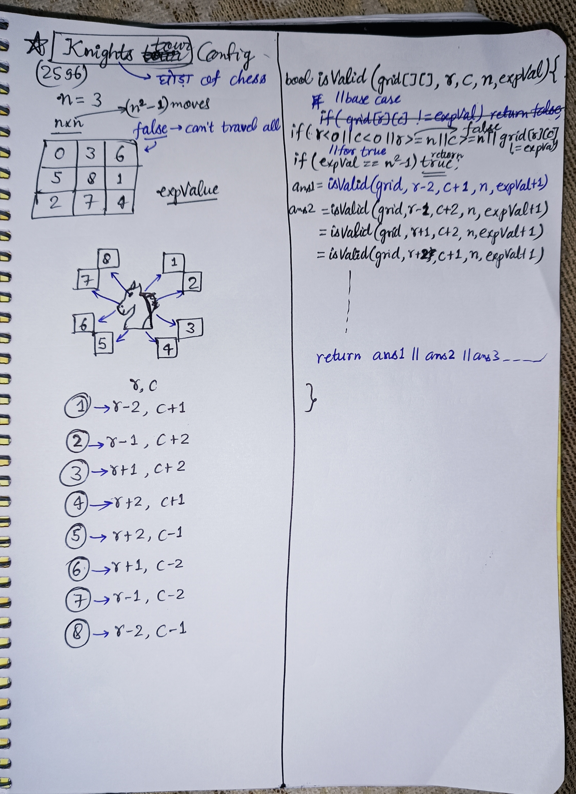

<h2><a href="https://leetcode.com/problems/check-knight-tour-configuration">2662. Check Knight Tour Configuration</a></h2><h3>Medium</h3><hr><p>There is a knight on an <code>n x n</code> chessboard. In a valid configuration, the knight starts <strong>at the top-left cell</strong> of the board and visits every cell on the board <strong>exactly once</strong>.</p>

<p>You are given an <code>n x n</code> integer matrix <code>grid</code> consisting of distinct integers from the range <code>[0, n * n - 1]</code> where <code>grid[row][col]</code> indicates that the cell <code>(row, col)</code> is the <code>grid[row][col]<sup>th</sup></code> cell that the knight visited. The moves are <strong>0-indexed</strong>.</p>

<p>Return <code>true</code> <em>if</em> <code>grid</code> <em>represents a valid configuration of the knight&#39;s movements or</em> <code>false</code> <em>otherwise</em>.</p>

<p><strong>Note</strong> that a valid knight move consists of moving two squares vertically and one square horizontally, or two squares horizontally and one square vertically. The figure below illustrates all the possible eight moves of a knight from some cell.</p>

<p>&nbsp;</p>
<p><strong class="example">Example 1:</strong></p>

<pre>
<strong>Input:</strong> grid = [[0,11,16,5,20],[17,4,19,10,15],[12,1,8,21,6],[3,18,23,14,9],[24,13,2,7,22]]
<strong>Output:</strong> true
<strong>Explanation:</strong> The above diagram represents the grid. It can be shown that it is a valid configuration.
</pre>

<p><strong class="example">Example 2:</strong></p>

<pre>
<strong>Input:</strong> grid = [[0,3,6],[5,8,1],[2,7,4]]
<strong>Output:</strong> false
<strong>Explanation:</strong> The above diagram represents the grid. The 8<sup>th</sup> move of the knight is not valid considering its position after the 7<sup>th</sup> move.
</pre>

<p>&nbsp;</p>
<p><strong>Constraints:</strong></p>

<ul>
	<li><code>n == grid.length == grid[i].length</code></li>
	<li><code>3 &lt;= n &lt;= 7</code></li>
	<li><code>0 &lt;= grid[row][col] &lt; n * n</code></li>
	<li>All integers in <code>grid</code> are <strong>unique</strong>.</li>
</ul>


<!-- AUTO-GENERATED-SOLUTION-START -->
---

## 🧠 Visual Solution & Intuition



---

## ⏱️ Complexity Analysis

```text
Time Complexity = O(8^(n^2)) => because of 8 moves in each call and recursion depth = n^2 (n x n board)
```

---

## 💻 C++ Solution

[View Original C++ File](./2596-check-knight-tour-configuration.cpp)

```cpp
class Solution {
public:
    //Time Complexity = O(8^(n^2)) => because of 8 moves in each call and recursion depth = n^2 (n x n board)
    bool isValid(vector<vector<int>>& grid, int r, int c, int n, int expVal){
     //basecase for false 
     if(r < 0 || c < 0 || r >= n || c >= n || grid[r][c] != expVal){
        return false ;
     }
     //basecase for true
     if(expVal == n*n - 1){
        return true ;
     }

     //8 possible moves
    int ans1 = isValid(grid,r-2,c+1,n,expVal+1) ;
    int ans2 = isValid(grid,r-1,c+2,n,expVal+1) ;
    int ans3 = isValid(grid,r+1,c+2,n,expVal+1) ;
    int ans4 = isValid(grid,r+2,c+1,n,expVal+1) ;
    int ans5 = isValid(grid,r+2,c-1,n,expVal+1) ;
    int ans6 = isValid(grid,r+1,c-2,n,expVal+1) ;
    int ans7 = isValid(grid,r-1,c-2,n,expVal+1) ;
    int ans8 = isValid(grid,r-2,c-1,n,expVal+1) ;

    return ans1 || ans2 || ans3 || ans4 || ans5 || ans6 || ans7 || ans8;
    }
    
    bool checkValidGrid(vector<vector<int>>& grid) {
        //function call to isValid to calculate
        return isValid(grid, 0, 0, grid.size(), 0) ;

    }
};
```

<!-- AUTO-GENERATED-SOLUTION-END -->
