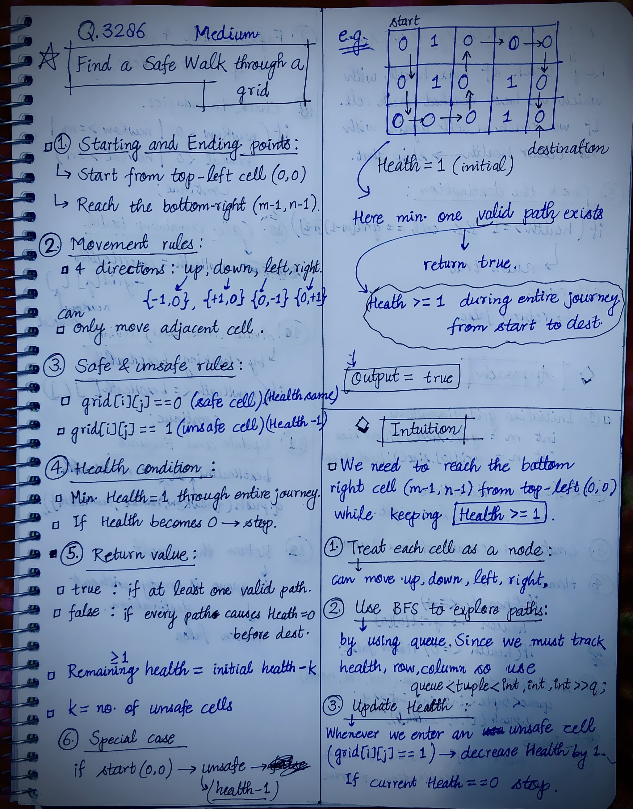
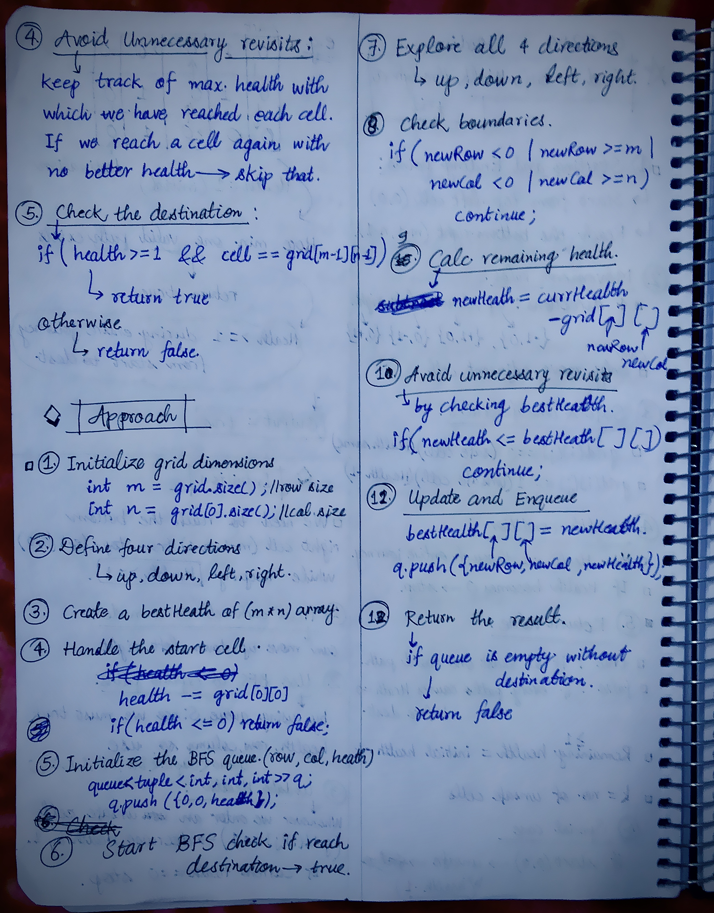

<h2><a href="https://leetcode.com/problems/find-a-safe-walk-through-a-grid/">3558. Find a Safe Walk Through a Grid</a></h2><h3>Medium</h3><hr><p>You are given an <code>m x n</code> binary matrix <code>grid</code> and an integer <code>health</code>.</p>

<p>You start on the upper-left corner <code>(0, 0)</code> and would like to get to the lower-right corner <code>(m - 1, n - 1)</code>.</p>

<p>You can move up, down, left, or right from one cell to another adjacent cell as long as your health <em>remains</em> <strong>positive</strong>.</p>

<p>Cells <code>(i, j)</code> with <code>grid[i][j] = 1</code> are considered <strong>unsafe</strong> and reduce your health by 1.</p>

<p>Return <code>true</code> if you can reach the final cell with a health value of 1 or more, and <code>false</code> otherwise.</p>

<p>&nbsp;</p>
<p><strong class="example">Example 1:</strong></p>

<div class="example-block">
<p><strong>Input:</strong> <span class="example-io">grid = [[0,1,0,0,0],[0,1,0,1,0],[0,0,0,1,0]], health = 1</span></p>

<p><strong>Output:</strong> <span class="example-io">true</span></p>

<p><strong>Explanation:</strong></p>

<p>The final cell can be reached safely by walking along the gray cells below.</p>
</div>

<p><strong class="example">Example 2:</strong></p>

<div class="example-block">
<p><strong>Input:</strong> <span class="example-io">grid = [[0,1,1,0,0,0],[1,0,1,0,0,0],[0,1,1,1,0,1],[0,0,1,0,1,0]], health = 3</span></p>

<p><strong>Output:</strong> <span class="example-io">false</span></p>

<p><strong>Explanation:</strong></p>

<p>A minimum of 4 health points is needed to reach the final cell safely.</p>
</div>

<p><strong class="example">Example 3:</strong></p>

<div class="example-block">
<p><strong>Input:</strong> <span class="example-io">grid = [[1,1,1],[1,0,1],[1,1,1]], health = 5</span></p>

<p><strong>Output:</strong> <span class="example-io">true</span></p>

<p><strong>Explanation:</strong></p>

<p>The final cell can be reached safely by walking along the gray cells below.</p>

<p></p>

<p>Any path that does not go through the cell <code>(1, 1)</code> is unsafe since your health will drop to 0 when reaching the final cell.</p>
</div>

<p>&nbsp;</p>
<p><strong>Constraints:</strong></p>

<ul>
	<li><code>m == grid.length</code></li>
	<li><code>n == grid[i].length</code></li>
	<li><code>1 &lt;= m, n &lt;= 50</code></li>
	<li><code><font face="monospace">2 &lt;= m * n</font></code></li>
	<li><code>1 &lt;= health &lt;= m + n</code></li>
	<li><code>grid[i][j]</code> is either 0 or 1.</li>
</ul>


<!-- AUTO-GENERATED-SOLUTION-START -->
---

## 🧠 Visual Solution & Intuition

### Part 1



### Part 2



---

## 💡 Approach

```text
Approach : BFS directly on the grid + health tracking
```

---

## ⏱️ Complexity Analysis

```text
Time Complexity = O(m * n * health) =>
Space Complexity = O(m * n * health) =>
```

---

## 💻 C++ Solution

[View Original C++ File](./3286-find-a-safe-walk-through-a-grid.cpp)

```cpp
class Solution {
public:
    //Approach : BFS directly on the grid + health tracking

    //Time Complexity = O(m * n * health) =>
    /* 1. There are m × n cells in the grid.
    2. Each cell can potentially be reached with different health values, from 1 to the initial health.
    3. Therefore, there can be up to m × n × health distinct states.
    4. For each state, BFS explores 4 directions, which takes constant time, O(1).
    */

    //Space Complexity = O(m * n * health) =>
    /* 1. The bestHealth matrix stores one value per cell, requiring O(m × n) space.
    2. The queue stores states containing the row, column, and remaining health.
    3. In the worst case, the queue can contain up to O(m × n × health) states.
    */

    vector<vector<int>> directions{ {-1,0}, {1, 0}, {0, -1}, {0, 1} }; //up, down, left, right

    bool findSafeWalk(vector<vector<int>>& grid, int health) {
        
        int m = grid.size(); //row size
        int n = grid[0].size(); //column size
        
        vector<vector<int>> bestHealth(m, vector<int>(n, -1));// Store the maximum health with which we reach each cell

        queue<tuple<int, int, int>> q; //to store row, column, health

        //calc. health for start cell
        health -= grid[0][0];

        if(health <= 0){
            return false;
        }

        q.push({0, 0, health}); //push start row, column, health
        bestHealth[0][0] = health;

        while(!q.empty()){
            
            auto [row, col, currHealth] = q.front();
            q.pop();

            //check if reached to destination
            if(health >= 1 && row == m-1 && col == n-1){
                return true;
            }

            //otherwise explore all the 4 directions
            for(auto& dir : directions){

                int newRow = row + dir[0];
                int newCol = col + dir[1];

                //check grid boundaries
                if(newRow < 0 || newRow >= m | newCol < 0 | newCol >= n){
                    continue;
                }

                //Reduce health if current health is unsafe
                int newHealth = currHealth - grid[newRow][newCol];

                //Health must remain >= 1
                if(newHealth <= 0){
                    continue;
                }

                //Avoid revisiting if already visited with bestHealth
                if(newHealth <= bestHealth[newRow][newCol]){
                    continue;
                }

                bestHealth[newRow][newCol] = newHealth;

                //push next cell in queue
                q.push({newRow, newCol, newHealth});
            }
        }


        //finally if no valid path found in above checks by BFS
        return false;
    }
};
```

<!-- AUTO-GENERATED-SOLUTION-END -->
