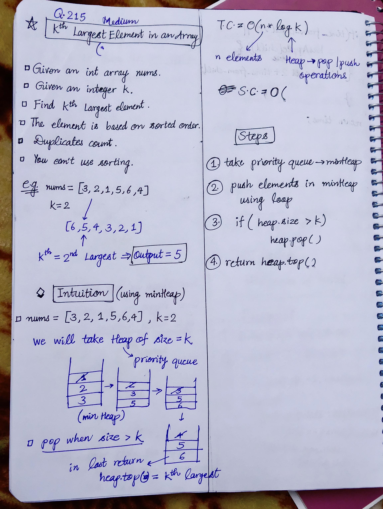

<h2><a href="https://leetcode.com/problems/kth-largest-element-in-an-array">215. Kth Largest Element in an Array</a></h2><h3>Medium</h3><hr><p>Given an integer array <code>nums</code> and an integer <code>k</code>, return <em>the</em> <code>k<sup>th</sup></code> <em>largest element in the array</em>.</p>

<p>Note that it is the <code>k<sup>th</sup></code> largest element in the sorted order, not the <code>k<sup>th</sup></code> distinct element.</p>

<p>Can you solve it without sorting?</p>

<p>&nbsp;</p>
<p><strong class="example">Example 1:</strong></p>
<pre><strong>Input:</strong> nums = [3,2,1,5,6,4], k = 2
<strong>Output:</strong> 5
</pre><p><strong class="example">Example 2:</strong></p>
<pre><strong>Input:</strong> nums = [3,2,3,1,2,4,5,5,6], k = 4
<strong>Output:</strong> 4
</pre>
<p>&nbsp;</p>
<p><strong>Constraints:</strong></p>

<ul>
	<li><code>1 &lt;= k &lt;= nums.length &lt;= 10<sup>5</sup></code></li>
	<li><code>-10<sup>4</sup> &lt;= nums[i] &lt;= 10<sup>4</sup></code></li>
</ul>


<!-- AUTO-GENERATED-SOLUTION-START -->
---

## 🧠 Visual Solution & Intuition



---

## ⏱️ Complexity Analysis

```text
Time Complexity = O(n * logK) =>
Space Complexity = O(k) => cause storing k elements in the Heap
```

---

## 💻 C++ Solution

[View Original C++ File](./0215-kth-largest-element-in-an-array.cpp)

```cpp
class Solution {
public:
    //Method-2 : min-Heap =>
    //Time Complexity = O(n * logK) =>
    /* There are n elements in nums, so the loop runs n times.
        minHeap.push(n)
        A heap insertion takes:
        O(log k)
        Why log k and not log n?
        Because we never allow the heap to contain more than k elements.
        if(minHeap.size() > k)
            minHeap.pop();

    */

    //Space Complexity = O(k) => cause storing k elements in the Heap

    int findKthLargest(vector<int>& nums, int k) {
        //1.)Take min-Heap
        priority_queue<int, vector<int>, greater<int>> minHeap;

        //2.) push elements in minHeap
        for(int &n : nums){

            minHeap.push(n);

            //3.)if size > k => pop()
            if(minHeap.size() > k){
                minHeap.pop();
            }
        }


        //4.) finally return the top most element
        return minHeap.top();
    }
};
```

<!-- AUTO-GENERATED-SOLUTION-END -->
