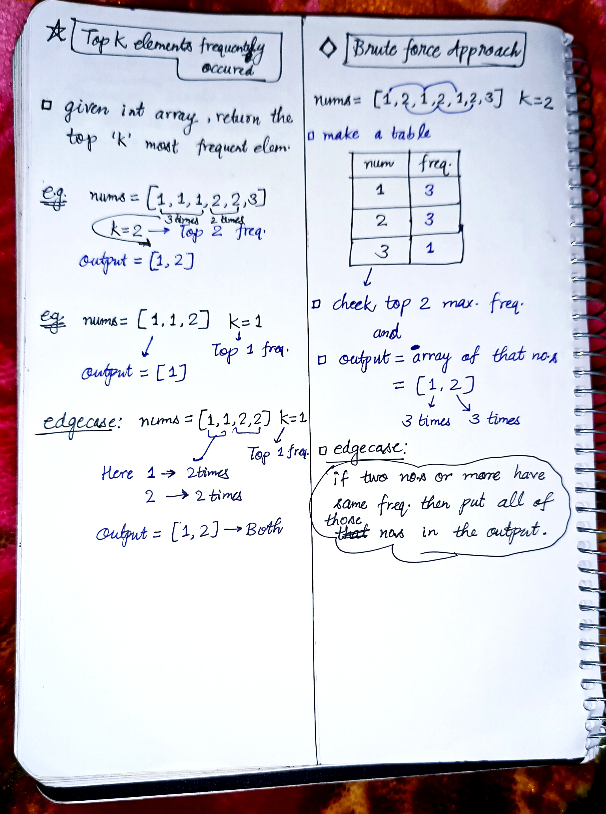
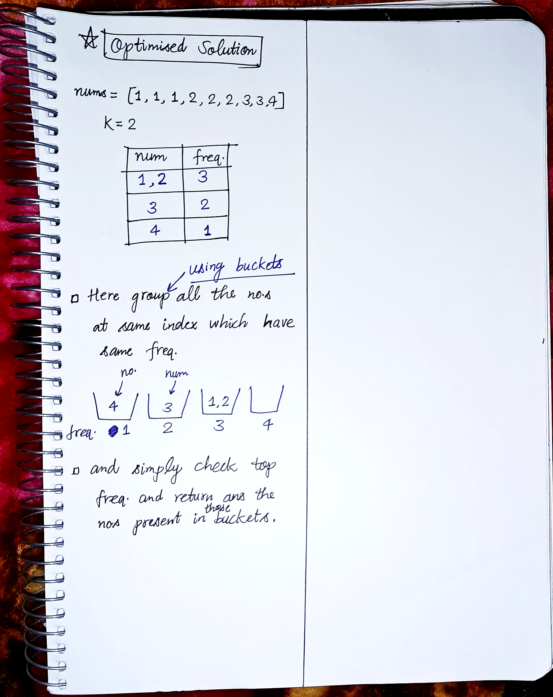

<h2><a href="https://leetcode.com/problems/top-k-frequent-elements">347. Top K Frequent Elements</a></h2><h3>Medium</h3><hr><p>Given an integer array <code>nums</code> and an integer <code>k</code>, return <em>the</em> <code>k</code> <em>most frequent elements</em>. You may return the answer in <strong>any order</strong>.</p>

<p>&nbsp;</p>
<p><strong class="example">Example 1:</strong></p>

<div class="example-block">
<p><strong>Input:</strong> <span class="example-io">nums = [1,1,1,2,2,3], k = 2</span></p>

<p><strong>Output:</strong> <span class="example-io">[1,2]</span></p>
</div>

<p><strong class="example">Example 2:</strong></p>

<div class="example-block">
<p><strong>Input:</strong> <span class="example-io">nums = [1], k = 1</span></p>

<p><strong>Output:</strong> <span class="example-io">[1]</span></p>
</div>

<p><strong class="example">Example 3:</strong></p>

<div class="example-block">
<p><strong>Input:</strong> <span class="example-io">nums = [1,2,1,2,1,2,3,1,3,2], k = 2</span></p>

<p><strong>Output:</strong> <span class="example-io">[1,2]</span></p>
</div>

<p>&nbsp;</p>
<p><strong>Constraints:</strong></p>

<ul>
	<li><code>1 &lt;= nums.length &lt;= 10<sup>5</sup></code></li>
	<li><code>-10<sup>4</sup> &lt;= nums[i] &lt;= 10<sup>4</sup></code></li>
	<li><code>k</code> is in the range <code>[1, the number of unique elements in the array]</code>.</li>
	<li>It is <strong>guaranteed</strong> that the answer is <strong>unique</strong>.</li>
</ul>

<p>&nbsp;</p>
<p><strong>Follow up:</strong> Your algorithm&#39;s time complexity must be better than <code>O(n log n)</code>, where n is the array&#39;s size.</p>


<!-- AUTO-GENERATED-SOLUTION-START -->
---

## 🧠 Visual Solution & Intuition

### Part 1



### Part 2



---

## 💡 Approach

```text
Approach : Hash Map (Frequency Counting) + Min Heap (Priority Queue)
```

---

## ⏱️ Complexity Analysis

```text
Time Complexity = O(n * logk) =>
Space Complexity = O(n + k) =>
```

---

## 💻 C++ Solution

[View Original C++ File](./0347-top-k-frequent-elements.cpp)

```cpp
class Solution {
public:
    //Approach : Hash Map (Frequency Counting) + Min Heap (Priority Queue)
 
    //Time Complexity = O(n * logk) =>
    /* Frequency Map: O(n) average time to count frequencies.
    * Heap Operations: O(m log k), where m is the number of unique elements.
    * Extract Elements: O(k log k).
    * Overall: O(n log k) for k ≥ 2, since m ≤ n.
    */

    //Space Complexity = O(n + k) =>
    /* Hash Map: O(n) in the worst case.
    * Min Heap: O(k).
    * Output Vector: O(k).
    * Overall: O(n + k) = O(n) since k ≤ n
    */


    typedef pair<int,int> P;
    vector<int> topKFrequent(vector<int>& nums, int k) {
        
        int n = nums.size();
        
        vector<int> ans; //to store the output

        unordered_map<int,int> freqMap; //store the (value -> freq)

        //Step-1: Count frequency of each element
        for(int i = 0; i < n; i++){

            //store the freq. of each in map
            freqMap[nums[i]]++;
        }

        //Step-2: minHeap priority queue to 
        priority_queue<P, vector<P>, greater<P>> pq;

        //Step-3: traverse the map and push only top k elements in priority queue
        for(auto& it : freqMap){
            
            int num = it.first;//first column is number
            int freq = it.second;//second column is frequency

            pq.push({freq, num});//push in minHeap

            if(pq.size() > k){ //when pq is full
                pq.pop();//pop the topmost element that is minimum
            }
        }

        //Step-4: Extract top k freq elements
        while(!pq.empty()){
            ans.push_back(pq.top().second);//top element is most freq element

            pq.pop(); //after inserting in ans pop from pq
        }

        //finally return the output
        return ans;
    }
};
```

<!-- AUTO-GENERATED-SOLUTION-END -->
