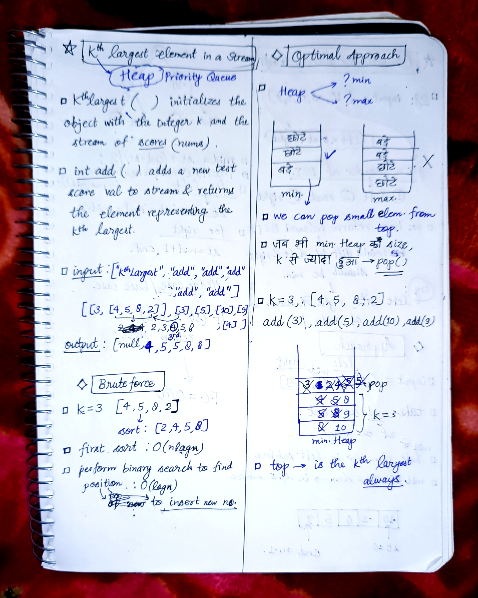

<h2><a href="https://leetcode.com/problems/kth-largest-element-in-a-stream">789. Kth Largest Element in a Stream</a></h2><h3>Easy</h3><hr><p>You are part of a university admissions office and need to keep track of the <code>kth</code> highest test score from applicants in real-time. This helps to determine cut-off marks for interviews and admissions dynamically as new applicants submit their scores.</p>

<p>You are tasked to implement a class which, for a given integer&nbsp;<code>k</code>, maintains a stream of test scores and continuously returns the&nbsp;<code>k</code>th highest test score&nbsp;<strong>after</strong>&nbsp;a new score has been submitted. More specifically, we are looking for the <code>k</code>th highest score in the sorted list of all scores.</p>

<p>Implement the&nbsp;<code>KthLargest</code> class:</p>

<ul>
	<li><code>KthLargest(int k, int[] nums)</code> Initializes the object with the integer <code>k</code> and the stream of test scores&nbsp;<code>nums</code>.</li>
	<li><code>int add(int val)</code> Adds a new test score&nbsp;<code>val</code> to the stream and returns the element representing the <code>k<sup>th</sup></code> largest element in the pool of test scores so far.</li>
</ul>

<p>&nbsp;</p>
<p><strong class="example">Example 1:</strong></p>

<div class="example-block">
<p><strong>Input:</strong><br />
<span class="example-io">[&quot;KthLargest&quot;, &quot;add&quot;, &quot;add&quot;, &quot;add&quot;, &quot;add&quot;, &quot;add&quot;]<br />
[[3, [4, 5, 8, 2]], [3], [5], [10], [9], [4]]</span></p>

<p><strong>Output:</strong> <span class="example-io">[null, 4, 5, 5, 8, 8]</span></p>

<p><strong>Explanation:</strong></p>

<p>KthLargest kthLargest = new KthLargest(3, [4, 5, 8, 2]);<br />
kthLargest.add(3); // return 4<br />
kthLargest.add(5); // return 5<br />
kthLargest.add(10); // return 5<br />
kthLargest.add(9); // return 8<br />
kthLargest.add(4); // return 8</p>
</div>

<p><strong class="example">Example 2:</strong></p>

<div class="example-block">
<p><strong>Input:</strong><br />
<span class="example-io">[&quot;KthLargest&quot;, &quot;add&quot;, &quot;add&quot;, &quot;add&quot;, &quot;add&quot;]<br />
[[4, [7, 7, 7, 7, 8, 3]], [2], [10], [9], [9]]</span></p>

<p><strong>Output:</strong> <span class="example-io">[null, 7, 7, 7, 8]</span></p>

<p><strong>Explanation:</strong></p>
KthLargest kthLargest = new KthLargest(4, [7, 7, 7, 7, 8, 3]);<br />
kthLargest.add(2); // return 7<br />
kthLargest.add(10); // return 7<br />
kthLargest.add(9); // return 7<br />
kthLargest.add(9); // return 8</div>

<p>&nbsp;</p>
<p><strong>Constraints:</strong></p>

<ul>
	<li><code>0 &lt;= nums.length &lt;= 10<sup>4</sup></code></li>
	<li><code>1 &lt;= k &lt;= nums.length + 1</code></li>
	<li><code>-10<sup>4</sup> &lt;= nums[i] &lt;= 10<sup>4</sup></code></li>
	<li><code>-10<sup>4</sup> &lt;= val &lt;= 10<sup>4</sup></code></li>
	<li>At most <code>10<sup>4</sup></code> calls will be made to <code>add</code>.</li>
</ul>


<!-- AUTO-GENERATED-SOLUTION-START -->
---

## 🧠 Visual Solution & Intuition



---

## ⏱️ Complexity Analysis

```text
Time Complexity = O(nlogk) => for n values push function = O(logk)
Space Complexity = O(k)
```

---

## 💻 C++ Solution

[View Original C++ File](./0703-kth-largest-element-in-a-stream.cpp)

```cpp
class KthLargest {
public:
    //Time Complexity = O(nlogk) => for n values push function = O(logk)
    //Space Complexity = O(k)
    int K ; //global K to access in add func.
    //min-heap => priority queue
    priority_queue<int, vector<int>, greater<int>> pq ;
    KthLargest(int k, vector<int>& nums) {
        K = k ;

        //push the values in pq
        for(int &val : nums){
            pq.push(val) ;

            //check size
            if(pq.size() > k)
               pq.pop() ; 
        }
    }
    
    int add(int val) {
        //push new val in pq
        pq.push(val) ;

        //check size and pop
        if(pq.size() > K){
            pq.pop() ; //minimum top element will be popped.
        }

        //return the ans that is top
        return pq.top() ;
    }
};


/**
 * Your KthLargest object will be instantiated and called as such:
 * KthLargest* obj = new KthLargest(k, nums);
 * int param_1 = obj->add(val);
 */
```

<!-- AUTO-GENERATED-SOLUTION-END -->
