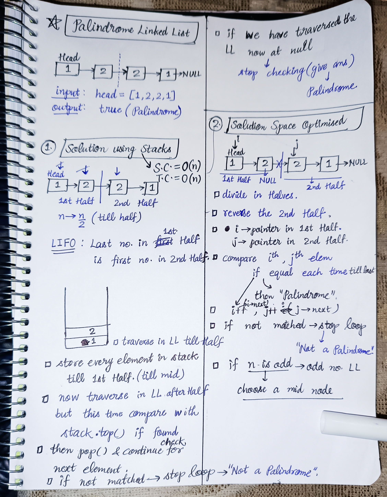

<h2><a href="https://leetcode.com/problems/palindrome-linked-list">234. Palindrome Linked List</a></h2><h3>Easy</h3><hr><p>Given the <code>head</code> of a singly linked list, return <code>true</code><em> if it is a </em><span data-keyword="palindrome-sequence"><em>palindrome</em></span><em> or </em><code>false</code><em> otherwise</em>.</p>

<p>&nbsp;</p>
<p><strong class="example">Example 1:</strong></p>

<pre>
<strong>Input:</strong> head = [1,2,2,1]
<strong>Output:</strong> true
</pre>

<p><strong class="example">Example 2:</strong></p>

<pre>
<strong>Input:</strong> head = [1,2]
<strong>Output:</strong> false
</pre>

<p>&nbsp;</p>
<p><strong>Constraints:</strong></p>

<ul>
	<li>The number of nodes in the list is in the range <code>[1, 10<sup>5</sup>]</code>.</li>
	<li><code>0 &lt;= Node.val &lt;= 9</code></li>
</ul>

<p>&nbsp;</p>
<strong>Follow up:</strong> Could you do it in <code>O(n)</code> time and <code>O(1)</code> space?

<!-- AUTO-GENERATED-SOLUTION-START -->
---

## 🧠 Visual Solution & Intuition



---

## ⏱️ Complexity Analysis

```text
Time Complexity = O(n) => for traversing on LL
Space Complexity = O(n) => using stack data structure to store
```

---

## 💻 C++ Solution

[View Original C++ File](./0234-palindrome-linked-list.cpp)

```cpp
/**
 * Definition for singly-linked list.
 * struct ListNode {
 *     int val;
 *     ListNode *next;
 *     ListNode() : val(0), next(nullptr) {}
 *     ListNode(int x) : val(x), next(nullptr) {}
 *     ListNode(int x, ListNode *next) : val(x), next(next) {}
 * };
 */
class Solution {
public:
    //Time Complexity = O(n) => for traversing on LL
    //Space Complexity = O(n) => using stack data structure to store
    bool isPalindrome(ListNode* head) {
        stack<int> st ;
        //to find mid of the LL we will use Slow-fast pointer approach
        //move slow with 1 step, fast with 2 step
        //until fast = NULL or fast->next = NULL
        //at that time slow will point the mid
        ListNode *slow = head, *fast = head ;
        
        //step 1 : push first half element in the stack
        while(fast != NULL && fast->next != NULL){
            st.push(slow->val) ;
            slow = slow->next ; //1 step
            fast = fast->next->next ; //2 step
        }
        //if odd length LL : skip the middle node
        if(fast != NULL){
            slow = slow->next ;
        }

        //step 2 : compare second half LL with stack elements
        while(slow != NULL){
            if(slow->val != st.top()){
                return false ; //if not matched
            }
            else{
                st.pop(); //pop the top value 
                slow = slow->next ; //and move for next value
            }
        }
        
        //if in above loop all value matched
        return true ;

    }
};
```

<!-- AUTO-GENERATED-SOLUTION-END -->
