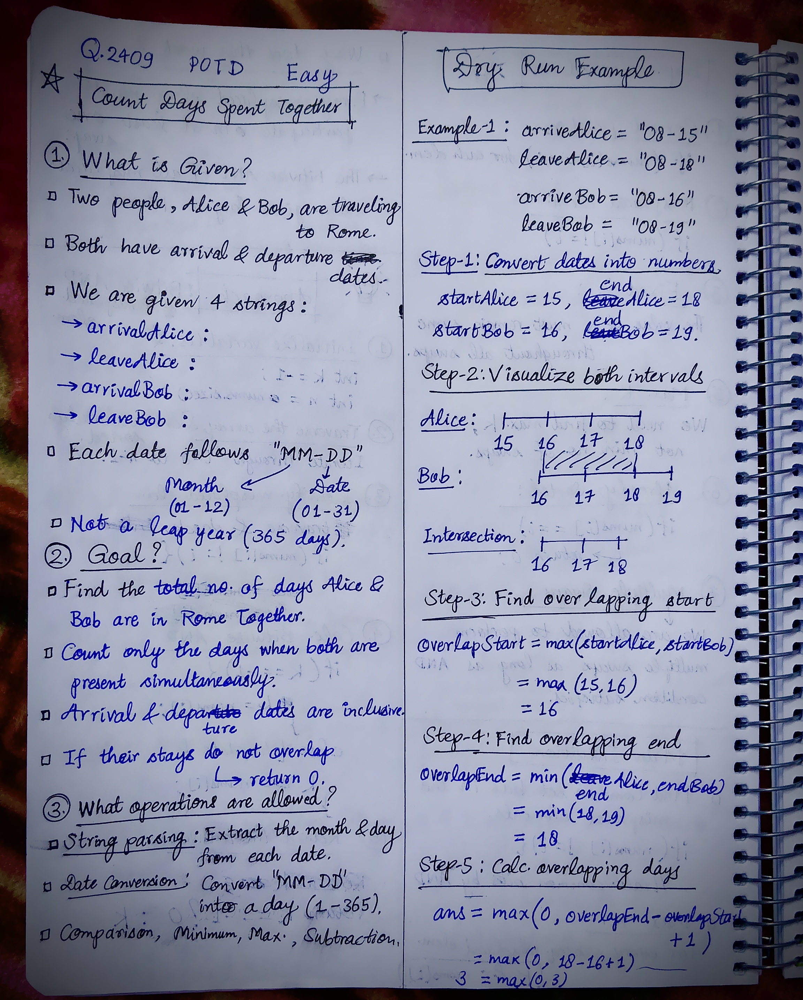
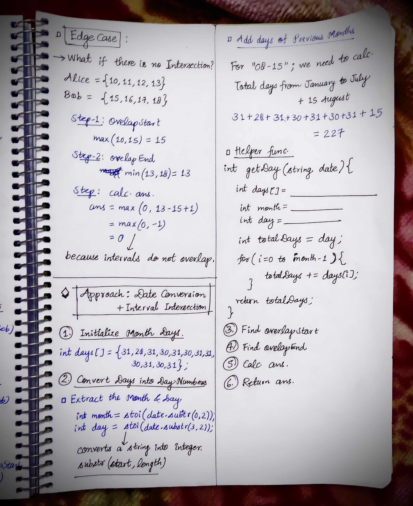

<h2><a href="https://leetcode.com/problems/count-days-spent-together">2496. Count Days Spent Together</a></h2><h3>Easy</h3><hr><p>Alice and Bob are traveling to Rome for separate business meetings.</p>

<p>You are given 4 strings <code>arriveAlice</code>, <code>leaveAlice</code>, <code>arriveBob</code>, and <code>leaveBob</code>. Alice will be in the city from the dates <code>arriveAlice</code> to <code>leaveAlice</code> (<strong>inclusive</strong>), while Bob will be in the city from the dates <code>arriveBob</code> to <code>leaveBob</code> (<strong>inclusive</strong>). Each will be a 5-character string in the format <code>&quot;MM-DD&quot;</code>, corresponding to the month and day of the date.</p>

<p>Return<em> the total number of days that Alice and Bob are in Rome together.</em></p>

<p>You can assume that all dates occur in the <strong>same</strong> calendar year, which is <strong>not</strong> a leap year. Note that the number of days per month can be represented as: <code>[31, 28, 31, 30, 31, 30, 31, 31, 30, 31, 30, 31]</code>.</p>

<p>&nbsp;</p>
<p><strong class="example">Example 1:</strong></p>

<pre>
<strong>Input:</strong> arriveAlice = &quot;08-15&quot;, leaveAlice = &quot;08-18&quot;, arriveBob = &quot;08-16&quot;, leaveBob = &quot;08-19&quot;
<strong>Output:</strong> 3
<strong>Explanation:</strong> Alice will be in Rome from August 15 to August 18. Bob will be in Rome from August 16 to August 19. They are both in Rome together on August 16th, 17th, and 18th, so the answer is 3.
</pre>

<p><strong class="example">Example 2:</strong></p>

<pre>
<strong>Input:</strong> arriveAlice = &quot;10-01&quot;, leaveAlice = &quot;10-31&quot;, arriveBob = &quot;11-01&quot;, leaveBob = &quot;12-31&quot;
<strong>Output:</strong> 0
<strong>Explanation:</strong> There is no day when Alice and Bob are in Rome together, so we return 0.
</pre>

<p>&nbsp;</p>
<p><strong>Constraints:</strong></p>

<ul>
	<li>All dates are provided in the format <code>&quot;MM-DD&quot;</code>.</li>
	<li>Alice and Bob&#39;s arrival dates are <strong>earlier than or equal to</strong> their leaving dates.</li>
	<li>The given dates are valid dates of a <strong>non-leap</strong> year.</li>
</ul>


<!-- AUTO-GENERATED-SOLUTION-START -->
---

## 🧠 Visual Solution & Intuition

### Part 1



### Part 2



---

## 💡 Approach

```text
Approach : Date Conversion + Interval Intersection
```

---

## ⏱️ Complexity Analysis

```text
Time Complexity = O(1) =>
Space Complexity = O(1) =>
```

---

## 💻 C++ Solution

[View Original C++ File](./2409-count-days-spent-together.cpp)

```cpp
class Solution {
public:
    //Approach : Date Conversion + Interval Intersection

    //Time Complexity = O(1) =>
    /* 1. Month Days Array: Initializing an array of 12 elements takes O(1) time.
    2. String Parsing: substr() and stoi() process fixed-length date strings ("MM-DD"), taking O(1) time.
    3. Date Conversion: The getDay() function loops through at most 11 months, taking O(1) time.
    4. Four Date Conversions: Calling getDay() four times takes 4 × O(1) = O(1).
    5. Interval Intersection: Finding max() and min() and calculating overlapping days takes O(1) time.
    */
 
    //Space Complexity = O(1) =>
    /* 1. Month Days Array: Stores exactly 12 integers → O(1).
    2. Date Variables: month, day, and totalDays use constant space → O(1).
    3. Converted Dates: Four integer variables store the converted dates → O(1).
    4. Overlap Variables: overlapStart, overlapEnd, and ans use constant space → O(1).
    5. No Extra Data Structures: No dynamically growing arrays, sets, or maps are used.
    */


    int getDay(string date){

        int days[] = {31, 28, 31, 30, 31, 30, 31, 31, 30 , 31, 30, 31};

        int month = stoi(date.substr(0, 2)); //substr(start, length)
        int day = stoi(date.substr(3, 2));

        int totalDays = day;//first add the days of current month

        for(int i = 0; i < month-1; i++){
            totalDays += days[i];//add days of previous months
        }

        return totalDays;
    }
    int countDaysTogether(string arriveAlice, string leaveAlice, string arriveBob, string leaveBob) {
        
        //Step-1: Convert days into numbers
        int startAlice = getDay(arriveAlice);
        int endAlice = getDay(leaveAlice);

        int startBob = getDay(arriveBob);
        int endBob = getDay(leaveBob);

        //Step-2: Find overlapping start
        int overlapStart = max(startAlice, startBob);

        //Step-3: Find overlapping end
        int overlapEnd = min(endAlice, endBob);

        //Step-4 : Calc. ans
        int ans = max(0, overlapEnd - overlapStart + 1);

        //Step-5 : finally return the answer
        return ans;
    }
};
```

<!-- AUTO-GENERATED-SOLUTION-END -->
