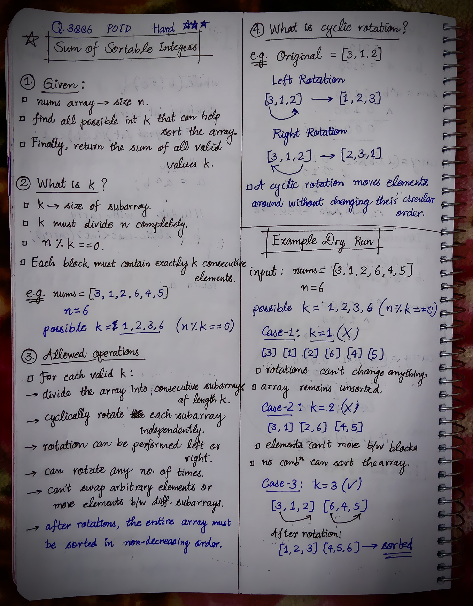
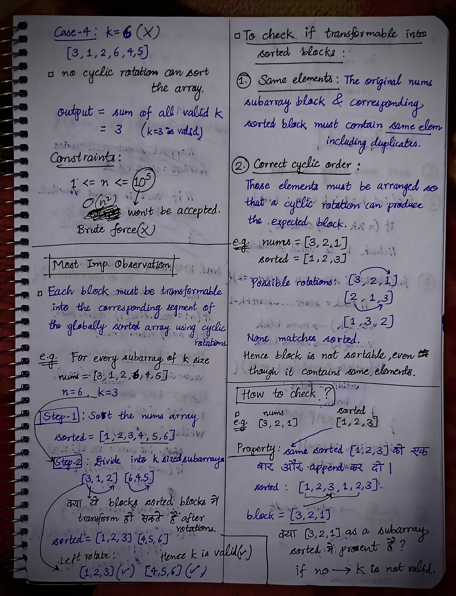
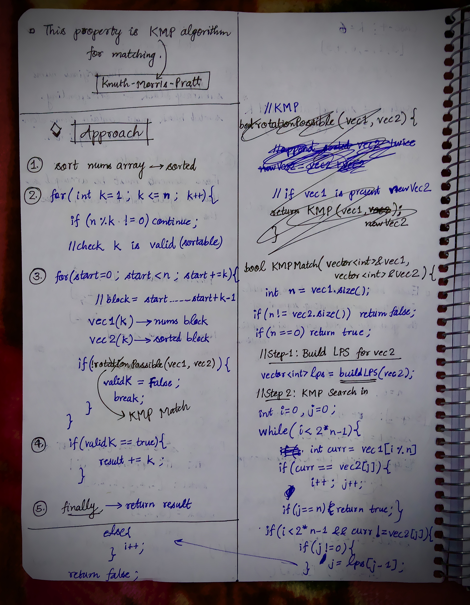
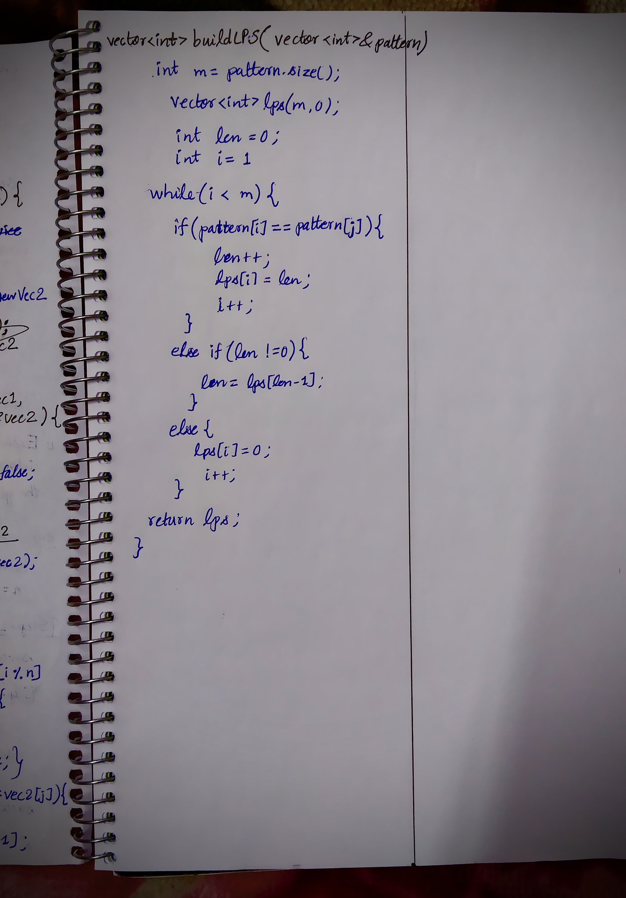

<h2><a href="https://leetcode.com/problems/sum-of-sortable-integers">4257. Sum of Sortable Integers</a></h2><h3>Hard</h3><hr><p>You are given an integer array <code>nums</code> of length <code>n</code>.</p>

<p>An integer <code>k</code> is called <strong>sortable</strong> if <code>k</code> <strong>divides</strong> <code>n</code> and you can sort <code>nums</code> in <strong>non-decreasing</strong> order by sequentially performing the following operations:</p>

<ul>
	<li>Partition <code>nums</code> into <strong>consecutive <span data-keyword="subarray-nonempty">subarrays</span></strong> of length <code>k</code>.</li>
	<li><strong>Cyclically rotate each subarray independently</strong> any number of times to the left or to the right.</li>
</ul>

<p>Return an integer denoting the sum of all possible sortable integers <code>k</code>.</p>

<p>&nbsp;</p>
<p><strong class="example">Example 1:</strong></p>

<div class="example-block">
<p><strong>Input:</strong> <span class="example-io">nums = [3,1,2]</span></p>

<p><strong>Output:</strong> <span class="example-io">3</span></p>

<p><strong>Explanation:</strong>​​​​​​​</p>

<ul>
	<li>For <code>n = 3</code>, possible divisors are 1 and 3.</li>
	<li>For <code>k = 1</code>: each subarray has one element. No rotation can sort the array.</li>
	<li>For <code>k = 3</code>: the single subarray <code>[3, 1, 2]</code> can be rotated once to produce <code>[1, 2, 3]</code>, which is sorted.</li>
	<li>Only <code>k = 3</code> is sortable. Hence, the answer is 3.</li>
</ul>
</div>

<p><strong class="example">Example 2:</strong></p>

<div class="example-block">
<p><strong>Input:</strong> <span class="example-io">nums = [7,6,5]</span></p>

<p><strong>Output:</strong> <span class="example-io">0</span></p>

<p><strong>Explanation:</strong></p>

<ul>
	<li>For <code>n = 3</code>, possible divisors are 1 and 3.</li>
	<li>For <code>k = 1</code>: each subarray has one element. No rotation can sort the array.</li>
	<li>For <code>k = 3</code>: the single subarray <code>[7, 6, 5]</code> cannot be rotated into non-decreasing order.</li>
	<li>No <code>k</code> is sortable. Hence, the answer is 0.</li>
</ul>
</div>

<p><strong class="example">Example 3:</strong></p>

<div class="example-block">
<p><strong>Input:</strong> <span class="example-io">nums = [5,8]</span></p>

<p><strong>Output:</strong> <span class="example-io">3</span></p>

<p><strong>Explanation:</strong>​​​​​​​</p>

<ul>
	<li>For <code>n = 2</code>, possible divisors are 1 and 2.</li>
	<li>Since <code>[5, 8]</code> is already sorted, every divisor is sortable. Hence, the answer is <code>1 + 2 = 3</code>.</li>
</ul>
</div>

<p>&nbsp;</p>
<p><strong>Constraints:</strong></p>

<ul>
	<li><code>1 &lt;= n == nums.length &lt;= 10<sup>5</sup></code></li>
	<li><code>1 &lt;= nums[i] &lt;= 10<sup>5</sup></code></li>
</ul>


<!-- AUTO-GENERATED-SOLUTION-START -->
---

## 🧠 Visual Solution & Intuition

### Part 1



### Part 2



### Part 3



### Part 4



---

## 💡 Approach

```text
Approach : Sorting + Divisor Enumeration + KMP-Based Cyclic Rotation Matching
```

---

## ⏱️ Complexity Analysis

```text
Time Complexity = O(n log n + n × d(n)) =>
Space Complexity = O(n) =>
```

---

## 💻 C++ Solution

[View Original C++ File](./3886-sum-of-sortable-integers.cpp)

```cpp
class Solution {
public:
    // !DISCLAIMER : NOT FOR BEGINNERS
    
    //Approach : Sorting + Divisor Enumeration + KMP-Based Cyclic Rotation Matching

    //Time Complexity = O(n log n + n × d(n)) =>
    /* Sorting the array: O(n log n).
    * Checking possible divisors: O(n).
    * For each valid divisor k:
        * Number of blocks = n/k.
        * KMP matching per block = O(k).
        * Total = (n/k) × O(k) = O(n).
    * Checking all divisors = O(n × d(n)).
    */

    //Space Complexity = O(n) =>
    /* Sorted array: O(n).
    * Temporary blocks: O(k).
    * LPS array: O(k).
    * Maximum k = n.
    */


    //Build LPS array
    vector<int> buildLPS(vector<int>& pattern){
        int m = pattern.size();

        vector<int> lps(m, 0);
        int len = 0;
        int i = 1;

        while(i < m){
            if(pattern[i] == pattern[len]){
                len++;
                lps[i] = len;
                i++;
            }
            else if(len != 0){
                len = lps[len -1];
            }

            else{
                lps[i] = 0;
                i++;
            }
        }

        return lps;
    }
    bool KMPMatch(vector<int>& vec1, vector<int>& vec2){
        int n = vec1.size();

        if(n != vec2.size()) return false;

        if(n == 0) return true;

        //Step-1: Build Lps for vec2
        vector<int> lps = buildLPS(vec2);

        //Step-2: KMP Search
        int i = 0, j = 0;

        while(i < 2*n - 1){
            
            if(vec1[i % n] == vec2[j]){
                i++;
                j++;

                if(j == n) return true;
            }

            else if(j != 0){
                j = lps[j-1];
            }
            else{
                i++;
            }
        }
        return false;
    }

    int sortableIntegers(vector<int>& nums) {
        int n = nums.size();
        
        int result = 0;

        vector<int> sorted = nums;

        //1.) Sort the array
        sort(sorted.begin(), sorted.end());


        //2.) 
        for(int k = 1; k <= n; k++){

            if(n % k != 0) continue;//skip

            //check if k is valid
            bool validK = true;

            for(int st = 0; st < n; st += k){

                //block = st....st+k-1

                //nums block k
                vector<int> vec1(nums.begin() + st, nums.begin() + st + k);
                //sorted block k
                vector<int> vec2(sorted.begin() + st, sorted.begin() + st + k);

                if(!KMPMatch(vec1, vec2)){
                    validK = false;
                    break;
                }
            }

            //check if k is valid
            if(validK){
                result += k;
            }
        }

        //finally return the result
        return result;
        
    }
};
```

<!-- AUTO-GENERATED-SOLUTION-END -->
