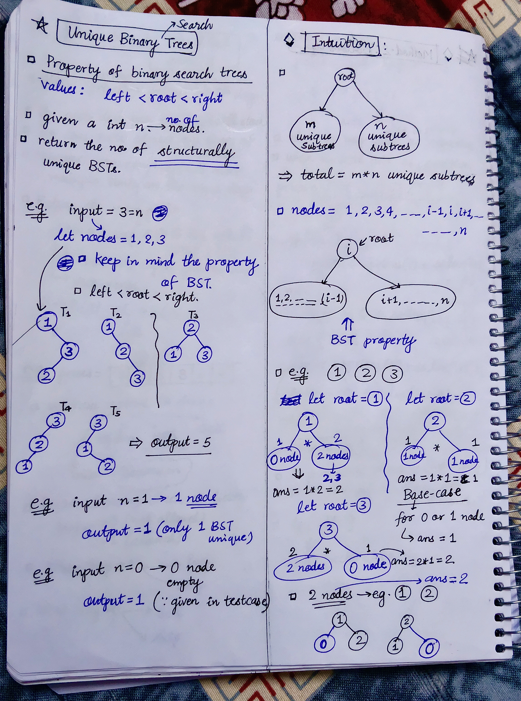
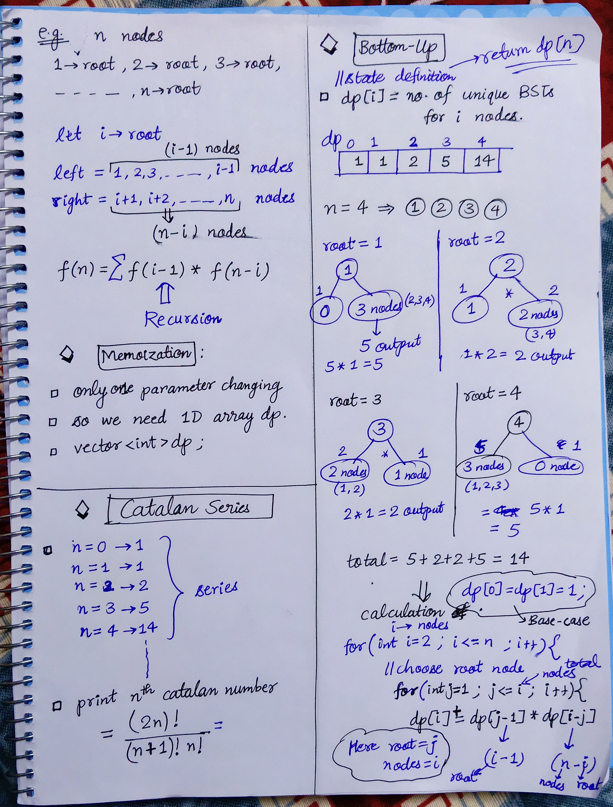

<h2><a href="https://leetcode.com/problems/unique-binary-search-trees">96. Unique Binary Search Trees</a></h2><h3>Medium</h3><hr><p>Given an integer <code>n</code>, return <em>the number of structurally unique <strong>BST&#39;</strong>s (binary search trees) which has exactly </em><code>n</code><em> nodes of unique values from</em> <code>1</code> <em>to</em> <code>n</code>.</p>

<p>&nbsp;</p>
<p><strong class="example">Example 1:</strong></p>

<pre>
<strong>Input:</strong> n = 3
<strong>Output:</strong> 5
</pre>

<p><strong class="example">Example 2:</strong></p>

<pre>
<strong>Input:</strong> n = 1
<strong>Output:</strong> 1
</pre>

<p>&nbsp;</p>
<p><strong>Constraints:</strong></p>

<ul>
	<li><code>1 &lt;= n &lt;= 19</code></li>
</ul>


<!-- AUTO-GENERATED-SOLUTION-START -->
---

## 🧠 Visual Solution & Intuition

### Part 1



### Part 2



---

## ⏱️ Complexity Analysis

```text
Time Complexity = O(n)
Space Complexity = O(n)
```

---

## 💻 C++ Solution

[View Original C++ File](./0096-unique-binary-search-trees.cpp)

```cpp
class Solution {
public:
    //Method-2 : Bottoum-Up Approach

    //Time Complexity = O(n)
    //Space Complexity = O(n)

    int numTrees(int n) {
        //make dp array
        vector<int>dp(n+1, 0) ; //initialize with 0

        //base-case :
        dp[0] = dp[1] = 1 ; // for 1 node or 0 node , ans = 1

        //fill remaining 
        // i = no. nodes = n
        for(int i=2 ; i<= n ; i++){
             //choose root for every i
             for(int j=1 ; j<= i ; j++){
                dp[i] += dp[j-1]* dp[i-j] ;
             }
        }

        //return dp[n] = no. of unique BSTs for n nodes
        return dp[n] ;
    }
};
```

<!-- AUTO-GENERATED-SOLUTION-END -->
