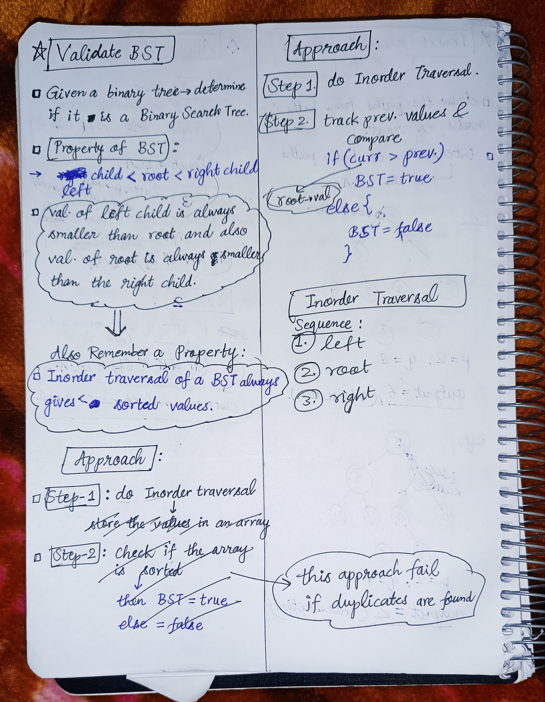

<h2><a href="https://leetcode.com/problems/validate-binary-search-tree">98. Validate Binary Search Tree</a></h2><h3>Medium</h3><hr><p>Given the <code>root</code> of a binary tree, <em>determine if it is a valid binary search tree (BST)</em>.</p>

<p>A <strong>valid BST</strong> is defined as follows:</p>

<ul>
	<li>The left <span data-keyword="subtree">subtree</span> of a node contains only nodes with keys&nbsp;<strong>strictly less than</strong> the node&#39;s key.</li>
	<li>The right subtree of a node contains only nodes with keys <strong>strictly greater than</strong> the node&#39;s key.</li>
	<li>Both the left and right subtrees must also be binary search trees.</li>
</ul>

<p>&nbsp;</p>
<p><strong class="example">Example 1:</strong></p>

<pre>
<strong>Input:</strong> root = [2,1,3]
<strong>Output:</strong> true
</pre>

<p><strong class="example">Example 2:</strong></p>

<pre>
<strong>Input:</strong> root = [5,1,4,null,null,3,6]
<strong>Output:</strong> false
<strong>Explanation:</strong> The root node&#39;s value is 5 but its right child&#39;s value is 4.
</pre>

<p>&nbsp;</p>
<p><strong>Constraints:</strong></p>

<ul>
	<li>The number of nodes in the tree is in the range <code>[1, 10<sup>4</sup>]</code>.</li>
	<li><code>-2<sup>31</sup> &lt;= Node.val &lt;= 2<sup>31</sup> - 1</code></li>
</ul>


<!-- AUTO-GENERATED-SOLUTION-START -->
---

## 🧠 Visual Solution & Intuition



---

## ⏱️ Complexity Analysis

```text
Time Complexity = O(n) =>
Space Complexity = O(h) =>
```

---

## 💻 C++ Solution

[View Original C++ File](./0098-validate-binary-search-tree.cpp)

```cpp
/**
 * Definition for a binary tree node.
 * struct TreeNode {
 *     int val;
 *     TreeNode *left;
 *     TreeNode *right;
 *     TreeNode() : val(0), left(nullptr), right(nullptr) {}
 *     TreeNode(int x) : val(x), left(nullptr), right(nullptr) {}
 *     TreeNode(int x, TreeNode *left, TreeNode *right) : val(x), left(left), right(right) {}
 * };
 */
class Solution {
public:
    //Approach :

    //Time Complexity = O(n) =>
    /* n is the number of nodes.
    * Each node is visited at most once.
    * Each visit performs constant work: checking bounds and preparing recursive calls.
    * In the worst case, all nodes are checked, so total time is O(n).
    * An invalid node may let us stop early, but the worst-case bound stays O(n).
    */

    //Space Complexity = O(h) =>
    /* h is the height of the tree.
    * Recursive calls use the call stack.
    * At any moment, the stack holds calls along one root-to-leaf path.
    * Balanced tree: h = O(log n) → space is O(log n).
    * Skewed tree: h = O(n) → space is O(n).
    * The left and right subtrees are processed sequentially, so their stack space does not add together.
    */


    bool validate(TreeNode* node, long long lower, long long upper){
        // Step 1: An empty subtree is a valid BST.
        if(node == NULL){
            
            return true;
        }

        // Step 2: Check the restrictions imposed by ALL ancestors.
        // Strict bounds also reject duplicate values.
        if(node->val <= lower || node->val >= upper){
            
            return false;
        }

        // Step 3: Every value in the left subtree must be smaller
        // than this node, while respecting the inherited lower bound.
        if(!validate(node->left, lower, node->val)){
            
            return false;
        }
        
        // Step 4: Every value in the right subtree must be greater
        // than this node, while respecting the inherited upper bound.
        return validate(node->right, node->val, upper);
    }

    bool isValidBST(TreeNode* root) {
        // Step 5: Start with bounds beyond all possible int values.
        // long long allows INT_MIN and INT_MAX to be valid node values.
        return validate(root, LLONG_MIN, LLONG_MAX);
    }
};
```

<!-- AUTO-GENERATED-SOLUTION-END -->
