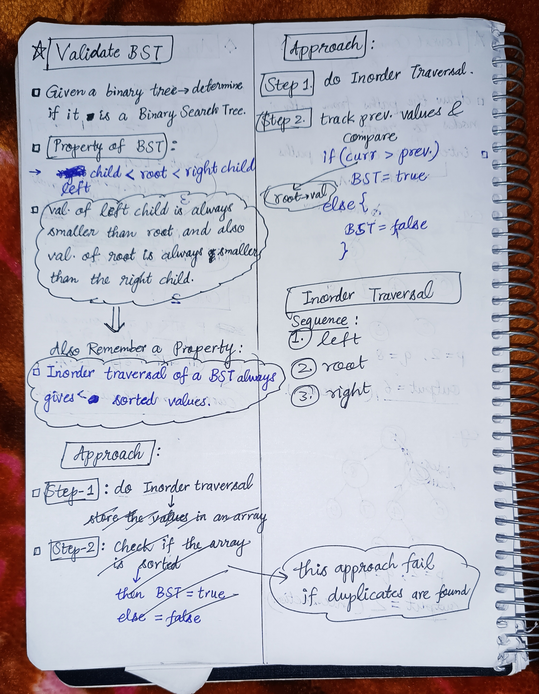

<h2><a href="https://leetcode.com/problems/validate-binary-search-tree">98. Validate Binary Search Tree</a></h2><h3>Medium</h3><hr><p>Given the <code>root</code> of a binary tree, <em>determine if it is a valid binary search tree (BST)</em>.</p>

<p>A <strong>valid BST</strong> is defined as follows:</p>

<ul>
	<li>The left <span data-keyword="subtree">subtree</span> of a node contains only nodes with keys&nbsp;<strong>strictly less than</strong> the node&#39;s key.</li>
	<li>The right subtree of a node contains only nodes with keys <strong>strictly greater than</strong> the node&#39;s key.</li>
	<li>Both the left and right subtrees must also be binary search trees.</li>
</ul>

<p>&nbsp;</p>
<p><strong class="example">Example 1:</strong></p>

<pre>
<strong>Input:</strong> root = [2,1,3]
<strong>Output:</strong> true
</pre>

<p><strong class="example">Example 2:</strong></p>

<pre>
<strong>Input:</strong> root = [5,1,4,null,null,3,6]
<strong>Output:</strong> false
<strong>Explanation:</strong> The root node&#39;s value is 5 but its right child&#39;s value is 4.
</pre>

<p>&nbsp;</p>
<p><strong>Constraints:</strong></p>

<ul>
	<li>The number of nodes in the tree is in the range <code>[1, 10<sup>4</sup>]</code>.</li>
	<li><code>-2<sup>31</sup> &lt;= Node.val &lt;= 2<sup>31</sup> - 1</code></li>
</ul>


<!-- AUTO-GENERATED-SOLUTION-START -->
---

## 🧠 Visual Solution & Intuition



---

## ⏱️ Complexity Analysis

```text
Time Complexity = O(n) => cause traversing n nodes of the tree.
Space Complexity = O(1) => cause no extra data structures used for storing nodes.
```

---

## 💻 C++ Solution

[View Original C++ File](./0098-validate-binary-search-tree.cpp)

```cpp
/**
 * Definition for a binary tree node.
 * struct TreeNode {
 *     int val;
 *     TreeNode *left;
 *     TreeNode *right;
 *     TreeNode() : val(0), left(nullptr), right(nullptr) {}
 *     TreeNode(int x) : val(x), left(nullptr), right(nullptr) {}
 *     TreeNode(int x, TreeNode *left, TreeNode *right) : val(x), left(left), right(right) {}
 * };
 */
class Solution {
public:
    //Time Complexity = O(n) => cause traversing n nodes of the tree.
    //Space Complexity = O(1) => cause no extra data structures used for storing nodes.
    
    //Very-very easy problem if you have already solved many problems of BST

    long long prev = LLONG_MIN ; //var to track prev values
    bool inorder(TreeNode* root){
        //for empty tree
        if(root == NULL) return true ;
        
        //Sequeunce :
        //1.) left
        //if the left subTree is invalid not follow BST rules then
        if(!inorder(root->left)) return false ;

        //2.) check current root node
        if(root->val <= prev) return false ; 

        //update prev
        prev = root->val ;

        //3.)func. call for right subTree
        return inorder(root->right) ;
    }
    bool isValidBST(TreeNode* root) {
        
        //func. call to inorder traversal
        return inorder(root) ;
        
    }
};
```

<!-- AUTO-GENERATED-SOLUTION-END -->
