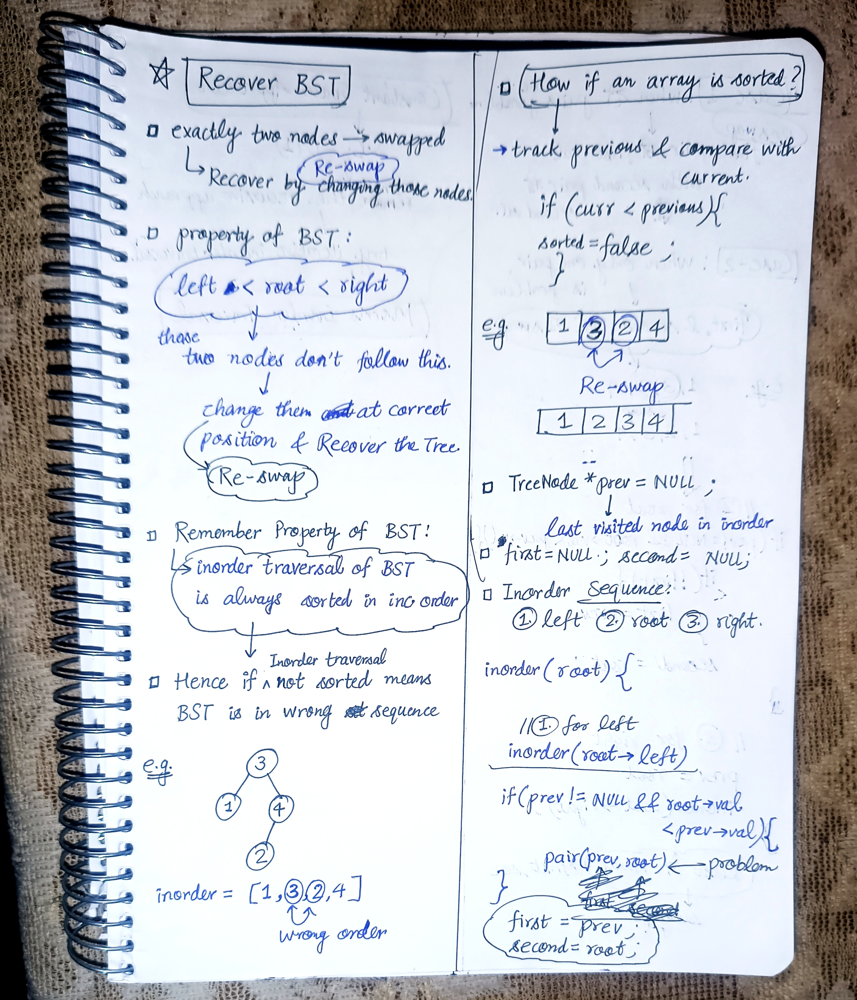
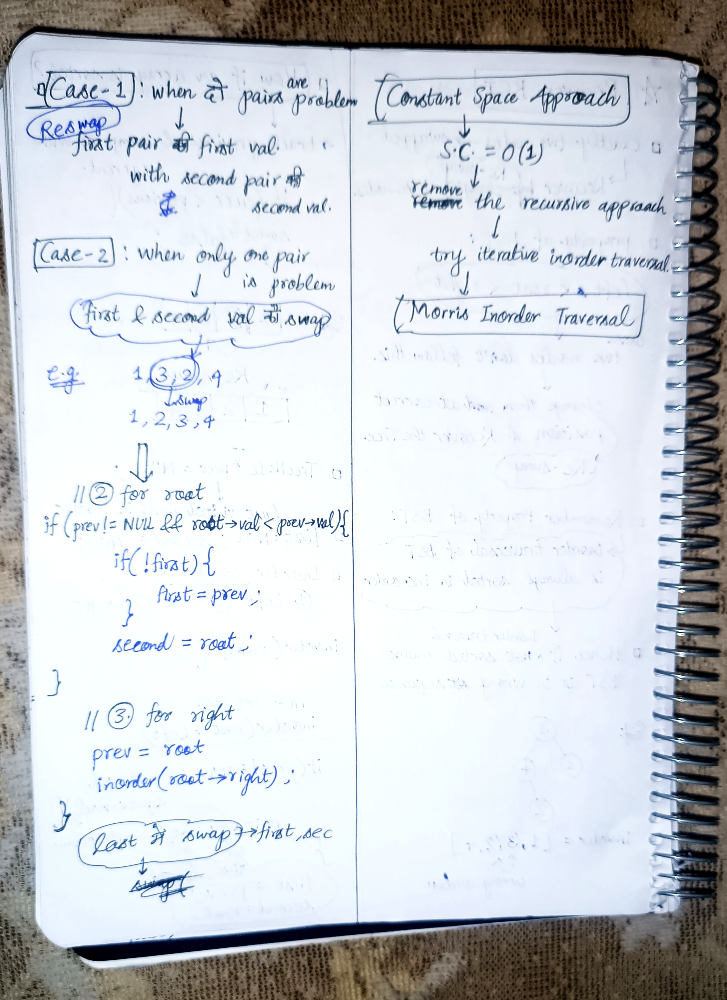
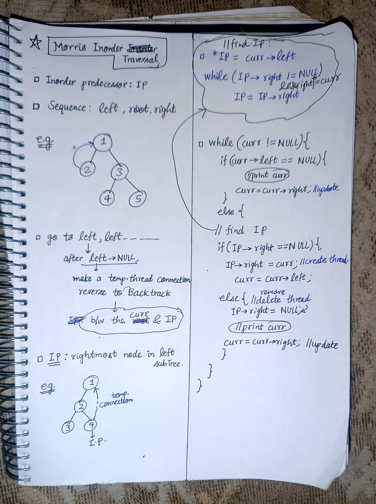

<h2><a href="https://leetcode.com/problems/recover-binary-search-tree">99. Recover Binary Search Tree</a></h2><h3>Medium</h3><hr><p>You are given the <code>root</code> of a binary search tree (BST), where the values of <strong>exactly</strong> two nodes of the tree were swapped by mistake. <em>Recover the tree without changing its structure</em>.</p>

<p>&nbsp;</p>
<p><strong class="example">Example 1:</strong></p>

<pre>
<strong>Input:</strong> root = [1,3,null,null,2]
<strong>Output:</strong> [3,1,null,null,2]
<strong>Explanation:</strong> 3 cannot be a left child of 1 because 3 &gt; 1. Swapping 1 and 3 makes the BST valid.
</pre>

<p><strong class="example">Example 2:</strong></p>

<pre>
<strong>Input:</strong> root = [3,1,4,null,null,2]
<strong>Output:</strong> [2,1,4,null,null,3]
<strong>Explanation:</strong> 2 cannot be in the right subtree of 3 because 2 &lt; 3. Swapping 2 and 3 makes the BST valid.
</pre>

<p>&nbsp;</p>
<p><strong>Constraints:</strong></p>

<ul>
	<li>The number of nodes in the tree is in the range <code>[2, 1000]</code>.</li>
	<li><code>-2<sup>31</sup> &lt;= Node.val &lt;= 2<sup>31</sup> - 1</code></li>
</ul>

<p>&nbsp;</p>
<strong>Follow up:</strong> A solution using <code>O(n)</code> space is pretty straight-forward. Could you devise a constant <code>O(1)</code> space solution?

<!-- AUTO-GENERATED-SOLUTION-START -->
---

## 🧠 Visual Solution & Intuition

### Part 1



### Part 2



### Part 3



---

## 💻 C++ Solution

[View Original C++ File](./0099-recover-binary-search-tree.cpp)

```cpp
/**
 * Definition for a binary tree node.
 * struct TreeNode {
 *     int val;
 *     TreeNode *left;
 *     TreeNode *right;
 *     TreeNode() : val(0), left(nullptr), right(nullptr) {}
 *     TreeNode(int x) : val(x), left(nullptr), right(nullptr) {}
 *     TreeNode(int x, TreeNode *left, TreeNode *right) : val(x), left(left), right(right) {}
 * };
 */
class Solution {
public:
    void recoverTree(TreeNode* root) {

        //three variables needed
        TreeNode* prev = NULL ;
        TreeNode* first = NULL ;
        TreeNode* second = NULL ;

        //Moris Inorder Traversal using Loop
    while(root != NULL){
        if(root->left == NULL){
            if(prev != NULL && root->val < prev->val){
                if(first == NULL){
                    first = prev ;
                }
                second = root ;
            }

            prev = root ;//update previous 
            root = root->right ;
        }

        else{
            //find the prev(IP) : Inorder predecessor
            TreeNode* IP = root->left ;
            while(IP->right != NULL && IP->right != root){
                IP = IP->right ;
            }

            if(IP->right == NULL){
                IP->right = root ;
                root = root->left ;
            }
            else{
                if(prev != NULL && root->val < prev->val){
                        if(first == NULL){
                            first = prev ;
                        }
                        second = root ;
                    }

                    //update previous
                    prev = root ;
                    IP->right = NULL ;
                    root = root->right ;
                }
            }
    }

        //swap the first & second
    if(first && second != NULL){
       int temp = first->val ;
       first->val = second->val ;
       second->val = temp ;

    }    
               
    }
};
```

<!-- AUTO-GENERATED-SOLUTION-END -->
