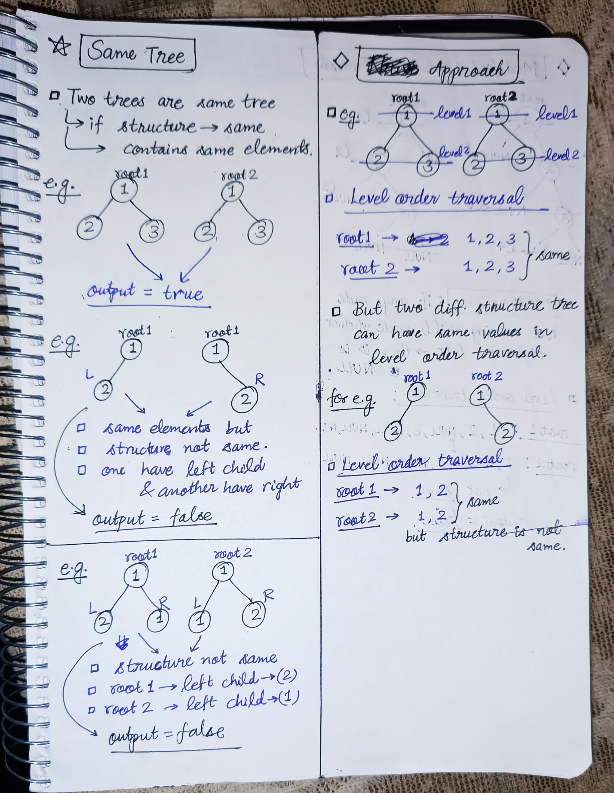
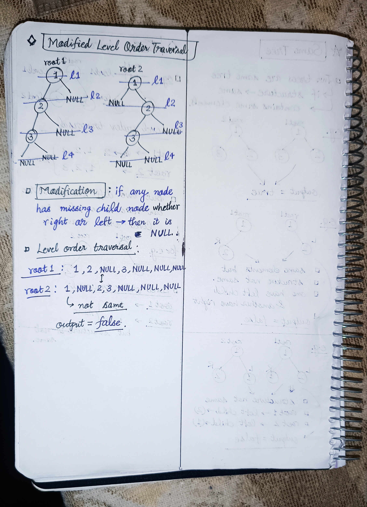

<h2><a href="https://leetcode.com/problems/same-tree">100. Same Tree</a></h2><h3>Easy</h3><hr><p>Given the roots of two binary trees <code>p</code> and <code>q</code>, write a function to check if they are the same or not.</p>

<p>Two binary trees are considered the same if they are structurally identical, and the nodes have the same value.</p>

<p>&nbsp;</p>
<p><strong class="example">Example 1:</strong></p>

<pre>
<strong>Input:</strong> p = [1,2,3], q = [1,2,3]
<strong>Output:</strong> true
</pre>

<p><strong class="example">Example 2:</strong></p>

<pre>
<strong>Input:</strong> p = [1,2], q = [1,null,2]
<strong>Output:</strong> false
</pre>

<p><strong class="example">Example 3:</strong></p>

<pre>
<strong>Input:</strong> p = [1,2,1], q = [1,1,2]
<strong>Output:</strong> false
</pre>

<p>&nbsp;</p>
<p><strong>Constraints:</strong></p>

<ul>
	<li>The number of nodes in both trees is in the range <code>[0, 100]</code>.</li>
	<li><code>-10<sup>4</sup> &lt;= Node.val &lt;= 10<sup>4</sup></code></li>
</ul>


<!-- AUTO-GENERATED-SOLUTION-START -->
---

## 🧠 Visual Solution & Intuition

### Part 1



### Part 2



---

## 💡 Approach

```text
Approach : Recursive Depth-First Search (DFS)
```

---

## ⏱️ Complexity Analysis

```text
Time Complexity = O(n) =>
Space Complexity = O(h) =>
```

---

## 💻 C++ Solution

[View Original C++ File](./0100-same-tree.cpp)

```cpp
/**
 * Definition for a binary tree node.
 * struct TreeNode {
 *     int val;
 *     TreeNode *left;
 *     TreeNode *right;
 *     TreeNode() : val(0), left(nullptr), right(nullptr) {}
 *     TreeNode(int x) : val(x), left(nullptr), right(nullptr) {}
 *     TreeNode(int x, TreeNode *left, TreeNode *right) : val(x), left(left), right(right) {}
 * };
 */
class Solution {
public:
    //Approach : Recursive Depth-First Search (DFS)

    //Time Complexity = O(n) =>
    /* N is the number of nodes in the larger tree.
    * Each pair of corresponding nodes is compared at most once.
    * Each comparison takes O(1) time.
    * In the worst case, the trees are identical, so we check every node.
    * Best case: O(1) if the roots immediately reveal a mismatch or both trees are empty.
    */

    //Space Complexity = O(h) =>
    /* H is the height of the tree.
    * Recursion uses the call stack to store active function calls.
    * At most one root-to-leaf path is active at a time.
    * Balanced tree: O(log N) stack space.
    * Skewed tree: O(N) stack space.
    * No additional arrays or queues are used.
    */

    bool isSameTree(TreeNode* p, TreeNode* q) {
        
        //1.) Start with root nodes
        if(p == NULL && q == NULL){
            
            return true;
        }

        //2.) Only one empty subtree means different structures.
        if(p == NULL || q == NULL){

            return false;
        }

        //3.) Corresponding nodes must have equal values.
        if(p->val != q->val){
            return false;
        }

        //4.) Both left and right subtree pairs must match.
        return isSameTree(p->left, q->left) &&
            isSameTree(p->right, q->right);
    }
};
```

<!-- AUTO-GENERATED-SOLUTION-END -->
