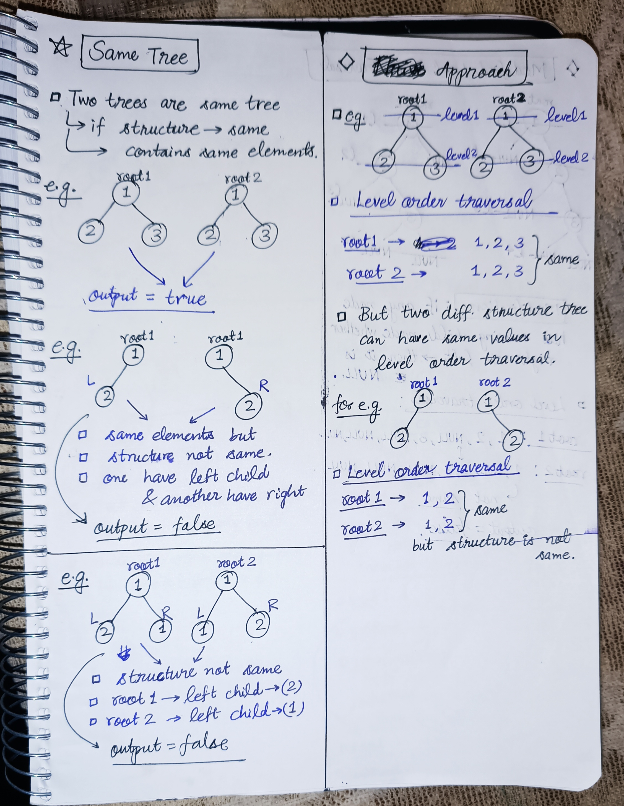
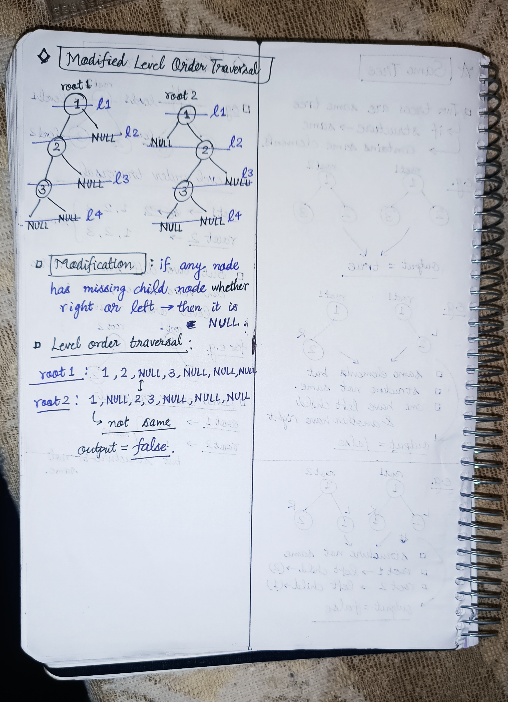

<h2><a href="https://leetcode.com/problems/same-tree">100. Same Tree</a></h2><h3>Easy</h3><hr><p>Given the roots of two binary trees <code>p</code> and <code>q</code>, write a function to check if they are the same or not.</p>

<p>Two binary trees are considered the same if they are structurally identical, and the nodes have the same value.</p>

<p>&nbsp;</p>
<p><strong class="example">Example 1:</strong></p>

<pre>
<strong>Input:</strong> p = [1,2,3], q = [1,2,3]
<strong>Output:</strong> true
</pre>

<p><strong class="example">Example 2:</strong></p>

<pre>
<strong>Input:</strong> p = [1,2], q = [1,null,2]
<strong>Output:</strong> false
</pre>

<p><strong class="example">Example 3:</strong></p>

<pre>
<strong>Input:</strong> p = [1,2,1], q = [1,1,2]
<strong>Output:</strong> false
</pre>

<p>&nbsp;</p>
<p><strong>Constraints:</strong></p>

<ul>
	<li>The number of nodes in both trees is in the range <code>[0, 100]</code>.</li>
	<li><code>-10<sup>4</sup> &lt;= Node.val &lt;= 10<sup>4</sup></code></li>
</ul>


<!-- AUTO-GENERATED-SOLUTION-START -->
---

## 🧠 Visual Solution & Intuition

### Part 1



### Part 2



---

## ⏱️ Complexity Analysis

```text
Time Complexity = O(n) => traversing n nodes in the tree
Space Complexity = O(n) => level order traversal using queue
```

---

## 💻 C++ Solution

[View Original C++ File](./0100-same-tree.cpp)

```cpp
/**
 * Definition for a binary tree node.
 * struct TreeNode {
 *     int val;
 *     TreeNode *left;
 *     TreeNode *right;
 *     TreeNode() : val(0), left(nullptr), right(nullptr) {}
 *     TreeNode(int x) : val(x), left(nullptr), right(nullptr) {}
 *     TreeNode(int x, TreeNode *left, TreeNode *right) : val(x), left(left), right(right) {}
 * };
 */
class Solution {
public:
    //Time Complexity = O(n) => traversing n nodes in the tree
    //Space Complexity = O(n) => level order traversal using queue
    bool isSameTree(TreeNode* root1, TreeNode* root2) {
        queue<TreeNode*> q ;
        //first push the root1, root2 in the queue 
        q.push(root1) ; 
        q.push(root2) ;

        //traverse on trees and make the modification

        while(!q.empty()){
            //make two pointers to point left child, right child null
            //if there is no child
            TreeNode* first = q.front() ; q.pop() ;
            TreeNode* second = q.front() ; q.pop() ;

            //if both null then continue
            if(first == NULL && second == NULL){
                continue ;
            }

            //if one val is NULL or values not same then false
            if(first == NULL || second == NULL || first->val != second->val){
                return false ;
            }

            //push children in same order left,left && right,right
            q.push(first->left) ;
            q.push(second->left) ;

            q.push(first->right) ;
            q.push(second->right) ;
        }

        //if no false found in above loop then
        return true ;
    }
};
```

<!-- AUTO-GENERATED-SOLUTION-END -->
