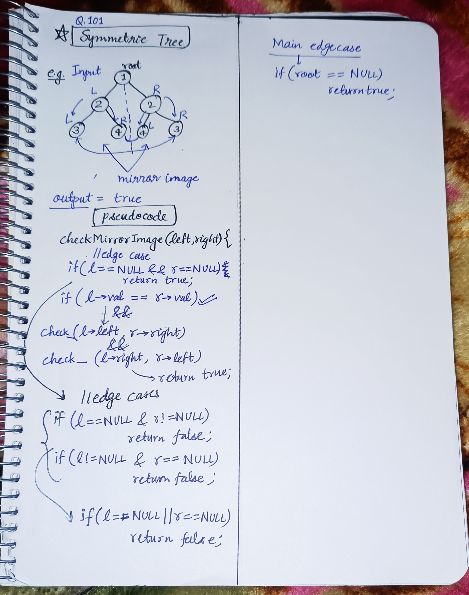

<h2><a href="https://leetcode.com/problems/symmetric-tree">101. Symmetric Tree</a></h2><h3>Easy</h3><hr><p>Given the <code>root</code> of a binary tree, <em>check whether it is a mirror of itself</em> (i.e., symmetric around its center).</p>

<p>&nbsp;</p>
<p><strong class="example">Example 1:</strong></p>

<pre>
<strong>Input:</strong> root = [1,2,2,3,4,4,3]
<strong>Output:</strong> true
</pre>

<p><strong class="example">Example 2:</strong></p>

<pre>
<strong>Input:</strong> root = [1,2,2,null,3,null,3]
<strong>Output:</strong> false
</pre>

<p>&nbsp;</p>
<p><strong>Constraints:</strong></p>

<ul>
	<li>The number of nodes in the tree is in the range <code>[1, 1000]</code>.</li>
	<li><code>-100 &lt;= Node.val &lt;= 100</code></li>
</ul>

<p>&nbsp;</p>
<strong>Follow up:</strong> Could you solve it both recursively and iteratively?

<!-- AUTO-GENERATED-SOLUTION-START -->
---

## 🧠 Visual Solution & Intuition



---

## ⏱️ Complexity Analysis

```text
Time Complexity = O(n)
Space Complexity = O(H) = O(logn) => H is height of the tree(generally logn)
```

---

## 💻 C++ Solution

[View Original C++ File](./0101-symmetric-tree.cpp)

```cpp
/**
 * Definition for a binary tree node.
 * struct TreeNode {
 *     int val;
 *     TreeNode *left;
 *     TreeNode *right;
 *     TreeNode() : val(0), left(nullptr), right(nullptr) {}
 *     TreeNode(int x) : val(x), left(nullptr), right(nullptr) {}
 *     TreeNode(int x, TreeNode *left, TreeNode *right) : val(x), left(left), right(right) {}
 * };
 */
class Solution {
public:
    //Time Complexity = O(n)
    //Space Complexity = O(H) = O(logn) => H is height of the tree(generally logn)
    bool checkMirrorImage(TreeNode *l, TreeNode *r){
        //base case
        if(l == NULL && r == NULL){
            return true ;
        }
        //edge cases
        if(l == NULL && r != NULL){
            return false ;
        }
        if(l != NULL && r == NULL){
            return false ;
        }

        //checks
        if((l->val == r->val) && checkMirrorImage(l->left,r->right) && checkMirrorImage(l->right,r->left)){
            return true ;
        }
        
        //if no true found in above then false
        return false ;
        
    }
    bool isSymmetric(TreeNode* root) {

        if(root == NULL) return true ;

        return checkMirrorImage(root->left,root->right) ;
    }
};
```

<!-- AUTO-GENERATED-SOLUTION-END -->
