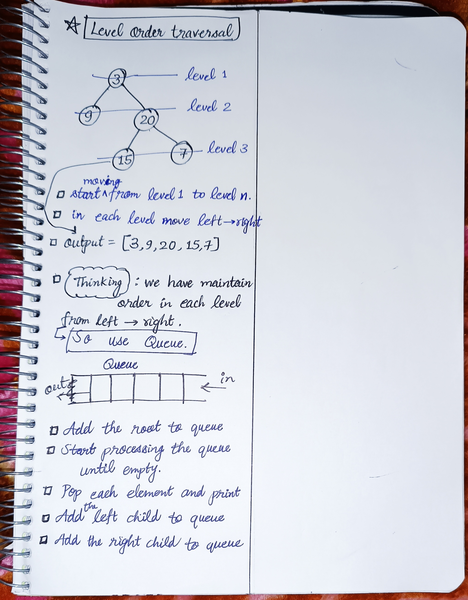

<h2><a href="https://leetcode.com/problems/binary-tree-level-order-traversal">102. Binary Tree Level Order Traversal</a></h2><h3>Medium</h3><hr><p>Given the <code>root</code> of a binary tree, return <em>the level order traversal of its nodes&#39; values</em>. (i.e., from left to right, level by level).</p>

<p>&nbsp;</p>
<p><strong class="example">Example 1:</strong></p>

<pre>
<strong>Input:</strong> root = [3,9,20,null,null,15,7]
<strong>Output:</strong> [[3],[9,20],[15,7]]
</pre>

<p><strong class="example">Example 2:</strong></p>

<pre>
<strong>Input:</strong> root = [1]
<strong>Output:</strong> [[1]]
</pre>

<p><strong class="example">Example 3:</strong></p>

<pre>
<strong>Input:</strong> root = []
<strong>Output:</strong> []
</pre>

<p>&nbsp;</p>
<p><strong>Constraints:</strong></p>

<ul>
	<li>The number of nodes in the tree is in the range <code>[0, 2000]</code>.</li>
	<li><code>-1000 &lt;= Node.val &lt;= 1000</code></li>
</ul>


<!-- AUTO-GENERATED-SOLUTION-START -->
---

## 🧠 Visual Solution & Intuition



---

## ⏱️ Complexity Analysis

```text
Time Complexity = O(n) => cause visiting n nodes of the tree.
Space Complexity = O(n) => cause at most queue stores n/2 nodes of the tree.
```

---

## 💻 C++ Solution

[View Original C++ File](./0102-binary-tree-level-order-traversal.cpp)

```cpp
/**
 * Definition for a binary tree node.
 * struct TreeNode {
 *     int val;
 *     TreeNode *left;
 *     TreeNode *right;
 *     TreeNode() : val(0), left(nullptr), right(nullptr) {}
 *     TreeNode(int x) : val(x), left(nullptr), right(nullptr) {}
 *     TreeNode(int x, TreeNode *left, TreeNode *right) : val(x), left(left), right(right) {}
 * };
 */
class Solution {
public:
    //Time Complexity = O(n) => cause visiting n nodes of the tree.
    //Space Complexity = O(n) => cause at most queue stores n/2 nodes of the tree.
    vector<vector<int>> levelOrder(TreeNode* root) {
        vector<vector<int>> ans ; //to store the the output

        //base case
        if(root == NULL){
            return ans ;
        }

        //make a queue
        queue<TreeNode*> q ;
        //start with root node (level-1)
        q.push(root) ;

        //loop till queue is not empty
        while(!q.empty()){
            int size = q.size() ;
            vector<int> level ; //stores each level

            for(int i=0 ; i<size ; i++){
                TreeNode* node = q.front() ;
                //Step 1 : pop and print(insert in level)
                q.pop() ;

                level.push_back(node->val) ;

                //Step 2 : add the left child to queue
                if(node->left) q.push(node->left) ;
                //Step 3 : add the right child to queue
                if(node->right) q.push(node->right) ;
                
            }
            //Now push level values in ans
            ans.push_back(level) ;

        }

        //Finally very important to return the output
        return ans ;

    }
};
```

<!-- AUTO-GENERATED-SOLUTION-END -->
