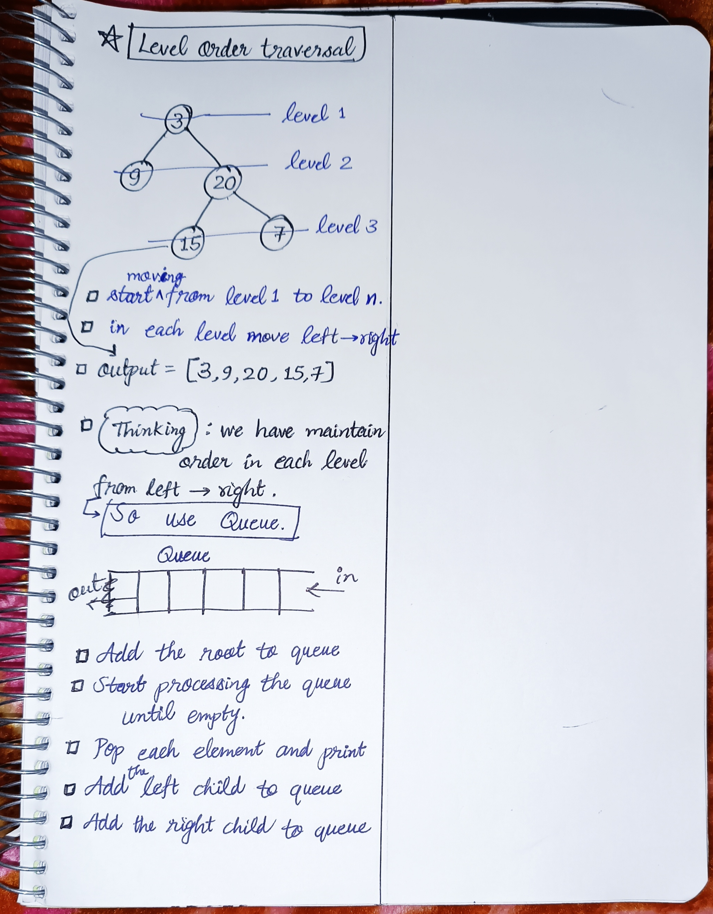

<h2><a href="https://leetcode.com/problems/binary-tree-level-order-traversal">102. Binary Tree Level Order Traversal</a></h2><h3>Medium</h3><hr><p>Given the <code>root</code> of a binary tree, return <em>the level order traversal of its nodes&#39; values</em>. (i.e., from left to right, level by level).</p>

<p>&nbsp;</p>
<p><strong class="example">Example 1:</strong></p>

<pre>
<strong>Input:</strong> root = [3,9,20,null,null,15,7]
<strong>Output:</strong> [[3],[9,20],[15,7]]
</pre>

<p><strong class="example">Example 2:</strong></p>

<pre>
<strong>Input:</strong> root = [1]
<strong>Output:</strong> [[1]]
</pre>

<p><strong class="example">Example 3:</strong></p>

<pre>
<strong>Input:</strong> root = []
<strong>Output:</strong> []
</pre>

<p>&nbsp;</p>
<p><strong>Constraints:</strong></p>

<ul>
	<li>The number of nodes in the tree is in the range <code>[0, 2000]</code>.</li>
	<li><code>-1000 &lt;= Node.val &lt;= 1000</code></li>
</ul>


<!-- AUTO-GENERATED-SOLUTION-START -->
---

## 🧠 Visual Solution & Intuition



---

## 💡 Approach

```text
Approach : BFS Level Order Traversal
```

---

## ⏱️ Complexity Analysis

```text
Time Complexity = O(n) =>
Space Complexity = O(n) =>
```

---

## 💻 C++ Solution

[View Original C++ File](./0102-binary-tree-level-order-traversal.cpp)

```cpp
/**
 * Definition for a binary tree node.
 * struct TreeNode {
 *     int val;
 *     TreeNode *left;
 *     TreeNode *right;
 *     TreeNode() : val(0), left(nullptr), right(nullptr) {}
 *     TreeNode(int x) : val(x), left(nullptr), right(nullptr) {}
 *     TreeNode(int x, TreeNode *left, TreeNode *right) : val(x), left(left), right(right) {}
 * };
 */
class Solution {
public:
    //Approach : BFS Level Order Traversal

    //Time Complexity = O(n) =>
    /* n is the total number of nodes.
    * Every node is pushed into the queue once and popped once.
    * Each node’s value is added to a level once.
    * Copying all completed levels into result takes O(n) total.
    * The nested loops process n nodes altogether, so time is O(n), not O(n²).
    */
 
    //Space Complexity = O(n) =>
    /* Queue: O(w), where w is the maximum number of nodes at any level.
    Temporary level vector: O(w), storing one level’s values.
    Auxiliary space: O(w), which is O(n) in the worst case.
    Output result: O(n), storing all node values.
    Total space including output: O(n).
    */
 

    vector<vector<int>> levelOrder(TreeNode* root) {
        
        vector<vector<int>> result;//to store the output
        
        if(root == NULL){
            return result;
        }

        //1.) Intialize a queue for BFS
        queue<TreeNode*> q;

        q.push(root); //start with root

        //2.) Process until q is empty
        while(!q.empty()){
         
            int N = q.size();//level size
            
            vector<int> level;
            
            //3.) Process exactly levelSize nodes
            while(N--){
                TreeNode* node = q.front();
                q.pop();

                level.push_back(node->val);

                //4.) Prepare the next level: push children in queue
                if(node->left){
                    q.push(node->left);
                }

                if(node->right){
                    q.push(node->right);
                }
            }

            // 5.) Store the completed level.
            result.push_back(level);
        }

        return result;
    }
};
```

<!-- AUTO-GENERATED-SOLUTION-END -->
