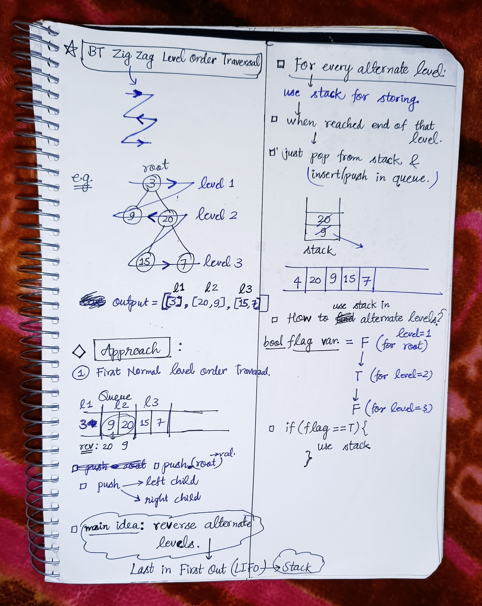

<h2><a href="https://leetcode.com/problems/binary-tree-zigzag-level-order-traversal">103. Binary Tree Zigzag Level Order Traversal</a></h2><h3>Medium</h3><hr><p>Given the <code>root</code> of a binary tree, return <em>the zigzag level order traversal of its nodes&#39; values</em>. (i.e., from left to right, then right to left for the next level and alternate between).</p>

<p>&nbsp;</p>
<p><strong class="example">Example 1:</strong></p>

<pre>
<strong>Input:</strong> root = [3,9,20,null,null,15,7]
<strong>Output:</strong> [[3],[20,9],[15,7]]
</pre>

<p><strong class="example">Example 2:</strong></p>

<pre>
<strong>Input:</strong> root = [1]
<strong>Output:</strong> [[1]]
</pre>

<p><strong class="example">Example 3:</strong></p>

<pre>
<strong>Input:</strong> root = []
<strong>Output:</strong> []
</pre>

<p>&nbsp;</p>
<p><strong>Constraints:</strong></p>

<ul>
	<li>The number of nodes in the tree is in the range <code>[0, 2000]</code>.</li>
	<li><code>-100 &lt;= Node.val &lt;= 100</code></li>
</ul>


<!-- AUTO-GENERATED-SOLUTION-START -->
---

## 🧠 Visual Solution & Intuition



---

## ⏱️ Complexity Analysis

```text
Time Complexity = O(n) => cause traversing n nodes of the tree.
Space Complexity = O(n) => cause queue stores elements of each level // in worst case queue stores n/2 elements at a time.
```

---

## 💻 C++ Solution

[View Original C++ File](./0103-binary-tree-zigzag-level-order-traversal.cpp)

```cpp
/**
 * Definition for a binary tree node.
 * struct TreeNode {
 *     int val;
 *     TreeNode *left;
 *     TreeNode *right;
 *     TreeNode() : val(0), left(nullptr), right(nullptr) {}
 *     TreeNode(int x) : val(x), left(nullptr), right(nullptr) {}
 *     TreeNode(int x, TreeNode *left, TreeNode *right) : val(x), left(left), right(right) {}
 * };
 */
class Solution {
public:
    //Time Complexity = O(n) => cause traversing n nodes of the tree.
    //Space Complexity = O(n) => cause queue stores elements of each level // in worst case queue stores n/2 elements at a time.
    vector<vector<int>> zigzagLevelOrder(TreeNode* root) {
        vector<vector<int>> zigzag ; //to store the output or ans.

        //for empty tree
        if(root == NULL) return zigzag ;

        queue<TreeNode*> q ; 

        //Push root in the queue as level-1
        q.push(root) ;

       //now traverse in the tree and push values in the queue level wise   
       bool flag = false ; //for root

       while(!q.empty()){
        int n = q.size() ;

        vector<int> level ; //to store values on each level

        stack<int> rev ; //to reverse the altenate level values

        while(n--){
            TreeNode* node = q.front() ;
            q.pop() ;

            if(flag){ //flag == true
                rev.push(node->val) ;
            }
            else{ //flag == false then 
                level.push_back(node->val) ;//simply add that value in the level
            }

            //push left, right child in the queue.
            if(node->left != NULL)
                  q.push(node->left) ;

            if(node->right != NULL){
                  q.push(node->right) ;
            }
        }
        //after each iteration update the flag
        flag = !flag ;

        //push in the queue & pop all elements from the stack
        while(!rev.empty()){
            level.push_back(rev.top()) ;
            rev.pop() ;
        }

        //after each level
        zigzag.push_back(level) ;

       }

       //very important to return the output
       return zigzag ;
    }
};
```

<!-- AUTO-GENERATED-SOLUTION-END -->
