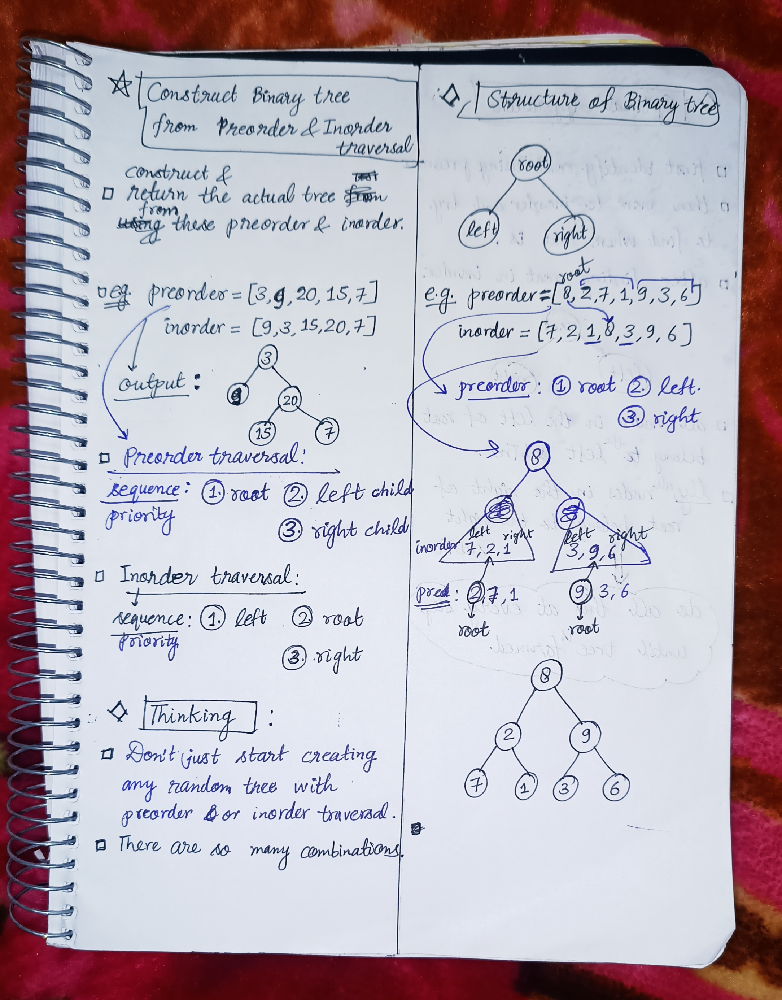

<h2><a href="https://leetcode.com/problems/construct-binary-tree-from-preorder-and-inorder-traversal">105. Construct Binary Tree from Preorder and Inorder Traversal</a></h2><h3>Medium</h3><hr><p>Given two integer arrays <code>preorder</code> and <code>inorder</code> where <code>preorder</code> is the preorder traversal of a binary tree and <code>inorder</code> is the inorder traversal of the same tree, construct and return <em>the binary tree</em>.</p>

<p>&nbsp;</p>
<p><strong class="example">Example 1:</strong></p>

<pre>
<strong>Input:</strong> preorder = [3,9,20,15,7], inorder = [9,3,15,20,7]
<strong>Output:</strong> [3,9,20,null,null,15,7]
</pre>

<p><strong class="example">Example 2:</strong></p>

<pre>
<strong>Input:</strong> preorder = [-1], inorder = [-1]
<strong>Output:</strong> [-1]
</pre>

<p>&nbsp;</p>
<p><strong>Constraints:</strong></p>

<ul>
	<li><code>1 &lt;= preorder.length &lt;= 3000</code></li>
	<li><code>inorder.length == preorder.length</code></li>
	<li><code>-3000 &lt;= preorder[i], inorder[i] &lt;= 3000</code></li>
	<li><code>preorder</code> and <code>inorder</code> consist of <strong>unique</strong> values.</li>
	<li>Each value of <code>inorder</code> also appears in <code>preorder</code>.</li>
	<li><code>preorder</code> is <strong>guaranteed</strong> to be the preorder traversal of the tree.</li>
	<li><code>inorder</code> is <strong>guaranteed</strong> to be the inorder traversal of the tree.</li>
</ul>


<!-- AUTO-GENERATED-SOLUTION-START -->
---

## 🧠 Visual Solution & Intuition

### Part 1



### Part 2


---

## ⏱️ Complexity Analysis

```text
Time Complexity = O(n) => cause traversing n nodes of the tree.
Space Complexity = O(n) + O(H) = O(n) => where O(n) : for Hashmap, O(H) for recursion stack height(height of the tree)
```

---

## 💻 C++ Solution

[View Original C++ File](./0105-construct-binary-tree-from-preorder-and-inorder-traversal.cpp)

```cpp
/**
 * Definition for a binary tree node.
 * struct TreeNode {
 *     int val;
 *     TreeNode *left;
 *     TreeNode *right;
 *     TreeNode() : val(0), left(nullptr), right(nullptr) {}
 *     TreeNode(int x) : val(x), left(nullptr), right(nullptr) {}
 *     TreeNode(int x, TreeNode *left, TreeNode *right) : val(x), left(left), right(right) {}
 * };
 */
class Solution {
public:
     
    //Time Complexity = O(n) => cause traversing n nodes of the tree.
    //Space Complexity = O(n) + O(H) = O(n) => where O(n) : for Hashmap, O(H) for recursion stack height(height of the tree)
    TreeNode* splitTree(vector<int>& preorder,unordered_map<int, int>& inorderIndexMap, int rootIndex, int left, int right){
        //edge case invalid condition
        if(left > right){
            return NULL ;
        }
        //Start Constructing the tree with root that is found in preorder rootIndex.
        TreeNode* root = new TreeNode(preorder[rootIndex]);

        //Find root position in inorder traversal
        int mid = inorderIndexMap[preorder[rootIndex]] ;

        //Create left SubTree( for all the nodes left of the root present in inorder)
        if(mid > left){
            root->left = splitTree(preorder, inorderIndexMap, rootIndex+1, left, mid-1) ;
        }

        //Create right SubTree(for all the nodes right of the root present in inorder)
        if(mid < right){
            root->right = splitTree(preorder, inorderIndexMap, rootIndex + (mid-left) + 1, mid+1, right) ;
        }

        return root ;
    }


    TreeNode* buildTree(vector<int>& preorder, vector<int>& inorder) {
        unordered_map<int, int> inorderIndexMap ;

        //Store value->index in Map from inorder traversal
        for(int i = 0 ; i<inorder.size() ; i++){
            inorderIndexMap[inorder[i]] = i ; //inserted i->val in map
        }

        //func. call to splitTree for constructing using preorder
        return splitTree(preorder, inorderIndexMap, 0, 0, inorder.size()-1) ;
    }
};
```

<!-- AUTO-GENERATED-SOLUTION-END -->
