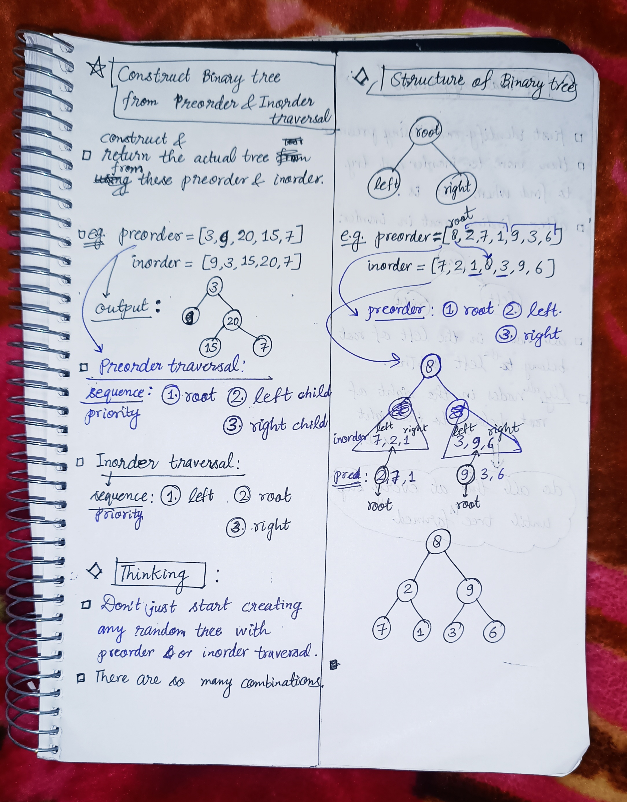

<h2><a href="https://leetcode.com/problems/construct-binary-tree-from-preorder-and-inorder-traversal">105. Construct Binary Tree from Preorder and Inorder Traversal</a></h2><h3>Medium</h3><hr><p>Given two integer arrays <code>preorder</code> and <code>inorder</code> where <code>preorder</code> is the preorder traversal of a binary tree and <code>inorder</code> is the inorder traversal of the same tree, construct and return <em>the binary tree</em>.</p>

<p>&nbsp;</p>
<p><strong class="example">Example 1:</strong></p>

<pre>
<strong>Input:</strong> preorder = [3,9,20,15,7], inorder = [9,3,15,20,7]
<strong>Output:</strong> [3,9,20,null,null,15,7]
</pre>

<p><strong class="example">Example 2:</strong></p>

<pre>
<strong>Input:</strong> preorder = [-1], inorder = [-1]
<strong>Output:</strong> [-1]
</pre>

<p>&nbsp;</p>
<p><strong>Constraints:</strong></p>

<ul>
	<li><code>1 &lt;= preorder.length &lt;= 3000</code></li>
	<li><code>inorder.length == preorder.length</code></li>
	<li><code>-3000 &lt;= preorder[i], inorder[i] &lt;= 3000</code></li>
	<li><code>preorder</code> and <code>inorder</code> consist of <strong>unique</strong> values.</li>
	<li>Each value of <code>inorder</code> also appears in <code>preorder</code>.</li>
	<li><code>preorder</code> is <strong>guaranteed</strong> to be the preorder traversal of the tree.</li>
	<li><code>inorder</code> is <strong>guaranteed</strong> to be the inorder traversal of the tree.</li>
</ul>


<!-- AUTO-GENERATED-SOLUTION-START -->
---

## 🧠 Visual Solution & Intuition

### Part 1



### Part 2


---

## ⏱️ Complexity Analysis

```text
Time Complexity = O(n) =>
Space Complexity = O(n) =>
```

---

## 💻 C++ Solution

[View Original C++ File](./0105-construct-binary-tree-from-preorder-and-inorder-traversal.cpp)

```cpp
/**
 * Definition for a binary tree node.
 * struct TreeNode {
 *     int val;
 *     TreeNode *left;
 *     TreeNode *right;
 *     TreeNode() : val(0), left(nullptr), right(nullptr) {}
 *     TreeNode(int x) : val(x), left(nullptr), right(nullptr) {}
 *     TreeNode(int x, TreeNode *left, TreeNode *right) : val(x), left(left), right(right) {}
 * };
 */
class Solution {
public:
    //Approach:

    //Time Complexity = O(n) =>
    /* Building the hashmap takes O(n).
    * Each of the n nodes is created exactly once.
    * Each hashmap lookup takes O(1) expected time.
    * Total: O(n) + O(n) = O(n).
    */

    //Space Complexity = O(n) =>
    /* The hashmap stores n entries: O(n).
    * The recursion stack uses O(h), where h is the tree’s height:
    * Balanced tree: O(log n).
    * Skewed tree: O(n).
    * Total: O(n + h) = O(n).
    */


    unordered_map<int, int> inorderIdx;//Hash map {value, idx}
    int preIdx = 0;

    TreeNode* build(vector<int>& preorder, int left, int right){

        //3.) An empty range represents an empty subtree.
        if(left > right){
            return NULL;
        }

        //4.) Take the next preorder value as the root.
        int rootValue = preorder[preIdx++];

        TreeNode* root = new TreeNode(rootValue);

        //5.) Find where the root divides the inorder range.
        int mid = inorderIdx.at(rootValue);

        //6.) Build the left subtree first, following preorder order.
        root->left = build(preorder, left, mid - 1);

        //7.) Build the right subtree.
        root->right = build(preorder, mid + 1, right);

        //8.) Return the completed subtree
        return root;

    }
    TreeNode* buildTree(vector<int>& preorder, vector<int>& inorder) {
        
        //1.) Reset shared state and store each value's inorder index.
        preIdx = 0;
        inorderIdx.clear();

        int n = static_cast<int>(inorder.size());

        for(int i = 0; i < n; i++){
            inorderIdx[inorder[i]] = i; //idx fill in hash map
        }
       
        //2.) Build the tree using the entire inorder range.
        return build(preorder, 0, n-1);
   
    }
};
```

<!-- AUTO-GENERATED-SOLUTION-END -->
