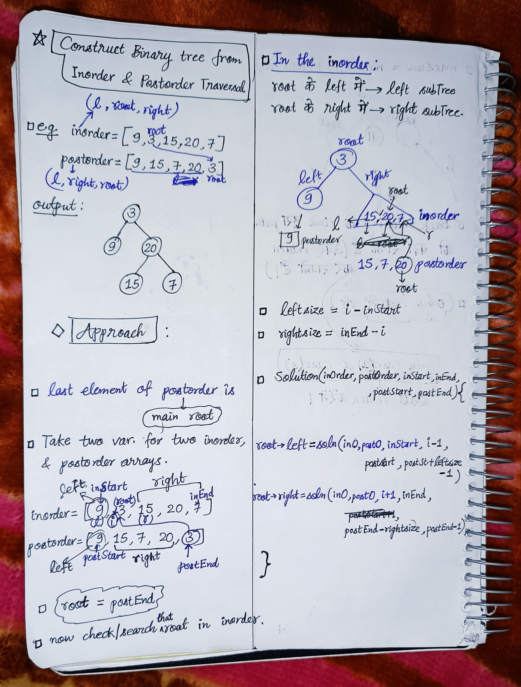

<h2><a href="https://leetcode.com/problems/construct-binary-tree-from-inorder-and-postorder-traversal">106. Construct Binary Tree from Inorder and Postorder Traversal</a></h2><h3>Medium</h3><hr><p>Given two integer arrays <code>inorder</code> and <code>postorder</code> where <code>inorder</code> is the inorder traversal of a binary tree and <code>postorder</code> is the postorder traversal of the same tree, construct and return <em>the binary tree</em>.</p>

<p>&nbsp;</p>
<p><strong class="example">Example 1:</strong></p>

<pre>
<strong>Input:</strong> inorder = [9,3,15,20,7], postorder = [9,15,7,20,3]
<strong>Output:</strong> [3,9,20,null,null,15,7]
</pre>

<p><strong class="example">Example 2:</strong></p>

<pre>
<strong>Input:</strong> inorder = [-1], postorder = [-1]
<strong>Output:</strong> [-1]
</pre>

<p>&nbsp;</p>
<p><strong>Constraints:</strong></p>

<ul>
	<li><code>1 &lt;= inorder.length &lt;= 3000</code></li>
	<li><code>postorder.length == inorder.length</code></li>
	<li><code>-3000 &lt;= inorder[i], postorder[i] &lt;= 3000</code></li>
	<li><code>inorder</code> and <code>postorder</code> consist of <strong>unique</strong> values.</li>
	<li>Each value of <code>postorder</code> also appears in <code>inorder</code>.</li>
	<li><code>inorder</code> is <strong>guaranteed</strong> to be the inorder traversal of the tree.</li>
	<li><code>postorder</code> is <strong>guaranteed</strong> to be the postorder traversal of the tree.</li>
</ul>


<!-- AUTO-GENERATED-SOLUTION-START -->
---

## 🧠 Visual Solution & Intuition



---

## ⏱️ Complexity Analysis

```text
Time Complexity = O(n^2)
Space Complexity = O(H)
```

---

## 💻 C++ Solution

[View Original C++ File](./0106-construct-binary-tree-from-inorder-and-postorder-traversal.cpp)

```cpp
/**
 * Definition for a binary tree node.
 * struct TreeNode {
 *     int val;
 *     TreeNode *left;
 *     TreeNode *right;
 *     TreeNode() : val(0), left(nullptr), right(nullptr) {}
 *     TreeNode(int x) : val(x), left(nullptr), right(nullptr) {}
 *     TreeNode(int x, TreeNode *left, TreeNode *right) : val(x), left(left), right(right) {}
 * };
 */
class Solution {
public:
    //Time Complexity = O(n^2) 
    //Space Complexity = O(H) 
    TreeNode* solution(vector<int>& inorder, vector<int>& postorder, int inStart, int inEnd, int postStart, int postEnd){
        //edge case
        if(inStart > inEnd){
            return NULL ;
        }
        //Step 1: Find root that is last element of postorder
        TreeNode* root = new TreeNode(postorder[postEnd]) ;

        //Step 2 : Search for that root in inorder
        int i = inStart ;

        for( ; i<= inEnd ; i++){

            if(root->val == inorder[i]) //i is the index of the root
                break ;
        }
        
        //Step 3 : root ke left me => left subTree
        //         root ke right me => right subTree
        int leftsize = i-inStart ;
        int rightsize = inEnd-i ;
        
        //func. call for left
        root->left = solution(inorder, postorder, inStart, i-1, postStart, postStart+leftsize-1) ;
        //func. call for right
        root->right = solution(inorder, postorder, i+1, inEnd, postEnd-rightsize, postEnd-1) ;

        return root ; //very important to return the root
    }
    TreeNode* buildTree(vector<int>& inorder, vector<int>& postorder) {
        int n = inorder.size() ;
        
        //two variables for inorder
        int inStart = 0 ;
        int inEnd = n-1 ;
        
        //two variables for postorder
        int postStart = 0 ;
        int postEnd = n-1 ;

        return solution(inorder, postorder, inStart, inEnd, postStart, postEnd) ;
    }
};
```

<!-- AUTO-GENERATED-SOLUTION-END -->
