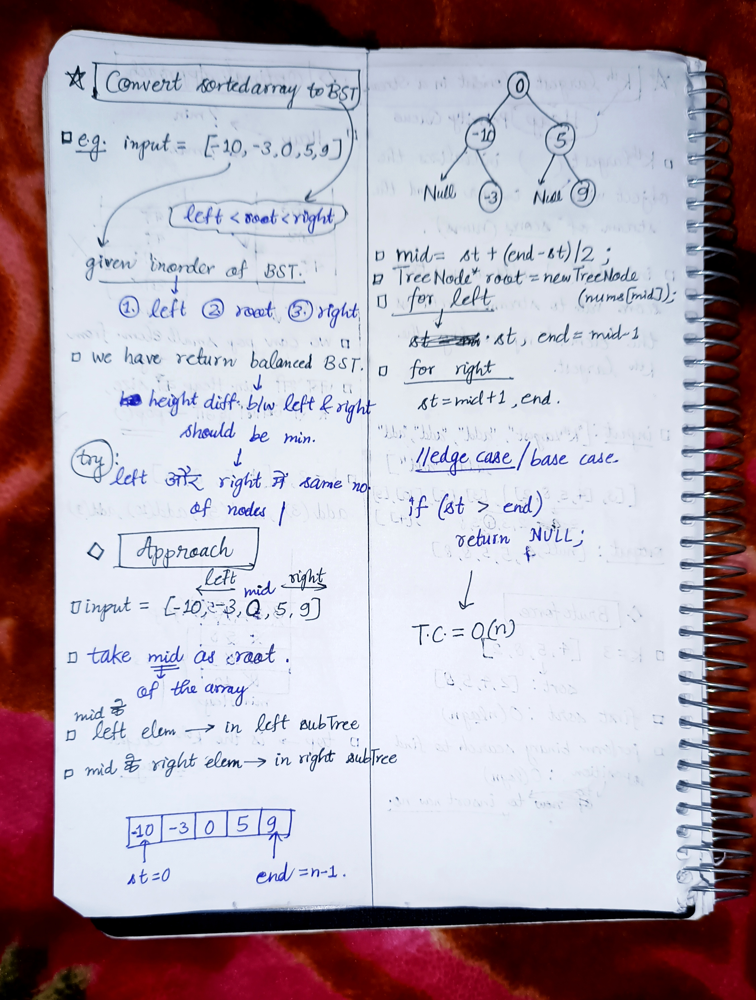

<h2><a href="https://leetcode.com/problems/convert-sorted-array-to-binary-search-tree">108. Convert Sorted Array to Binary Search Tree</a></h2><h3>Easy</h3><hr><p>Given an integer array <code>nums</code> where the elements are sorted in <strong>ascending order</strong>, convert <em>it to a </em><span data-keyword="height-balanced"><strong><em>height-balanced</em></strong></span> <em>binary search tree</em>.</p>

<p>&nbsp;</p>
<p><strong class="example">Example 1:</strong></p>

<pre>
<strong>Input:</strong> nums = [-10,-3,0,5,9]
<strong>Output:</strong> [0,-3,9,-10,null,5]
<strong>Explanation:</strong> [0,-10,5,null,-3,null,9] is also accepted:

</pre>

<p><strong class="example">Example 2:</strong></p>

<pre>
<strong>Input:</strong> nums = [1,3]
<strong>Output:</strong> [3,1]
<strong>Explanation:</strong> [1,null,3] and [3,1] are both height-balanced BSTs.
</pre>

<p>&nbsp;</p>
<p><strong>Constraints:</strong></p>

<ul>
	<li><code>1 &lt;= nums.length &lt;= 10<sup>4</sup></code></li>
	<li><code>-10<sup>4</sup> &lt;= nums[i] &lt;= 10<sup>4</sup></code></li>
	<li><code>nums</code> is sorted in a <strong>strictly increasing</strong> order.</li>
</ul>


<!-- AUTO-GENERATED-SOLUTION-START -->
---

## 🧠 Visual Solution & Intuition



---

## ⏱️ Complexity Analysis

```text
Time Complexity = O(n) => cause visiting n nodes of the tree.
Space Complexity = O(logn) => cause diving nums at every step in half
```

---

## 💻 C++ Solution

[View Original C++ File](./0108-convert-sorted-array-to-binary-search-tree.cpp)

```cpp
/**
 * Definition for a binary tree node.
 * struct TreeNode {
 *     int val;
 *     TreeNode *left;
 *     TreeNode *right;
 *     TreeNode() : val(0), left(nullptr), right(nullptr) {}
 *     TreeNode(int x) : val(x), left(nullptr), right(nullptr) {}
 *     TreeNode(int x, TreeNode *left, TreeNode *right) : val(x), left(left), right(right) {}
 * };
 */
class Solution {
public:
    //Time Complexity = O(n) => cause visiting n nodes of the tree.
    //Space Complexity = O(logn) => cause diving nums at every step in half
    TreeNode* solution(vector<int>& nums, int st, int end){

        //edge case : invalid input
        if(st > end){
            return NULL ;
        }

        //1.) take mid as root
        int mid = st + (end-st)/2 ;
        TreeNode* root = new TreeNode(nums[mid]) ;

        //2.) left elem. in nums => in left SubTree
        root->left = solution(nums, st, mid-1) ;

        //3.) right elem. in nums => in right SubTree
        root->right = solution(nums, mid+1, end) ;

       //very important to return the root
       return root ;
    }
    TreeNode* sortedArrayToBST(vector<int>& nums) {
        //solution func. 
        int n = nums.size() ;
        return solution(nums, 0, n-1) ; //as sortedArray... is a non-void func. , so return the func. call
    }
};
```

<!-- AUTO-GENERATED-SOLUTION-END -->
