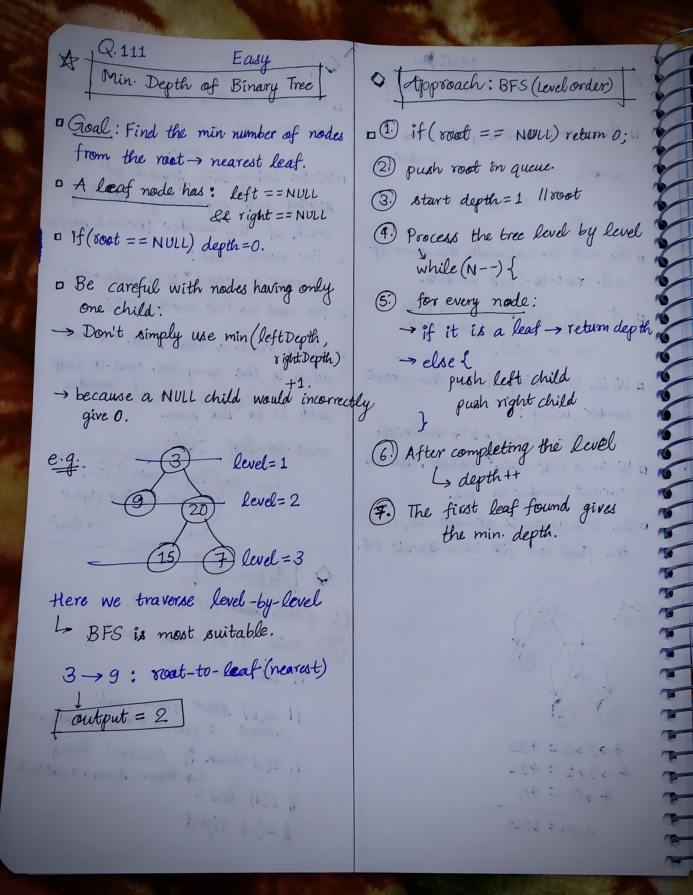

<h2><a href="https://leetcode.com/problems/minimum-depth-of-binary-tree">111. Minimum Depth of Binary Tree</a></h2><h3>Easy</h3><hr><p>Given a binary tree, find its minimum depth.</p>

<p>The minimum depth is the number of nodes along the shortest path from the root node down to the nearest leaf node.</p>

<p><strong>Note:</strong>&nbsp;A leaf is a node with no children.</p>

<p>&nbsp;</p>
<p><strong class="example">Example 1:</strong></p>

<pre>
<strong>Input:</strong> root = [3,9,20,null,null,15,7]
<strong>Output:</strong> 2
</pre>

<p><strong class="example">Example 2:</strong></p>

<pre>
<strong>Input:</strong> root = [2,null,3,null,4,null,5,null,6]
<strong>Output:</strong> 5
</pre>

<p>&nbsp;</p>
<p><strong>Constraints:</strong></p>

<ul>
	<li>The number of nodes in the tree is in the range <code>[0, 10<sup>5</sup>]</code>.</li>
	<li><code>-1000 &lt;= Node.val &lt;= 1000</code></li>
</ul>


<!-- AUTO-GENERATED-SOLUTION-START -->
---

## 🧠 Visual Solution & Intuition



---

## 💡 Approach

```text
Approach : BFS(Level Order Traversal)
```

---

## ⏱️ Complexity Analysis

```text
Time Complexity = O(N) =>
Space Complexity = O(N) =>
```

---

## 💻 C++ Solution

[View Original C++ File](./0111-minimum-depth-of-binary-tree.cpp)

```cpp
/**
 * Definition for a binary tree node.
 * struct TreeNode {
 *     int val;
 *     TreeNode *left;
 *     TreeNode *right;
 *     TreeNode() : val(0), left(nullptr), right(nullptr) {}
 *     TreeNode(int x) : val(x), left(nullptr), right(nullptr) {}
 *     TreeNode(int x, TreeNode *left, TreeNode *right) : val(x), left(left), right(right) {}
 * };
 */
class Solution {
public:
    //Approach : BFS(Level Order Traversal)


    //Time Complexity = O(N) =>
    /* N = number of nodes in the binary tree.
    * Each node is:
        * pushed into the queue once
        * popped from the queue once
        * checked once for whether it is a leaf.
    * Therefore, total work is proportional to N.
    */

    //Space Complexity = O(N) =>
    /* The extra space comes from the queue.
    * In the worst case, the queue can contain many nodes from the same level.
    * For example, in a nearly complete binary tree, the last level can contain about N/2 nodes.
    * So the queue can hold O(N) nodes.
    */


    int bfs(TreeNode* root, int depth){
        //base-case
        if(root == NULL) return 0; //depth = 0
        
        queue<TreeNode*> q;
        q.push(root);
         
        while(!q.empty()){
            int N = q.size(); //size of level

            while(N--){ //process the current level

                TreeNode* node = q.front();
                q.pop();

                //check if reached to leaf node
                if(node->left == NULL && node->right == NULL){
                    return depth;
                }

                //push left child
                if(node->left != NULL){
                    q.push(node->left);
                }
                //push right child
                if(node->right != NULL){
                    q.push(node->right);
                }
            }
            depth++;//current level completed increase depth
        }

        return depth;

    }
    int minDepth(TreeNode* root) {
        
        int depth = 1;//root depth = 1
        
        //finally return the depth usiing dfs
        return bfs(root, depth);
    }
};
```

<!-- AUTO-GENERATED-SOLUTION-END -->
