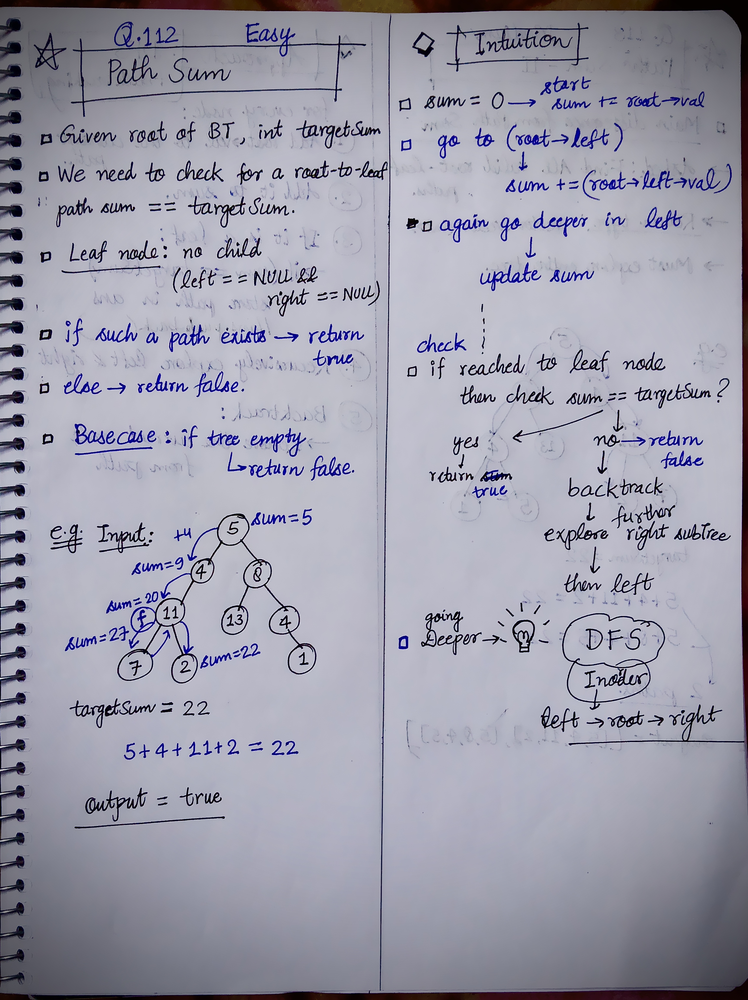

<h2><a href="https://leetcode.com/problems/path-sum">112. Path Sum</a></h2><h3>Easy</h3><hr><p>Given the <code>root</code> of a binary tree and an integer <code>targetSum</code>, return <code>true</code> if the tree has a <strong>root-to-leaf</strong> path such that adding up all the values along the path equals <code>targetSum</code>.</p>

<p>A <strong>leaf</strong> is a node with no children.</p>

<p>&nbsp;</p>
<p><strong class="example">Example 1:</strong></p>

<pre>
<strong>Input:</strong> root = [5,4,8,11,null,13,4,7,2,null,null,null,1], targetSum = 22
<strong>Output:</strong> true
<strong>Explanation:</strong> The root-to-leaf path with the target sum is shown.
</pre>

<p><strong class="example">Example 2:</strong></p>

<pre>
<strong>Input:</strong> root = [1,2,3], targetSum = 5
<strong>Output:</strong> false
<strong>Explanation:</strong> There are two root-to-leaf paths in the tree:
(1 --&gt; 2): The sum is 3.
(1 --&gt; 3): The sum is 4.
There is no root-to-leaf path with sum = 5.
</pre>

<p><strong class="example">Example 3:</strong></p>

<pre>
<strong>Input:</strong> root = [], targetSum = 0
<strong>Output:</strong> false
<strong>Explanation:</strong> Since the tree is empty, there are no root-to-leaf paths.
</pre>

<p>&nbsp;</p>
<p><strong>Constraints:</strong></p>

<ul>
	<li>The number of nodes in the tree is in the range <code>[0, 5000]</code>.</li>
	<li><code>-1000 &lt;= Node.val &lt;= 1000</code></li>
	<li><code>-1000 &lt;= targetSum &lt;= 1000</code></li>
</ul>


<!-- AUTO-GENERATED-SOLUTION-START -->
---

## 🧠 Visual Solution & Intuition

### Part 1



---

## 💡 Approach

```text
Approach : DFS Inorder
```

---

## ⏱️ Complexity Analysis

```text
Time Complexity = O(N) =>
Space Complexity = O(H) =>
```

---

## 💻 C++ Solution

[View Original C++ File](./0112-path-sum.cpp)

```cpp
/**
 * Definition for a binary tree node.
 * struct TreeNode {
 *     int val;
 *     TreeNode *left;
 *     TreeNode *right;
 *     TreeNode() : val(0), left(nullptr), right(nullptr) {}
 *     TreeNode(int x) : val(x), left(nullptr), right(nullptr) {}
 *     TreeNode(int x, TreeNode *left, TreeNode *right) : val(x), left(left), right(right) {}
 * };
 */
class Solution {
public:
    //Approach : DFS Inorder 

    //Time Complexity = O(N) =>
    /* O(N) — Each node is visited once.
    */

    //Space Complexity = O(H) =>
    /* O(H) — Recursion stack, where H is the height of the tree.
    * Worst case: O(N) for a skewed tree.
    * Best case: O(log N) for a balanced tree.
    */

    
    bool checkPathDFS(TreeNode* root, int sum, int targetSum){
        
        //base-case or edge-case
        if(root == NULL){
            return false;
        }


        sum += root->val;

        //if reached to leaf node
        if(root->left == NULL && root->right == NULL){
            if(sum == targetSum){
                return true;
            }
            else{
                return false;
            }
        }

        //check for left subtree
        bool leftSubTree = checkPathDFS(root->left, sum, targetSum);

        //check for right subtree
        bool rightSubTree = checkPathDFS(root->right, sum, targetSum);
         

        //return any one of the paths
        return leftSubTree || rightSubTree;
    }
    bool hasPathSum(TreeNode* root, int targetSum) {
                       
        int sum = 0;

        return checkPathDFS(root, sum, targetSum);
    }
};
```

<!-- AUTO-GENERATED-SOLUTION-END -->
