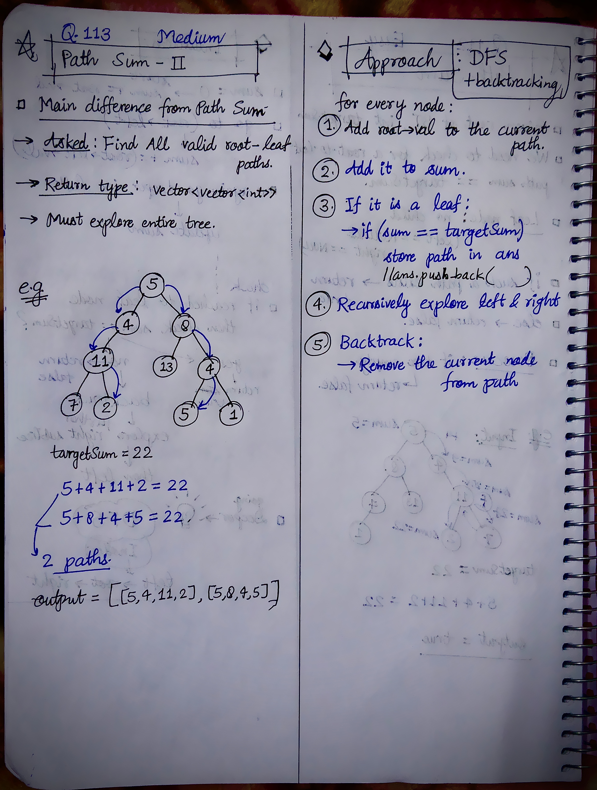

<h2><a href="https://leetcode.com/problems/path-sum-ii/">113. Path Sum II</a></h2><h3>Medium</h3><hr><p>Given the <code>root</code> of a binary tree and an integer <code>targetSum</code>, return <em>all <strong>root-to-leaf</strong> paths where the sum of the node values in the path equals </em><code>targetSum</code><em>. Each path should be returned as a list of the node <strong>values</strong>, not node references</em>.</p>

<p>A <strong>root-to-leaf</strong> path is a path starting from the root and ending at any leaf node. A <strong>leaf</strong> is a node with no children.</p>

<p>&nbsp;</p>
<p><strong class="example">Example 1:</strong></p>

<pre>
<strong>Input:</strong> root = [5,4,8,11,null,13,4,7,2,null,null,5,1], targetSum = 22
<strong>Output:</strong> [[5,4,11,2],[5,8,4,5]]
<strong>Explanation:</strong> There are two paths whose sum equals targetSum:
5 + 4 + 11 + 2 = 22
5 + 8 + 4 + 5 = 22
</pre>

<p><strong class="example">Example 2:</strong></p>

<pre>
<strong>Input:</strong> root = [1,2,3], targetSum = 5
<strong>Output:</strong> []
</pre>

<p><strong class="example">Example 3:</strong></p>

<pre>
<strong>Input:</strong> root = [1,2], targetSum = 0
<strong>Output:</strong> []
</pre>

<p>&nbsp;</p>
<p><strong>Constraints:</strong></p>

<ul>
	<li>The number of nodes in the tree is in the range <code>[0, 5000]</code>.</li>
	<li><code>-1000 &lt;= Node.val &lt;= 1000</code></li>
	<li><code>-1000 &lt;= targetSum &lt;= 1000</code></li>
</ul>


<!-- AUTO-GENERATED-SOLUTION-START -->
---

## 🧠 Visual Solution & Intuition

### Part 2



---

## 💡 Approach

```text
Approach : DFS + Backtracking
```

---

## ⏱️ Complexity Analysis

```text
Time Complexity = O(N) =>
Space Complexity = O(H) =>
```

---

## 💻 C++ Solution

[View Original C++ File](./0113-path-sum-ii.cpp)

```cpp
/**
 * Definition for a binary tree node.
 * struct TreeNode {
 *     int val;
 *     TreeNode *left;
 *     TreeNode *right;
 *     TreeNode() : val(0), left(nullptr), right(nullptr) {}
 *     TreeNode(int x) : val(x), left(nullptr), right(nullptr) {}
 *     TreeNode(int x, TreeNode *left, TreeNode *right) : val(x), left(left), right(right) {}
 * };
 */
class Solution {
public:
    //Topic : Binary Trees
    
    //Approach : DFS + Backtracking

    //Time Complexity = O(N) =>
    /* O(N) — Each node is visited once.
    * Plus path-copying cost for every valid path. 
    */

    //Space Complexity = O(H) =>
    /* Recursion stack + current temp path.
    * Output: O(K × H) for K valid paths.
    */
    void pathDFS(TreeNode* root, int sum, int targetSum, vector<int>& temp, vector<vector<int>>& ans){

        //base-case or edge-case
        if(root == NULL){
            return;
        }
        
        //1.)
        temp.push_back(root->val);
        //2.)
        sum += root->val;

        //3.)if reached to leaf node
        if(root->left == NULL && root->right == NULL){
            if(sum == targetSum){
                ans.push_back(temp);
            }
        }

        //4.)recursively call left & right 
        pathDFS(root->left, sum, targetSum, temp, ans);
        pathDFS(root->right, sum, targetSum, temp, ans);

        //5.)Backtrack : remove current node from path
        temp.pop_back();

    }
    vector<vector<int>> pathSum(TreeNode* root, int targetSum) {
        
        //ans to store the output of all paths
        vector<vector<int>> ans;

        vector<int> temp; //to store current path

        int sum = 0;

       //func. call
       pathDFS(root, sum, targetSum, temp, ans);


        //finally return the output
        return ans;

    }
};
```

<!-- AUTO-GENERATED-SOLUTION-END -->
