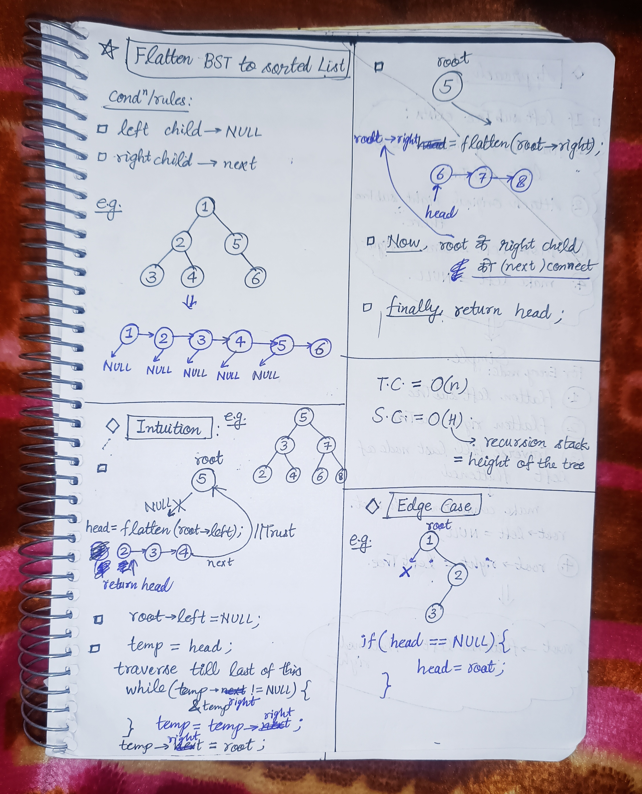

<h2><a href="https://leetcode.com/problems/flatten-binary-tree-to-linked-list">114. Flatten Binary Tree to Linked List</a></h2><h3>Medium</h3><hr><p>Given the <code>root</code> of a binary tree, flatten the tree into a &quot;linked list&quot;:</p>

<ul>
	<li>The &quot;linked list&quot; should use the same <code>TreeNode</code> class where the <code>right</code> child pointer points to the next node in the list and the <code>left</code> child pointer is always <code>null</code>.</li>
	<li>The &quot;linked list&quot; should be in the same order as a <a href="https://en.wikipedia.org/wiki/Tree_traversal#Pre-order,_NLR" target="_blank"><strong>pre-order</strong><strong> traversal</strong></a> of the binary tree.</li>
</ul>

<p>&nbsp;</p>
<p><strong class="example">Example 1:</strong></p>

<pre>
<strong>Input:</strong> root = [1,2,5,3,4,null,6]
<strong>Output:</strong> [1,null,2,null,3,null,4,null,5,null,6]
</pre>

<p><strong class="example">Example 2:</strong></p>

<pre>
<strong>Input:</strong> root = []
<strong>Output:</strong> []
</pre>

<p><strong class="example">Example 3:</strong></p>

<pre>
<strong>Input:</strong> root = [0]
<strong>Output:</strong> [0]
</pre>

<p>&nbsp;</p>
<p><strong>Constraints:</strong></p>

<ul>
	<li>The number of nodes in the tree is in the range <code>[0, 2000]</code>.</li>
	<li><code>-100 &lt;= Node.val &lt;= 100</code></li>
</ul>

<p>&nbsp;</p>
<strong>Follow up:</strong> Can you flatten the tree in-place (with <code>O(1)</code> extra space)?

<!-- AUTO-GENERATED-SOLUTION-START -->
---

## 🧠 Visual Solution & Intuition

### Part 1



### Part 2


---

## ⏱️ Complexity Analysis

```text
Time Complexity = O(n^2)
Space Complexity = O(H) => recursion stack height = height of the tree. // H = logn for balanced tree. // H = n for skewed tree.
```

---

## 💻 C++ Solution

[View Original C++ File](./0114-flatten-binary-tree-to-linked-list.cpp)

```cpp
/**
 * Definition for a binary tree node.
 * struct TreeNode {
 *     int val;
 *     TreeNode *left;
 *     TreeNode *right;
 *     TreeNode() : val(0), left(nullptr), right(nullptr) {}
 *     TreeNode(int x) : val(x), left(nullptr), right(nullptr) {}
 *     TreeNode(int x, TreeNode *left, TreeNode *right) : val(x), left(left), right(right) {}
 * };
 */
class Solution {
public:
    //Time Complexity = O(n^2) 
    //Space Complexity = O(H) => recursion stack height = height of the tree. // H = logn for balanced tree. // H = n for skewed tree.
    void flatten(TreeNode* root) {
        //for empty tree
        if(root == NULL) return ;

        //trust and call for root->left to flatten
        flatten(root->left) ;
        
        //lly for right child trust and func. call
        flatten(root->right) ;

        TreeNode* leftTree = root->left ;
        TreeNode* rightTree = root->right ;
        //given condition
        root->left = NULL ; 
        root->right = leftTree ;

        TreeNode* temp = root ;             
        //traverse till last node of flattened
        while(temp->right != NULL){
                temp = temp->right ;
        }
        //make connection of last node to root
        temp->right = rightTree ;

    }
};
```

<!-- AUTO-GENERATED-SOLUTION-END -->
