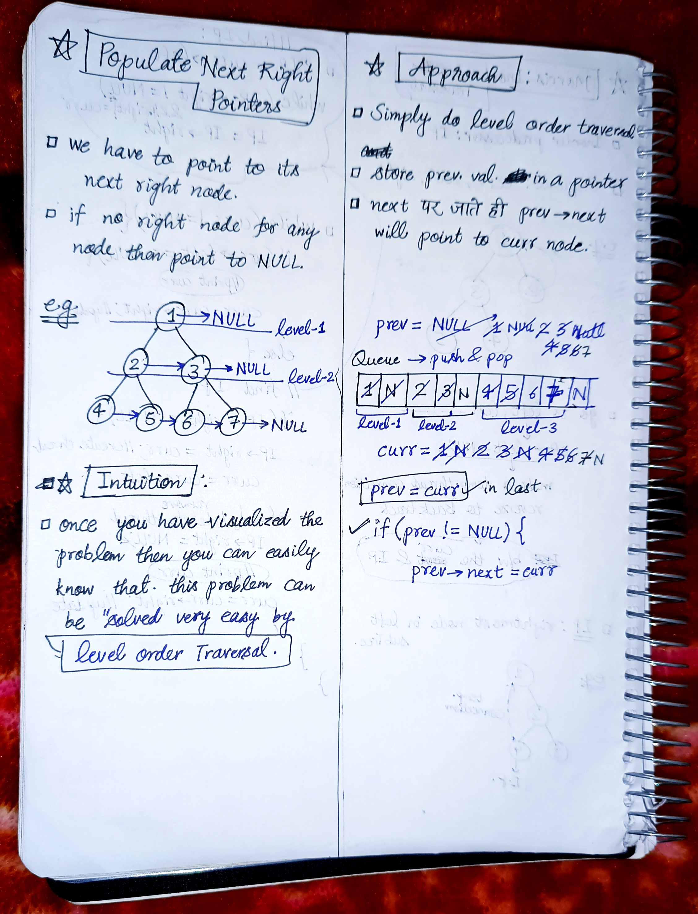

<h2><a href="https://leetcode.com/problems/populating-next-right-pointers-in-each-node">116. Populating Next Right Pointers in Each Node</a></h2><h3>Medium</h3><hr><p>You are given a <strong>perfect binary tree</strong> where all leaves are on the same level, and every parent has two children. The binary tree has the following definition:</p>

<pre>
struct Node {
  int val;
  Node *left;
  Node *right;
  Node *next;
}
</pre>

<p>Populate each next pointer to point to its next right node. If there is no next right node, the next pointer should be set to <code>NULL</code>.</p>

<p>Initially, all next pointers are set to <code>NULL</code>.</p>

<p>&nbsp;</p>
<p><strong class="example">Example 1:</strong></p>

<pre>
<strong>Input:</strong> root = [1,2,3,4,5,6,7]
<strong>Output:</strong> [1,#,2,3,#,4,5,6,7,#]
<strong>Explanation: </strong>Given the above perfect binary tree (Figure A), your function should populate each next pointer to point to its next right node, just like in Figure B. The serialized output is in level order as connected by the next pointers, with &#39;#&#39; signifying the end of each level.
</pre>

<p><strong class="example">Example 2:</strong></p>

<pre>
<strong>Input:</strong> root = []
<strong>Output:</strong> []
</pre>

<p>&nbsp;</p>
<p><strong>Constraints:</strong></p>

<ul>
	<li>The number of nodes in the tree is in the range <code>[0, 2<sup>12</sup> - 1]</code>.</li>
	<li><code>-1000 &lt;= Node.val &lt;= 1000</code></li>
</ul>

<p>&nbsp;</p>
<p><strong>Follow-up:</strong></p>

<ul>
	<li>You may only use constant extra space.</li>
	<li>The recursive approach is fine. You may assume implicit stack space does not count as extra space for this problem.</li>
</ul>


<!-- AUTO-GENERATED-SOLUTION-START -->
---

## 🧠 Visual Solution & Intuition



---

## ⏱️ Complexity Analysis

```text
Time Complexity = O(n) => cause visiting n nodes of the tree.
Space Complexity = O(W) => W = width of the tree.
```

---

## 💻 C++ Solution

[View Original C++ File](./0116-populating-next-right-pointers-in-each-node.cpp)

```cpp
/*
// Definition for a Node.
class Node {
public:
    int val;
    Node* left;
    Node* right;
    Node* next;

    Node() : val(0), left(NULL), right(NULL), next(NULL) {}

    Node(int _val) : val(_val), left(NULL), right(NULL), next(NULL) {}

    Node(int _val, Node* _left, Node* _right, Node* _next)
        : val(_val), left(_left), right(_right), next(_next) {}
};
*/

class Solution {
public:
    //Time Complexity = O(n) => cause visiting n nodes of the tree.
    //Space Complexity = O(W) => W = width of the tree.
    Node* connect(Node* root) {
        //base case
        if(root == NULL || root->left == NULL){
            return root ;
        }

        queue<Node*> q ; //to store each level nodes

        //first start push with root 
        q.push(root) ;

        q.push(NULL) ;//to mark the ending of each level

        Node* prev = NULL ; //to track previous values

        while(!q.empty()){
            Node* curr = q.front() ;
            q.pop() ;

            if(curr == NULL){
                //end of current level
                prev = NULL ; //reset previous for next level

                if(q.empty() ){
                    break ;
                }

                else{
                    q.push(NULL) ;
                }

            }
            else{
                if(curr->left != NULL){
                    q.push(curr->left) ;
                }

                if(curr->right != NULL){
                    q.push(curr->right) ;
                }

                if(prev != NULL){
                    prev->next = curr ;
                }

                //update prev for next checks
                prev = curr ;

            }
 
        }
        //very important to return the root
        return root ;
    }
};
```

<!-- AUTO-GENERATED-SOLUTION-END -->
