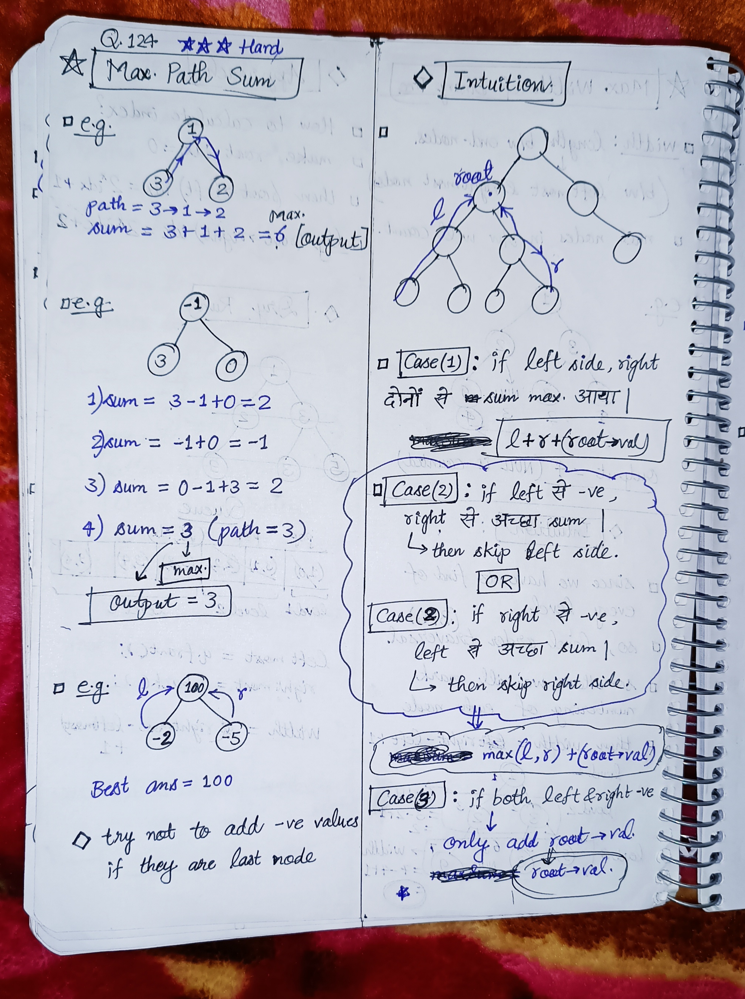
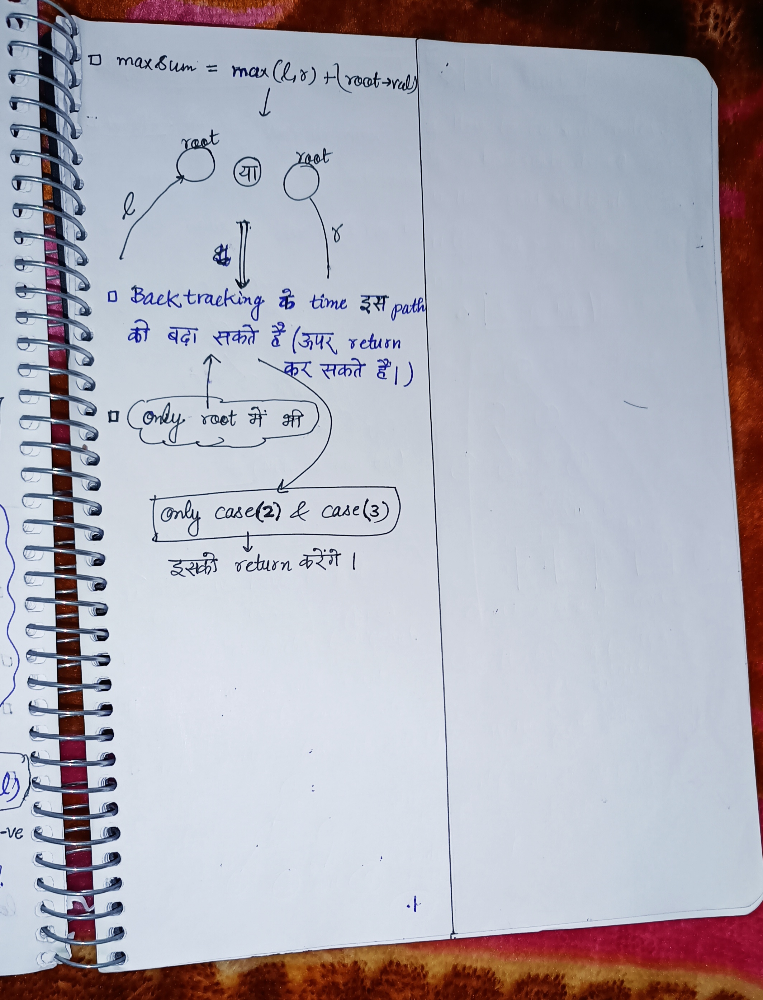

<h2><a href="https://leetcode.com/problems/binary-tree-maximum-path-sum">124. Binary Tree Maximum Path Sum</a></h2><h3>Hard</h3><hr><p>A <strong>path</strong> in a binary tree is a sequence of nodes where each pair of adjacent nodes in the sequence has an edge connecting them. A node can only appear in the sequence <strong>at most once</strong>. Note that the path does not need to pass through the root.</p>

<p>The <strong>path sum</strong> of a path is the sum of the node&#39;s values in the path.</p>

<p>Given the <code>root</code> of a binary tree, return <em>the maximum <strong>path sum</strong> of any <strong>non-empty</strong> path</em>.</p>

<p>&nbsp;</p>
<p><strong class="example">Example 1:</strong></p>

<pre>
<strong>Input:</strong> root = [1,2,3]
<strong>Output:</strong> 6
<strong>Explanation:</strong> The optimal path is 2 -&gt; 1 -&gt; 3 with a path sum of 2 + 1 + 3 = 6.
</pre>

<p><strong class="example">Example 2:</strong></p>

<pre>
<strong>Input:</strong> root = [-10,9,20,null,null,15,7]
<strong>Output:</strong> 42
<strong>Explanation:</strong> The optimal path is 15 -&gt; 20 -&gt; 7 with a path sum of 15 + 20 + 7 = 42.
</pre>

<p>&nbsp;</p>
<p><strong>Constraints:</strong></p>

<ul>
	<li>The number of nodes in the tree is in the range <code>[1, 3 * 10<sup>4</sup>]</code>.</li>
	<li><code>-1000 &lt;= Node.val &lt;= 1000</code></li>
</ul>


<!-- AUTO-GENERATED-SOLUTION-START -->
---

## 🧠 Visual Solution & Intuition

### Part 1



### Part 2



---

## ⏱️ Complexity Analysis

```text
Time Complexity = O(n) => cause traversing n nodes of the tree.
Space Complexity = O(H) => H = recursion stack height = Height of the tree.
```

---

## 💻 C++ Solution

[View Original C++ File](./0124-binary-tree-maximum-path-sum.cpp)

```cpp
/**
 * Definition for a binary tree node.
 * struct TreeNode {
 *     int val;
 *     TreeNode *left;
 *     TreeNode *right;
 *     TreeNode() : val(0), left(nullptr), right(nullptr) {}
 *     TreeNode(int x) : val(x), left(nullptr), right(nullptr) {}
 *     TreeNode(int x, TreeNode *left, TreeNode *right) : val(x), left(left), right(right) {}
 * };
 */
class Solution {
public:
    //Time Complexity = O(n) => cause traversing n nodes of the tree.
    //Space Complexity = O(H) => H = recursion stack height = Height of the tree.
    // H = logn for balanced tree, H = n for skewed tree.
    int maxSum ; //global var to store the ans

    int solution(TreeNode* root){
        //for empty tree
        if(root == NULL) return 0 ;

        //calculate left sum
        int left = solution(root->left) ;
        //calculate right sum
        int right = solution(root->right) ;

        //Case 1 : if both right and left provide good sum
        int both_good_sum = left + right + (root->val) ;

        //Case 2 : if only one left or right is good sum
        int only_one_good = max(left,right) + (root->val) ;

        //Case 3 : if both right & left are -ve sum
        int only_root = root->val ;

        maxSum = max(maxSum,  max({both_good_sum, only_one_good, only_root}) ); //very important how to write max of this.

        return max(only_one_good, only_root) ; //return case 2 or case 3 to explore more.
    }
    int maxPathSum(TreeNode* root) {

       maxSum = INT_MIN ; // -♾️ infinity

       solution(root) ;

       return maxSum ; //very important to return the ans.
        
    }
};
```

<!-- AUTO-GENERATED-SOLUTION-END -->
