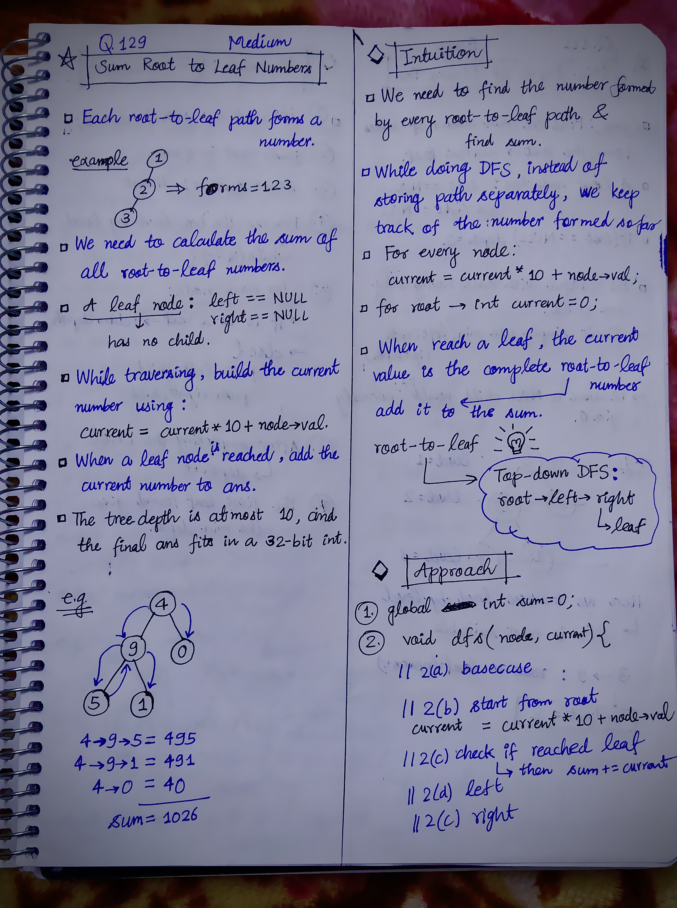

<h2><a href="https://leetcode.com/problems/sum-root-to-leaf-numbers">129. Sum Root to Leaf Numbers</a></h2><h3>Medium</h3><hr><p>You are given the <code>root</code> of a binary tree containing digits from <code>0</code> to <code>9</code> only.</p>

<p>Each root-to-leaf path in the tree represents a number.</p>

<ul>
	<li>For example, the root-to-leaf path <code>1 -&gt; 2 -&gt; 3</code> represents the number <code>123</code>.</li>
</ul>

<p>Return <em>the total sum of all root-to-leaf numbers</em>. Test cases are generated so that the answer will fit in a <strong>32-bit</strong> integer.</p>

<p>A <strong>leaf</strong> node is a node with no children.</p>

<p>&nbsp;</p>
<p><strong class="example">Example 1:</strong></p>

<pre>
<strong>Input:</strong> root = [1,2,3]
<strong>Output:</strong> 25
<strong>Explanation:</strong>
The root-to-leaf path <code>1-&gt;2</code> represents the number <code>12</code>.
The root-to-leaf path <code>1-&gt;3</code> represents the number <code>13</code>.
Therefore, sum = 12 + 13 = <code>25</code>.
</pre>

<p><strong class="example">Example 2:</strong></p>

<pre>
<strong>Input:</strong> root = [4,9,0,5,1]
<strong>Output:</strong> 1026
<strong>Explanation:</strong>
The root-to-leaf path <code>4-&gt;9-&gt;5</code> represents the number 495.
The root-to-leaf path <code>4-&gt;9-&gt;1</code> represents the number 491.
The root-to-leaf path <code>4-&gt;0</code> represents the number 40.
Therefore, sum = 495 + 491 + 40 = <code>1026</code>.
</pre>

<p>&nbsp;</p>
<p><strong>Constraints:</strong></p>

<ul>
	<li>The number of nodes in the tree is in the range <code>[1, 1000]</code>.</li>
	<li><code>0 &lt;= Node.val &lt;= 9</code></li>
	<li>The depth of the tree will not exceed <code>10</code>.</li>
</ul>


<!-- AUTO-GENERATED-SOLUTION-START -->
---

## 🧠 Visual Solution & Intuition



---

## 💡 Approach

```text
Approach : Top-Down DFS (Root-to-Leaf DFS) + Running Number
```

---

## ⏱️ Complexity Analysis

```text
Time Complexity = O(N) =>
Space Complexity = O(H) =>
```

---

## 💻 C++ Solution

[View Original C++ File](./0129-sum-root-to-leaf-numbers.cpp)

```cpp
/**
 * Definition for a binary tree node.
 * struct TreeNode {
 *     int val;
 *     TreeNode *left;
 *     TreeNode *right;
 *     TreeNode() : val(0), left(nullptr), right(nullptr) {}
 *     TreeNode(int x) : val(x), left(nullptr), right(nullptr) {}
 *     TreeNode(int x, TreeNode *left, TreeNode *right) : val(x), left(left), right(right) {}
 * };
 */
class Solution {
public:
    //Approach : Top-Down DFS (Root-to-Leaf DFS) + Running Number

    //Time Complexity = O(N) =>
    /* Our DFS visits every node exactly once.
    * For each node, we do only constant-time work: 
        current = current * 10 + node->val;
        and check whether it is a leaf.
    * Overall : N nodes × O(1) work = O(N)
    */

    //Space Complexity = O(H) =>
    /* The extra space comes from the recursive call stack.
    * So the stack uses O(H) space.
    * Worst case: O(N) — completely skewed tree.
    * Balanced tree: O(log N) approximately.
    */

    int sum = 0;
    void dfs(TreeNode* node, int current){
        //base-case
        if(node == NULL) return;
        
        //1.) root
        current = current * 10 + node->val;
        
        //check if reached leaf node
        if(node->left == NULL && node->right == NULL){
            sum += current;
            return;
        }

        //2.) left
        dfs(node->left, current);
        
        //3.) right
        dfs(node->right, current);       

    }
    int sumNumbers(TreeNode* root) {
        
        int current = 0;

        dfs(root, current);

        return sum;
    }
};
```

<!-- AUTO-GENERATED-SOLUTION-END -->
