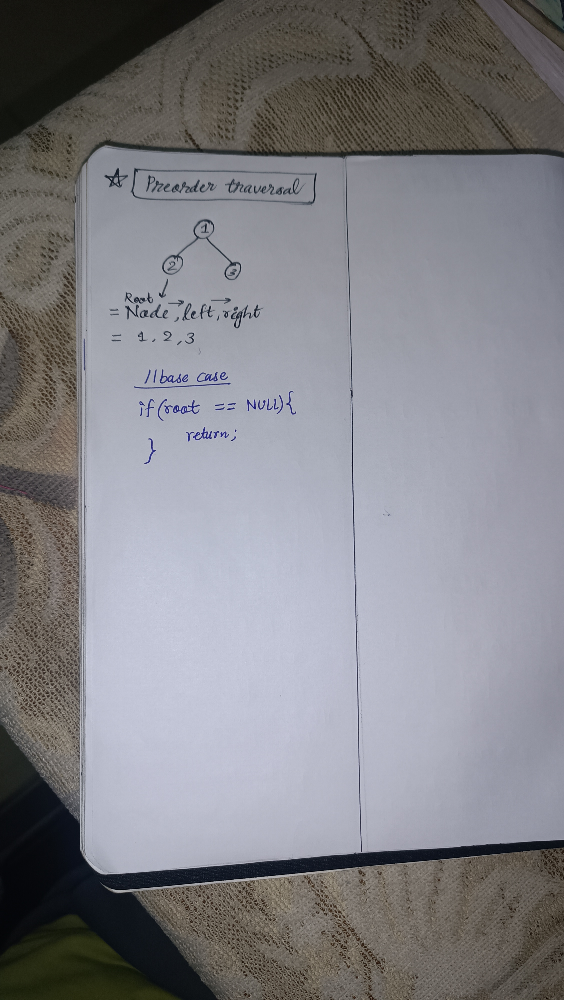

<h2><a href="https://leetcode.com/problems/binary-tree-preorder-traversal">144. Binary Tree Preorder Traversal</a></h2><h3>Easy</h3><hr><p>Given the <code>root</code> of a binary tree, return <em>the preorder traversal of its nodes&#39; values</em>.</p>

<p>&nbsp;</p>
<p><strong class="example">Example 1:</strong></p>

<div class="example-block">
<p><strong>Input:</strong> <span class="example-io">root = [1,null,2,3]</span></p>

<p><strong>Output:</strong> <span class="example-io">[1,2,3]</span></p>

<p><strong>Explanation:</strong></p>

<p></p>
</div>

<p><strong class="example">Example 2:</strong></p>

<div class="example-block">
<p><strong>Input:</strong> <span class="example-io">root = [1,2,3,4,5,null,8,null,null,6,7,9]</span></p>

<p><strong>Output:</strong> <span class="example-io">[1,2,4,5,6,7,3,8,9]</span></p>

<p><strong>Explanation:</strong></p>

<p></p>
</div>

<p><strong class="example">Example 3:</strong></p>

<div class="example-block">
<p><strong>Input:</strong> <span class="example-io">root = []</span></p>

<p><strong>Output:</strong> <span class="example-io">[]</span></p>
</div>

<p><strong class="example">Example 4:</strong></p>

<div class="example-block">
<p><strong>Input:</strong> <span class="example-io">root = [1]</span></p>

<p><strong>Output:</strong> <span class="example-io">[1]</span></p>
</div>

<p>&nbsp;</p>
<p><strong>Constraints:</strong></p>

<ul>
	<li>The number of nodes in the tree is in the range <code>[0, 100]</code>.</li>
	<li><code>-100 &lt;= Node.val &lt;= 100</code></li>
</ul>

<p>&nbsp;</p>
<p><strong>Follow up:</strong> Recursive solution is trivial, could you do it iteratively?</p>


<!-- AUTO-GENERATED-SOLUTION-START -->
---

## 🧠 Visual Solution & Intuition



---

## ⏱️ Complexity Analysis

```text
Time Complexity = O(n) => visiting n nodes
Space Complexity = O(h) => h = height of the tree
```

---

## 💻 C++ Solution

[View Original C++ File](./0144-binary-tree-preorder-traversal.cpp)

```cpp
/**
 * Definition for a binary tree node.
 * struct TreeNode {
 *     int val;
 *     TreeNode *left;
 *     TreeNode *right;
 *     TreeNode() : val(0), left(nullptr), right(nullptr) {}
 *     TreeNode(int x) : val(x), left(nullptr), right(nullptr) {}
 *     TreeNode(int x, TreeNode *left, TreeNode *right) : val(x), left(left), right(right) {}
 * };
 */
class Solution {
public:
    //Method-2 : Iterative

    //Time Complexity = O(n) => visiting n nodes 

    //Space Complexity = O(h) => h = height of the tree
    // h = logn for balanced tree
    // h = n for skewed tree


    vector<int> preorderTraversal(TreeNode* root) {
        //ans. vector to store result 
        vector<int> ans;
        
        //edge-case : if empty tree
        if(root == NULL) return ans;

        //Make a stack st
        stack<TreeNode*> st ;

        st.push(root); //start traversal with root first

        while(!st.empty()){
            TreeNode* node = st.top();
            st.pop();
            
            ans.push_back(node->val); //push root node value

            if(node->right != NULL){
                st.push(node->right);
            }

            if(node->left != NULL){
                st.push(node->left);
            }
        }
        
        //finally return the traversal vector
        return ans;
    }
};
```

<!-- AUTO-GENERATED-SOLUTION-END -->
